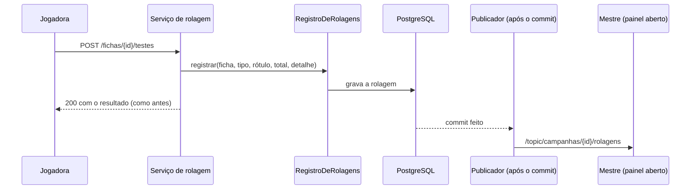
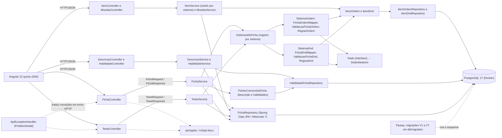
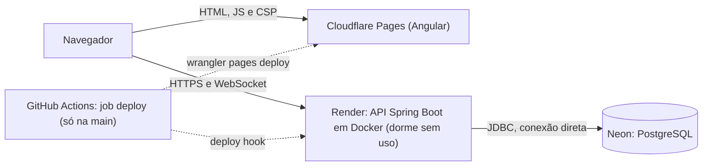
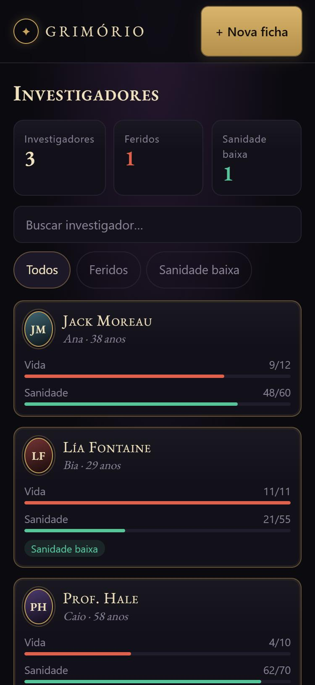
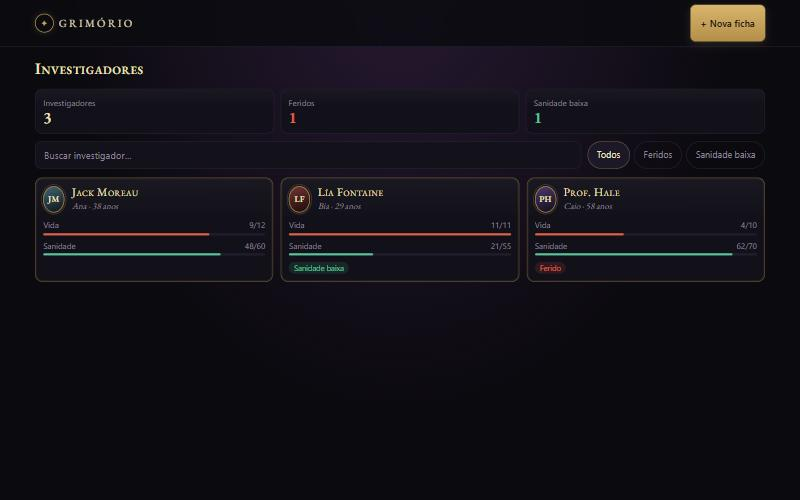
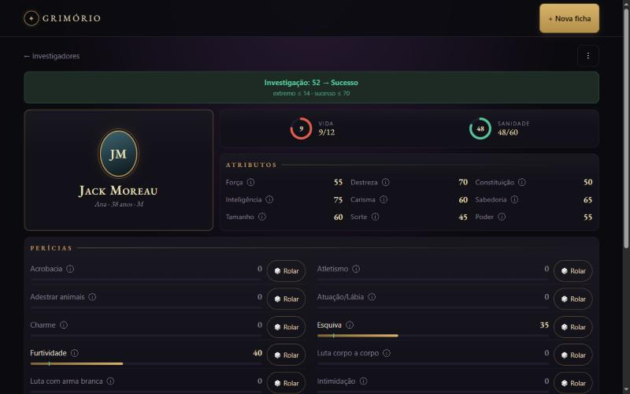
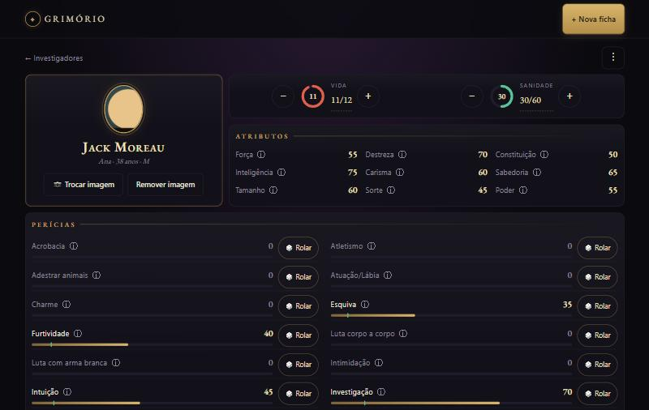

# Gerenciador de Fichas RPG

Aplicação de estudo full stack para cadastrar, consultar, editar e excluir fichas de personagens de RPG de mais de um sistema (hoje Ordem Paranormal, D&D 5e e D&D 2024), com interface Angular e API REST em Java e Spring Boot, persistida em PostgreSQL, com o esquema versionado por migrações Flyway.

## Experimente em 2 minutos

**Link público: <https://fichas-rpg.pages.dev>** (a API tem o Swagger em <https://fichas-rpg-api.onrender.com/swagger-ui.html>).

1. Abra o link e toque em **"Ver demonstração"**. Não precisa de conta: o app cria um visitante temporário, a "Mesa de demonstração" e duas fichas de exemplo (Ordem Paranormal e D&D 2024).
2. **A API gratuita dorme depois de 15 min sem uso.** Se ela estiver dormindo, aparece a faixa "Acordando o servidor gratuito…" e o primeiro acesso leva cerca de 1 minuto ou um pouco mais. É o custo de hospedar de graça (veja [Deploy](#deploy)).
3. Para ver a mesa ao vivo, copie o link do convite no cartão da campanha e abra em **outra aba** (ou no celular): ele entra como jogador de demonstração.
4. Na aba do jogador, abra uma ficha e role um teste. A rolagem aparece na hora no painel "Rolagens" da aba do mestre, sem recarregar.

As contas de demonstração são apagadas depois de 24 h.

> **App não oficial.** Ordem Paranormal é de seus autores e da Jambô Editora; o app usa só nomes e mecânicas, sem texto dos livros. Para D&D, o app é compatível com a quinta edição (5E) e usa material do SRD 5.1 e do SRD 5.2.1 sob a licença CC-BY-4.0 (atribuição abaixo).

### Atribuição do SRD (D&D)

O app usa do SRD só nomes de atributos e perícias e a mecânica de modificador, proficiência e vantagem, sem nenhum texto do SRD. As duas frases abaixo são as atribuições que a licença CC-BY-4.0 pede, uma para cada edição:

> This work includes material taken from the System Reference Document 5.1 ("SRD 5.1") by Wizards of the Coast LLC and available at https://dnd.wizards.com/resources/systems-reference-document. The SRD 5.1 is licensed under the Creative Commons Attribution 4.0 International License available at https://creativecommons.org/licenses/by/4.0/legalcode.

> This work includes material from the System Reference Document 5.2.1 ("SRD 5.2.1") by Wizards of the Coast LLC, available at https://www.dndbeyond.com/srd. The SRD 5.2.1 is licensed under the Creative Commons Attribution 4.0 International License, available at https://creativecommons.org/licenses/by/4.0/legalcode.

## Problema

Mestres e jogadores de RPG de mesa costumam manter as fichas de personagem em papel, que se perdem e são difíceis de atualizar. Este sistema guarda a ficha em um banco de dados e permite editá-la a qualquer momento, e cada ficha pertence a um sistema de RPG, com as regras dele. Começa por **Ordem Paranormal**: dados do jogador e do personagem, classe, origem, NEX (5% a 99%), 5 atributos de 0 a 5, 28 perícias com grau de treinamento (Treinado, Veterano, Expert) e os recursos PV, SAN e PE (atual e máximo). Em **D&D 5e (2014) e D&D 2024**: nível, 6 atributos com modificador, 6 salvaguardas, 18 perícias com proficiência ou especialização, PV, PV temporário, CA e inspiração.

## Status da modernização

O projeto original é de dezembro de 2021 (Java 11, Spring Boot 2.5.7, Springfox, Angular 13). Ele está sendo modernizado de forma incremental, por refatoração e não por reescrita, com cada passo coberto por testes.

| Incremento | Entrega | Situação |
| --- | --- | --- |
| 1.1 | Base segura e testável: credenciais fora do código, `docker compose` com o banco local, testes de caracterização das 5 rotas, CI | Concluído (PR #1) |
| 1.2 | Upgrade para Java 21 e Spring Boot 4.1.2 em duas etapas, springdoc no lugar do Springfox, pacote `dev.spironello.fichasrpg` | Concluído (PR #2) |
| 1.3 | Camada de serviço, DTOs, validação, erros padronizados (ProblemDetail), logs e correção dos comportamentos errados da API | Concluído (PR #3) |
| 1.4a | Migrações Flyway (`ddl-auto=validate`) e troca do MySQL por PostgreSQL 17, sem mudar a API | Concluído (PR #4) |
| 1.4b | Perícias em tabela própria (migração V2), sem mudar o JSON da API | Concluído (PR #5) |
| 1.5 | Teste de perícia (rolagem com sucesso, sucesso extremo e falha) com aleatoriedade injetável | Concluído (PR #6) |
| 1.6 | Contrato da API com nomes claros (`/fichas`, JSON em português), front-end Angular ajustado no mesmo incremento, job de CI do front-end e README final | Concluído (PR #7) |

**Fase 2 — mesa ao vivo** (design em [`docs/specs/2026-11-04-j1-fase-2-design.md`](docs/specs/2026-11-04-j1-fase-2-design.md)): transformar o projeto numa ferramenta usada de verdade pelo grupo durante as sessões, com login, campanhas e rolagens ao vivo.

| Incremento | Entrega | Situação |
| --- | --- | --- |
| 2.1 | Frontend refeito em Angular 22, visual "investigação sombria", pensado primeiro para o celular | Concluído (PR #8) |
| 2.1b | Redesign: painel de fichas e tela própria para cada ficha, visual "Moderno com alma gótica" ([spec](docs/specs/2026-11-04-j1-redesign-design.md)) | Concluído (PR #9) |
| 2.1c | Retrato do personagem enviado pelo jogador (recorte no navegador, tabela `retrato_ficha`) e edição rápida de vida e sanidade na ficha | Concluído (PR #10) |
| 2.1d | Vários sistemas de RPG, começando por Ordem Paranormal completa: uma tabela por sistema (migração V4), API polimórfica, rolagem de vários d20, edição rápida por `PATCH`, escolha do sistema na criação. **O d100 saiu** e as fichas antigas viraram Ordem ([spec](docs/specs/2026-11-04-j1-sistemas-design.md), [ADR 0015](docs/decisoes/0015-uma-tabela-por-sistema.md), [ADR 0016](docs/decisoes/0016-saida-do-d100-e-conversao-para-ordem.md)) | Concluído (PR #11) |
| 2.1e | D&D 5e e D&D 2024 no mesmo esqueleto: tabelas `ficha_dnd` e `ficha_dnd_pericia` (migração V5), proficiência, especialização, salvaguardas, vantagem e desvantagem, e as regras de cada sistema atrás da interface `SistemaDeFicha` ([spec](docs/specs/2026-11-04-j1-sistemas-design.md), [plano](docs/planos/2026-11-05-j1-2.1e-dnd.md), [ADR 0017](docs/decisoes/0017-regras-de-cada-sistema-atras-de-uma-interface.md)) | Concluído (PR #12) |
| 2.1g | Abas na ficha (Ficha, Habilidades e Descrição), com a descrição e as habilidades em rotas próprias (migração V6) e um componente de lista editável que as próximas abas reaproveitam ([spec](docs/specs/2026-11-09-j1-abas-da-ficha-design.md), [plano](docs/planos/2026-11-09-j1-2.1g-abas-descricao-habilidades.md), [ADR 0018](docs/decisoes/0018-listas-da-ficha-em-recursos-proprios.md)) | Concluído (PR #13) |
| 2.1h | Inventário (aba nova nos dois sistemas): itens, moedas em D&D e a carga usada contra o limite, com migração V7 e rotas próprias ([spec](docs/specs/2026-11-09-j1-abas-da-ficha-design.md), [plano](docs/planos/2026-11-09-j1-2.1h-inventario.md), [ADR 0019](docs/decisoes/0019-totais-de-exibicao-calculados-no-front.md)) | Concluído (PR #14) |
| 2.1j | Magias (D&D) e rituais (Ordem), cada um numa aba nova: lista, espaços de magia com descanso longo, atributo de conjuração, CD, ataque mágico, custo em PE e DT, com migração V8 e rotas próprias ([spec](docs/specs/2026-11-09-j1-abas-da-ficha-design.md), [plano](docs/planos/2026-11-11-j1-2.1j-magias-rituais.md)) | Concluído (PR #15) |
| 2.1f | Dado animado em 3D: um d20 por dado rolado pelo servidor (1 a 5 em Ordem, 2 com vantagem ou desvantagem em D&D), o mantido dourado, carregado só na primeira rolagem e com plano B automático ([spec §5](docs/specs/2026-11-04-j1-redesign-design.md), [plano](docs/planos/2026-11-11-j1-2.1f-dado-animado.md), [ADR 0020](docs/decisoes/0020-dado-3d-sob-demanda-com-plano-b.md)) | Concluído (PR #16) |
| 2.1i | Ataques (aba nova nos dois sistemas) com rolagem de ataque e dano e o crítico de cada sistema, mais a **rolagem livre** (aba Dados, por botões ou pela notação), tudo rolado no servidor e mostrado no dado 3D (d4 a d100), com migração V9 ([spec](docs/specs/2026-11-09-j1-abas-da-ficha-design.md), [plano](docs/planos/2026-11-11-j1-2.1i-ataques-e-rolagem-livre.md), [ADR 0021](docs/decisoes/0021-notacao-de-dados-no-servidor.md)) | Concluído (PR #17) |
| 2.2 | Login com e-mail e senha: JWT de acesso de 15 min e refresh de 30 dias rotacionado por família, telas de entrar e cadastrar, e o dono da ficha (cada pessoa vê, edita e rola só as próprias; a de outra pessoa dá 404), com migração V10 ([spec](docs/specs/2026-11-12-j1-login-design.md), [plano](docs/planos/2026-11-12-j1-2.2-login.md), [ADR 0022](docs/decisoes/0022-autenticacao-propria-com-jwt-e-refresh-rotacionado.md), [ADR 0023](docs/decisoes/0023-tokens-no-navegador.md)) | Concluído (PR #18) |
| 2.3 | Campanhas com convite por link e papéis Mestre/Jogador: o mestre vê, edita e rola com as fichas da mesa, o jogador vê o resumo das fichas dos outros jogadores, e a ficha do mestre fica oculta; a ficha pode ficar sem campanha; trava otimista (`@Version`, 409) na ficha; migração V11 ([spec](docs/specs/2026-11-16-j1-campanhas-design.md), [plano](docs/planos/2026-11-16-j1-2.3-campanhas.md), [ADR 0024](docs/decisoes/0024-permissoes-de-campanha-num-ponto-central.md), [ADR 0025](docs/decisoes/0025-trava-otimista-na-ficha.md)) | Concluído (PR #19) |
| 2.4 | Rolagens gravadas e ao vivo: as três rolagens de uma ficha em campanha (teste, ataque e rolagem livre) são gravadas e chegam na hora ao painel de todos os membros, por WebSocket (STOMP); histórico com "Carregar mais", ficha do mestre como "Mestre" e o primeiro teste de ponta a ponta (Playwright, com duas sessões) no CI; migração V12 ([spec](docs/specs/2026-11-16-j1-rolagens-ao-vivo-design.md), [plano](docs/planos/2026-11-17-j1-2.4-rolagens-ao-vivo.md), [ADR 0026](docs/decisoes/0026-rolagens-ao-vivo-com-stomp.md)) | Concluído (PR #20) |
| 2.5 | Login com Google: botão oficial do Google em Entrar e Cadastrar, *ID token* validado na API (RS256, JWKS do Google, `aud`, `iss`, `exp`) e trocado pelos tokens próprios; ligação de contas por e-mail verificado, apagando a senha (*pre-account takeover*); migração V13 ([spec](docs/specs/2026-11-17-j1-login-google-design.md), [plano](docs/planos/2026-11-17-j1-2.5-login-google.md), [ADR 0027](docs/decisoes/0027-login-com-google-e-ligacao-de-contas.md)) | Concluído (PR #21) |
| 2.6 | Deploy gratuito e link público: Cloudflare Pages (front), Render com Docker (API) e Neon (PostgreSQL); botão "Ver demonstração" com conta temporária e mesa pronta; limite de tentativas de login e limpeza das contas demo e dos refresh vencidos; CSP; publicação pelo CI depois dos testes; migração V14 ([spec](docs/specs/2026-11-17-j1-deploy-design.md), [plano](docs/planos/2026-11-17-j1-2.6-deploy.md), [ADR 0028](docs/decisoes/0028-hospedagem-gratuita-e-publicacao-pelo-ci.md), [ADR 0029](docs/decisoes/0029-conta-de-demonstracao-e-limite-de-tentativas.md)) | Em revisão (PR) |

## Tecnologias

| Camada | Stack do repositório |
| --- | --- |
| Back-end | Java 21, Spring Boot 4.1.2, Spring Web MVC, Spring Data JPA (Hibernate 7), Spring Security (resource server com JWT, BCrypt) |
| Banco de dados | PostgreSQL 17 (Docker), migrações com Flyway 12 |
| Front-end | Angular 22 (standalone, signals, zoneless), Angular Material 22, TypeScript 6; dado 3D com `open-dice-dnd` 1.13 (`three` 0.130 e `cannon-es` 0.20, todas MIT), carregado sob demanda |
| Documentação de API | springdoc-openapi (OpenAPI 3 e Swagger UI) |
| Testes | Back-end: JUnit, MockMvc, Mockito, Testcontainers. Front-end: Vitest |
| Build e CI | Maven e Angular CLI; GitHub Actions (job `backend` com `./mvnw -B verify` e job `frontend` com build e testes em Node 24) |

## Funcionalidades da API

### Conta e login (2.2 e 2.5)

O `AuthController` cuida da conta ([ADR 0022](docs/decisoes/0022-autenticacao-propria-com-jwt-e-refresh-rotacionado.md)). **Todas as outras rotas exigem `Authorization: Bearer <accessToken>`**, menos a documentação (`/v3/api-docs`, `/swagger-ui`). Sem token, com token inválido ou vencido, a resposta é 401 em ProblemDetail ("Faça login para continuar.") com `WWW-Authenticate: Bearer`.

| Método | Rota | Corpo | Respostas |
| --- | --- | --- | --- |
| POST | `/auth/registro` | `{nome, email, senha}` | 201 com `Location: /me` e `{accessToken, refreshToken, usuario}` (já entra na conta); 400 por campo; 409 "E-mail já cadastrado" em `errors.email` |
| POST | `/auth/login` | `{email, senha}` | 200 com o mesmo corpo; 401 "E-mail ou senha incorretos", igual para senha errada e e-mail inexistente |
| POST | `/auth/refresh` | `{refreshToken}` | 200 com um **par novo** (o refresh é trocado a cada uso); 401 "Sessão expirada. Entre de novo." se o refresh venceu, não existe ou já foi usado (nesse caso, a sessão inteira daquele login é revogada) |
| POST | `/auth/logout` | `{refreshToken}` | 204, sempre (revoga o refresh; o token de acesso vale até vencer, em no máximo 15 min) |
| POST | `/auth/google` | `{idToken}` | 200 com o mesmo corpo do login (entra ou cria a conta); 400 sem o campo; 401 "Não foi possível entrar com o Google. Tente de novo." (token inválido), "Confirme o seu e-mail no Google antes de entrar." ou "Este e-mail já está ligado a outra conta do Google." |
| GET | `/me` | — | 200 `{id, nome, email}`; 401 |

O e-mail é gravado sem espaços e em minúsculas. **A senha do cadastro segue a NIST SP 800-63B-4 e o OWASP ASVS 5.0:** pelo menos 15 caracteres (espaços valem, então uma frase serve), sem exigir maiúscula, número ou símbolo, e recusando um trecho repetido (`senhasenhasenha`), sequências (`123456…`, `qwerty…`), o próprio nome ou e-mail e as senhas comuns de uma lista curta do projeto (`password2024!!!` conta como `password`); cada motivo volta em `errors.senha`. O login aceita qualquer senha já cadastrada. O token de acesso é um JWT HS256 de 15 min; o refresh vale 30 dias a partir da última renovação, e o banco guarda só o hash dele. **Cada pessoa só alcança as próprias fichas e as da mesa em que é mestre** (2.3, abaixo): a ficha de outra pessoa (e tudo o que está dentro dela: itens, retrato, rolagens...) responde 404, como se não existisse, e `GET /fichas` lista só as suas.

**Login com Google (2.5, [ADR 0027](docs/decisoes/0027-login-com-google-e-ligacao-de-contas.md)).** A API confere o *ID token* do Google (assinatura RS256 pelas chaves públicas do Google, `aud` igual ao Client ID, `iss` do Google e validade) e recusa e-mail não verificado. Se o `google_sub` já tem conta, entra nela; se o e-mail já tem conta por senha, **liga as duas, apaga a senha e encerra todas as sessões abertas** (o cadastro não confirma o e-mail, então quem prova ao Google que é dono do e-mail vence); senão, cria uma conta sem senha. Uma conta ligada ou criada pelo Google entra só pelo Google.

### Campanhas e convite (2.3)

O mestre cria a campanha e manda um link de convite; quem entra pelo link vira jogador. Uma ficha pode ficar **sem campanha** (o painel "Minhas fichas") ou numa campanha da qual o dono participa. A regra de acesso fica num ponto só, o `AcessoAFicha` ([ADR 0024](docs/decisoes/0024-permissoes-de-campanha-num-ponto-central.md)):

| Ação na ficha | Dono | Mestre da campanha | Outro jogador | Fora da campanha |
| --- | --- | --- | --- | --- |
| Ver completa, editar, rolar, listas, enviar ou apagar o retrato | sim | sim | 403 | 404 |
| Baixar o retrato (o cartão do resumo o mostra) | sim | sim | sim | 404 |
| Excluir, levar a outra campanha ou tirar da campanha | sim | 403 | 403 | 404 |
| Qualquer ação na ficha do mestre (NPCs ficam ocultos) | — | (é o dono) | 404 | 404 |

Quem está fora recebe 404 (a campanha e as fichas "não existem" para ele); o membro sem permissão recebe 403 "Você não tem permissão para isso nesta campanha.". Ficha sem campanha só é do dono.

| Método | Rota | Quem | Respostas |
| --- | --- | --- | --- |
| GET | `/campanhas` | logado | `[{id, nome, papel, mestre: {id, nome}, fichas}]`; `fichas` conta as que ele vê |
| POST | `/campanhas` | logado | `{nome, descricao}` → 201 + `Location` e a campanha; quem cria vira mestre, com o convite ativo |
| GET | `/campanhas/{id}` | membro | `{id, nome, descricao, meuPapel, mestre, convite}`; `convite` (`{codigo, ativo}`) só para o mestre |
| PUT / DELETE | `/campanhas/{id}` | mestre | 200 / 204; ao excluir, as fichas voltam aos donos, sem campanha |
| GET | `/campanhas/{id}/membros` | membro | `[{usuarioId, nome, papel, entrouEm}]`, sem e-mail |
| DELETE | `/campanhas/{id}/membros/{usuarioId}` | mestre (remover) ou o jogador (sair) | 204; as fichas dele voltam a "sem campanha"; o mestre não sai: 409 |
| GET / POST | `/campanhas/{id}/fichas` | membro | os resumos que ele vê (o jogador não vê as fichas do mestre) / criar ficha já na campanha (201) |
| PUT | `/fichas/{id}/campanha` | dono | `{campanhaId}` ou `null`: leva a ficha a uma campanha dele ou a tira de uma |
| POST / DELETE | `/campanhas/{id}/convite` | mestre | gera um código novo (o antigo para na hora) / desativa |
| GET | `/convites/{codigo}` | **público** | prévia `{campanhaId, campanha, mestre}`; 404 "Convite inválido ou desativado" |
| POST | `/convites/{codigo}/aceitar` | logado | 201 ao entrar; 200 se já era membro |

O código do convite tem 12 caracteres (`A-Z`, `a-z`, `0-9`, cerca de 71 bits, `SecureRandom`) e não expira. **O banco garante** que a ficha só fique numa campanha da qual o dono participa: a chave estrangeira `(campanha_id, dono_id)` aponta para a participação, com `on delete set null (campanha_id)`, então sair, ser removido ou apagar a campanha devolve as fichas a "sem campanha" sem código no serviço.

**Rolagens da mesa (2.4).** O histórico e o canal ao vivo da campanha:

| Método | Rota | Quem | Respostas |
| --- | --- | --- | --- |
| GET | `/campanhas/{id}/rolagens?antes=<id>&limite=50` | membro | lista da mais nova para a mais antiga; `antes` é opcional (só traz ids menores); `limite` de 1 a 100 (padrão 50), fora disso 400; quem não é membro recebe 404, e sem token, 401 |
| WebSocket | `/ws` (STOMP, sem SockJS) | handshake público | a autenticação acontece no `CONNECT`, com `Authorization: Bearer <token>`; sem token, ou com token inválido ou vencido, a conexão é recusada |
| SUBSCRIBE | `/topic/campanhas/{id}/rolagens` | membro | cada rolagem nova, no mesmo formato do `GET`; qualquer outro destino é recusado, e o `SEND` do cliente também |

```json
{ "id": 41, "campanhaId": 3, "criadaEm": "2026-11-16T22:10:03Z",
  "autor": { "id": 7, "nome": "Lía" }, "personagem": "Kai", "doMestre": false,
  "tipo": "TESTE", "rotulo": "Furtividade", "total": 25,
  "detalhe": { "...": "a resposta da rota, como foi devolvida a quem rolou" } }
```

`tipo` é `TESTE`, `ATAQUE` ou `LIVRE`; o `rotulo` é o nome da perícia, do atributo, da salvaguarda ou do ataque, ou a expressão (`2d6+3`). Na ficha do mestre, `doMestre` é `true` e `personagem` é `null`; a resposta não traz o id da ficha, então o id do NPC não se descobre. A tela mostra "Carregar mais" quando a página veio cheia.

### Rolagens ao vivo (2.4)

Quem rola com uma ficha que está numa campanha aparece, na hora, no painel de rolagens de todos os membros que estão com a campanha aberta. Quem chega depois vê o histórico. O desenho está no [ADR 0026](docs/decisoes/0026-rolagens-ao-vivo-com-stomp.md).

- **O que é gravado:** as três rolagens (teste de perícia, atributo ou salvaguarda; ataque com dano e crítico; rolagem livre). A **ficha sem campanha não grava nem publica**: a rolagem fica só na tela de quem rolou, como antes. A resposta das três rotas `POST` não mudou.
- **Quem vê:** os membros da campanha. Se a ficha é do mestre, todos veem "Mestre" no lugar do nome do personagem, e **o nome do NPC nem é gravado**. Se o mestre rola com a ficha de um jogador, a linha diz "(rolado pelo mestre)".
- **Histórico:** `GET /campanhas/{id}/rolagens`, com as 50 últimas e um cursor pelo `id` para o "Carregar mais".
- **Painel e aviso:** o botão "Rolagens", na campanha e na ficha que tem campanha, abre um painel lateral (360 px à direita a partir de 900 px; tela cheia no celular). Com o painel fechado, a rolagem de outra pessoa aparece num aviso de 4 s, e tocar nele abre o painel. Se a conexão cai e volta, o painel busca de novo a primeira página do histórico para recuperar o que foi rolado durante a queda.
- **WebSocket:** STOMP em `/ws`, com um broker simples em memória. O handshake é público, e o token vai no `CONNECT` (cabeçalho `Authorization: Bearer`). O `SUBSCRIBE` em `/topic/campanhas/{id}/rolagens` só vale para membros, e o `SEND` do cliente é recusado: a mesa só recebe.
- **Regra para o futuro:** toda rota que rola dados chama o `RegistroDeRolagens`. Uma rolagem nova que esquecesse a chamada não apareceria para a mesa.



### Fichas

O controlador `FichaController` expõe o recurso `/fichas`. O campo `sistema` do corpo escolhe o tipo da ficha ([ADR 0015](docs/decisoes/0015-uma-tabela-por-sistema.md)); os valores aceitos são `ORDEM_PARANORMAL` e `DND`:

| Método | Rota | Finalidade | Respostas |
| --- | --- | --- | --- |
| GET | `/fichas` | Listar o **resumo** das fichas (o que o painel mostra) | 200 |
| GET | `/fichas/{id}` | Consultar a ficha completa | 200; 404 se não existe |
| POST | `/fichas` | Cadastrar uma ficha (o corpo leva o `sistema`) | 201 com `Location: /fichas/{id}`; 400 se inválida, ou se `sistema` falta ou é desconhecido |
| PUT | `/fichas/{id}` | Substituir uma ficha | 200; 400 se inválida; 404 se não existe; 409 "Sistema não muda" se o `sistema` do corpo for outro |
| PATCH | `/fichas/{id}/recursos` | Edição rápida: muda só os valores **atuais** enviados, por exemplo `{"PV": 10, "SAN": 30}` | 200 com a ficha completa; 400 se o código não existe no sistema da ficha ou o valor é negativo ou nulo; 404 se não existe |
| DELETE | `/fichas/{id}` | Excluir uma ficha | 204; 404 se não existe |
O `RetratoController` cuida da imagem do personagem (incremento 2.1c, [ADR 0014](docs/decisoes/0014-retrato-no-postgresql-em-tabela-separada.md)):

| Método | Rota | Finalidade | Respostas |
| --- | --- | --- | --- |
| PUT | `/fichas/{id}/retrato` | Enviar ou trocar o retrato: o corpo é o próprio JPEG (`Content-Type: image/jpeg`) | 204; 404 se a ficha não existe; 415 se não for `image/jpeg`; 413 acima de 200 KB; 422 se não for um JPEG legível ou passar de 1000 px por lado |
| GET | `/fichas/{id}/retrato` | Baixar o retrato | 200 `image/jpeg` com `Cache-Control: private, max-age=31536000, immutable` e `nosniff`; 404 se a ficha não existe ou não tem retrato |
| DELETE | `/fichas/{id}/retrato` | Remover o retrato | 204 (também sem retrato); 404 se a ficha não existe |

O servidor confere o tamanho pelo **cabeçalho** do JPEG antes de decodificar: um arquivo de poucos bytes que "diz" ter 50000×50000 é recusado com 422, sem a API alocar gigabytes de memória.

A descrição e as habilidades têm rotas próprias, no `DescricaoController` e no `HabilidadeController` (incremento 2.1g, [ADR 0018](docs/decisoes/0018-listas-da-ficha-em-recursos-proprios.md)). Elas não fazem parte do `PUT /fichas/{id}`:

| Método | Rota | Finalidade | Respostas |
| --- | --- | --- | --- |
| PUT | `/fichas/{id}/descricao` | Substituir a descrição (`aparencia`, `historia` e `anotacoes`) | 200 com a descrição; 400 por campo; 404 "Ficha não encontrada" |
| POST | `/fichas/{id}/habilidades` | Acrescentar uma habilidade (`nome`, `tipo` e `descricao`) | 201 com `Location: /fichas/{id}/habilidades/{habilidadeId}`; 400 por campo; 404 "Ficha não encontrada" |
| PUT | `/fichas/{id}/habilidades/{habilidadeId}` | Substituir uma habilidade | 200; 400 por campo; 404 "Ficha não encontrada" ou "Item não encontrado" |
| DELETE | `/fichas/{id}/habilidades/{habilidadeId}` | Remover uma habilidade | 204; 404 "Ficha não encontrada" ou "Item não encontrado" |

Uma habilidade que não existe, ou que é de outra ficha, responde 404 "Item não encontrado". Nos erros 400, a chave de `errors` é o campo (`nome`, `tipo`, `aparencia`...).

O inventário também tem rotas próprias, no `ItemController` e no `MoedasController` (incremento 2.1h). Como a descrição e as habilidades, elas não fazem parte do `PUT /fichas/{id}`. A rota de itens é a mesma para os dois sistemas, e a ficha diz quais campos valem:

| Método | Rota | Finalidade | Respostas |
| --- | --- | --- | --- |
| POST | `/fichas/{id}/itens` | Acrescentar um item | 201 com `Location: /fichas/{id}/itens/{itemId}`; 400 por campo; 404 "Ficha não encontrada" |
| PUT | `/fichas/{id}/itens/{itemId}` | Substituir um item | 200; 400 por campo; 404 "Ficha não encontrada" ou "Item não encontrado" |
| DELETE | `/fichas/{id}/itens/{itemId}` | Remover um item | 204; 404 "Ficha não encontrada" ou "Item não encontrado" |
| PATCH | `/fichas/{id}/moedas` | Mudar as moedas (só D&D): só as chaves enviadas mudam, por exemplo `{"po": 30}` | 200 com as cinco moedas; 400 por chave; 404 "Ficha não encontrada" |

Um item que não existe, que é de outra ficha ou que é de outro sistema responde 404 "Item não encontrado". Nos erros 400, a chave de `errors` é o campo (`nome`, `categoria`, `peso`...).

As magias, os espaços de magia e os rituais (incremento 2.1j) seguem o mesmo padrão, cada um no seu controller (`MagiaController`, `EspacosController` e `RitualController`). Cada lista existe num sistema só:

| Método | Rota | Finalidade | Respostas |
| --- | --- | --- | --- |
| POST | `/fichas/{id}/magias` | Acrescentar uma magia (só D&D) | 201 com `Location`; 400 por campo; 400 em `errors.lista` numa ficha de Ordem; 404 "Ficha não encontrada" |
| PUT · DELETE | `/fichas/{id}/magias/{magiaId}` | Substituir ou remover uma magia | 200 ou 204; 400 por campo; 404 "Ficha não encontrada" ou "Item não encontrado" |
| PATCH | `/fichas/{id}/espacos` | Mudar os espaços de magia (só D&D): só os níveis enviados mudam, por exemplo `{"1": {"total": 4, "usados": 1}}` | 200 com os 9 níveis; 400 por chave (`"10"`, `"3.total"`, `"3.usados"`); 400 em `errors.lista` numa ficha de Ordem |
| POST | `/fichas/{id}/rituais` | Acrescentar um ritual (só Ordem) | 201 com `Location`; 400 por campo; 400 em `errors.lista` numa ficha de D&D; 404 "Ficha não encontrada" |
| PUT · DELETE | `/fichas/{id}/rituais/{ritualId}` | Substituir ou remover um ritual | 200 ou 204; 400 por campo; 404 "Ficha não encontrada" ou "Item não encontrado" |

Os ataques e a rolagem livre (incremento 2.1i) ficam no `AtaqueController` e no `RolagemController`. Os ataques existem nos dois sistemas, com um pedido só (como os itens), e a rolagem livre não grava nada:

| Método | Rota | Finalidade | Respostas |
| --- | --- | --- | --- |
| POST | `/fichas/{id}/ataques` | Acrescentar um ataque | 201 com `Location`; 400 por campo (inclusive `dano` com notação inválida, ou um campo do outro sistema); 404 "Ficha não encontrada" |
| PUT · DELETE | `/fichas/{id}/ataques/{ataqueId}` | Substituir ou remover um ataque | 200 ou 204; 400 por campo; 404 "Ficha não encontrada" ou "Item não encontrado" |
| POST | `/fichas/{id}/ataques/{ataqueId}/rolagem` | Rolar o ataque e o dano, com o crítico do sistema; em D&D, `{"modo": "VANTAGEM"}` opcional | 200 com `ataque`, `dano` e `critico`; 400 em `errors.modo` numa ficha de Ordem; 404 |
| POST | `/fichas/{id}/rolagens` | Rolagem livre: `{"expressao": "2d6+1d4+3"}` | 200 com cada dado (`lados` e `valor`), o bônus e o total; 400 em `errors.expressao`; 404 "Ficha não encontrada" |

**Notação de dados** (a mesma do dano e da rolagem livre, [ADR 0021](docs/decisoes/0021-notacao-de-dados-no-servidor.md)):
- **Termos:** `NdM`, com N de 1 a 20 e M em 4, 6, 8, 10, 12, 20 ou 100, ou uma constante de 0 a 99, ligados por `+` ou `-`.
- **Limites:** no máximo 8 termos e 20 dados somados. Dados não podem ser subtraídos (`1d8-1d4` dá 400).
- **Formato:** espaços e `D` maiúsculo são aceitos, e a resposta devolve a forma canônica (`2d6+3`).
- **Total:** a soma dos dados mais as constantes. Se ficar negativa, o total é 0.

**Crítico do ataque:** em D&D, um 20 natural no dado mantido dobra os dados do dano. Em Ordem, o crítico acontece quando o dado mantido é maior ou igual à `margem` da arma, e multiplica os dados do dano pelo `multiplicador`. Nos dois sistemas, as constantes não multiplicam.

Qualquer falha inesperada responde 500 com uma mensagem genérica; o detalhe fica só no log do servidor.

### Formato da ficha

A resposta completa (`GET /fichas/{id}`, e o corpo de `POST`, `PUT` e `PATCH`) leva `sistema` e os dados do sistema. Em Ordem Paranormal, `atributos` e `recursos` são objetos chaveados pelo código, e `pericias` traz só as perícias treinadas, com o grau:

```json
{
  "id": 7, "sistema": "ORDEM_PARANORMAL",
  "jogador": "Ana", "personagem": "Jack Moreau", "genero": "M", "idade": 38, "retratoVersao": null,
  "classe": "ESPECIALISTA", "origem": "Investigador", "nex": 10,
  "atributos": { "AGI": 2, "FOR": 1, "INT": 3, "PRE": 2, "VIG": 1 },
  "recursos": { "PV": { "atual": 18, "maximo": 20 }, "SAN": { "atual": 16, "maximo": 16 }, "PE": { "atual": 3, "maximo": 5 } },
  "pericias": { "INVESTIGACAO": "TREINADO", "PERCEPCAO": "TREINADO" }
}
```

A listagem (`GET /fichas`) devolve só um **resumo** por ficha, igual para qualquer sistema: o painel não precisa conhecer os detalhes de cada um, e `recursos` vira uma lista (em Ordem, PV, SAN e PE nessa ordem). Por não tocar nas perícias, listar continua sendo uma consulta só:

```json
{ "id": 7, "sistema": "ORDEM_PARANORMAL", "jogador": "Ana", "personagem": "Jack Moreau", "idade": 38,
  "retratoVersao": null, "recursos": [ { "codigo": "PV", "atual": 18, "maximo": 20 }, { "codigo": "SAN", "atual": 16, "maximo": 16 }, { "codigo": "PE", "atual": 3, "maximo": 5 } ] }
```

**Descrição e habilidades (2.1g).** A ficha completa, de qualquer sistema, traz também `descricao` e `habilidades`:

```json
"descricao": { "aparencia": "Alto, cicatriz no queixo.", "historia": null, "anotacoes": null },
"habilidades": [ { "id": 3, "nome": "Ataque Furtivo", "tipo": "CLASSE", "descricao": "Dano extra uma vez por turno." } ]
```

O `GET /fichas/{id}` monta as duas partes, mas o `PUT /fichas/{id}` **não as toca**: o corpo do `PUT` não leva `descricao` nem `habilidades`, e, por causa do JSON estrito, enviá-las dá 400. Elas só mudam pelas rotas da seção anterior. A listagem (`GET /fichas`) não as traz.

- **Descrição:** `aparencia`, `historia` e `anotacoes` têm até 4000 caracteres cada. Texto vazio (ou só com espaços) vira `null`, e as quebras de linha são preservadas.
- **Habilidade:** `nome` é obrigatório (até 255 caracteres), `tipo` é obrigatório e `descricao` é opcional (até 4000). A lista vem na ordem em que as habilidades foram criadas.
- **Tipos por sistema:**

| Sistema | Tipos (`tipo`) |
| --- | --- |
| Ordem Paranormal | `CLASSE` (Classe), `TRILHA` (Trilha), `ORIGEM` (Origem), `PARANORMAL` (Poder paranormal) e `OUTRA` (Outra) |
| D&D (2014 e 2024) | `CLASSE` (Classe), `SUBCLASSE` (Subclasse), `ESPECIE` (Raça na 2014, Espécie na 2024), `ANTECEDENTE` (Antecedente), `TALENTO` (Talento) e `OUTRA` (Outra) |

Um tipo que existe só no outro sistema responde 400 com `errors.tipo` ("não existe em D&D" ou "não existe em Ordem Paranormal").

**Inventário (2.1h).** A ficha completa traz também `itens`, nos dois sistemas, e `moedas`, só em D&D. Em Ordem:

```json
"itens": [ { "id": 5, "nome": "Pistola", "categoria": 1, "espacos": 1, "quantidade": 1, "descricao": "Calibre .38." } ]
```

Em D&D (as moedas são cobre, prata, electro, ouro e platina):

```json
"itens": [ { "id": 8, "nome": "Corda de cânhamo", "quantidade": 1, "peso": 5.0, "equipado": false, "descricao": null } ],
"moedas": { "pc": 0, "pp": 12, "pe": 0, "po": 30, "pl": 1 }
```

Como a descrição e as habilidades, o `GET /fichas/{id}` monta `itens` e `moedas`, mas o `PUT /fichas/{id}` **não os toca**: se o corpo os enviar, o JSON estrito responde 400. A listagem (`GET /fichas`) não os traz. Os itens vêm na ordem em que foram criados.

| Sistema | Campos do item |
| --- | --- |
| Ordem Paranormal | `nome` (obrigatório, até 255), `categoria` (0 a 4, mostrada como 0, I, II, III e IV), `espacos` (inteiro, 0 ou mais, por unidade), `quantidade` (1 ou mais) e `descricao` (opcional, até 4000) |
| D&D (2014 e 2024) | `nome` (obrigatório, até 255), `quantidade` (1 ou mais), `peso` (kg por unidade, de 0 a 99999,99, até 2 casas), `equipado` e `descricao` (opcional, até 4000) |

Um campo do outro sistema dá 400 no próprio campo (`errors.peso`: "não existe em Ordem Paranormal"; `errors.categoria`: "não existe em D&D"). O zero é valor válido: categoria 0, 0 espaço e peso 0 são aceitos. As moedas são inteiros de 0 ou mais; um valor negativo ou uma chave desconhecida dá 400, e o `PATCH /fichas/{id}/moedas` numa ficha de Ordem dá 400 em `errors.lista`.

**Regras de carga** (contas no front, [ADR 0019](docs/decisoes/0019-totais-de-exibicao-calculados-no-front.md)):

| Sistema | Usado | Limite |
| --- | --- | --- |
| Ordem Paranormal | soma de `espacos × quantidade` | 5 × Força (com Força 0, o limite é 2) |
| D&D | soma de `peso × quantidade`, arredondada a 2 casas | Força × 7,5 kg |

O app só avisa quando o usado passa do limite (estritamente acima). Nada é bloqueado, e a penalidade por excesso fica fora do escopo.

**Magias e rituais (2.1j).** A ficha de D&D traz `atributoConjuracao` (`INT`, `SAB`, `CAR` ou `null`; vai no `PUT /fichas/{id}`, e `FOR`, `DES` ou `CON` dão 400), `magias` (por nível e depois pela ordem de criação) e `espacos`, sempre com os 9 níveis (um nível que nunca foi salvo aparece como `{"total": 0, "usados": 0}`). A ficha de Ordem traz `rituais` (por círculo e depois pela ordem de criação):

```json
"magias": [ { "id": 1, "nome": "Bola de Fogo", "nivel": 3, "escola": "Evocação", "tempo": null, "alcance": null, "componentes": null, "duracao": null, "concentracao": false, "ritual": false, "preparada": true, "descricao": null } ],
"espacos": { "1": { "total": 4, "usados": 1 }, "2": { "total": 3, "usados": 0 }, "…": "…", "9": { "total": 0, "usados": 0 } },
"rituais": [ { "id": 2, "nome": "Ritual de exemplo", "circulo": 2, "elemento": "SANGUE", "execucao": null, "alcance": null, "alvo": null, "duracao": null, "resistencia": null, "descricao": null } ]
```

Magia: `nome` (obrigatório), `nivel` (0 a 9; 0 é truque), os textos curtos opcionais (até 255), os três marcadores (nulo vira `false`) e a `descricao` (até 4000). Ritual: `nome`, `circulo` (1 a 4) e `elemento` (`SANGUE`, `MORTE`, `CONHECIMENTO`, `ENERGIA` ou `MEDO`) obrigatórios, mais os textos opcionais. Nos espaços, `usados` nunca passa de `total` (a API responde 400 e o banco tem `check`). Como as outras listas, `magias`, `espacos` e `rituais` ficam fora do `PUT /fichas/{id}`.

**Contas de magia e ritual** (no front, como a carga, [ADR 0019](docs/decisoes/0019-totais-de-exibicao-calculados-no-front.md)): CD das magias = 8 + proficiência + modificador do atributo de conjuração; ataque mágico = proficiência + modificador; sem atributo, os dois aparecem como "—". Em Ordem, o custo em PE pelo círculo é 1, 3, 6 e 10, e a DT = 10 + ⌊NEX / 5⌋ + Presença.

`retratoVersao` só existe na **resposta**: é o instante do último envio do retrato em milissegundos (ou `null` sem retrato), e a interface o usa na URL da imagem (`/retrato?v=…`) para o cache do navegador nunca mostrar uma foto velha. Enviado no corpo do `POST` ou `PUT`, ele é recusado como chave desconhecida.

**Dono, campanha e versão (2.3).** A ficha completa e o resumo trazem `dono` (`{id, nome}`) e `campanha` (`{id, nome}` ou `null`), só na resposta. A ficha completa traz também `versao`, que o `PUT` precisa devolver: sem ela, 400 em `errors.versao`; com uma versão velha (outra pessoa gravou antes), **409 "Esta ficha mudou enquanto você editava. Recarregue para ver a versão nova."** ([ADR 0025](docs/decisoes/0025-trava-otimista-na-ficha.md)). No `POST` ela é ignorada, como o `id`.

**Entrada** (`POST` e `PUT`, sem o `id`, que vem da URL):
- `sistema` é obrigatório e escolhe o formato do resto do corpo (o Jackson usa `@JsonTypeInfo`). Em Ordem: `jogador`, `personagem` e `genero` são obrigatórios (até 255 caracteres), `nex` é obrigatório (5 a 99), `atributos` traz os 5 códigos (`AGI`, `FOR`, `INT`, `PRE`, `VIG`) de 0 a 5, e `classe` (`COMBATENTE`, `ESPECIALISTA` ou `OCULTISTA`), `origem`, `idade`, `recursos` e `pericias` são opcionais.
- Perícia ausente é destreinada. `VETERANO` exige NEX 35 ou mais e `EXPERT`, NEX 70 ou mais.
- O JSON é **estrito**: uma chave desconhecida (por exemplo `"STR"`) devolve 400 citando a chave, em vez de ser ignorada. Em `pericias`, um código que não existe (por exemplo `"VOAR"`) ou um grau que não existe (`"MESTRE"`) também devolve 400. Um sistema desconhecido ou ausente devolve 400.
- O `id` no corpo é aceito e **ignorado**, porque o Angular o envia sempre: no PUT vale o id da URL; no POST o id é gerado.
- O PUT é substituição completa ([ADR 0008](docs/decisoes/0008-put-como-substituicao-completa.md)): campos omitidos viram `null` e perícias e recursos omitidos são removidos. O sistema da ficha não muda: um `sistema` diferente devolve 409.
- O `PATCH` é o oposto, de propósito: só os recursos enviados mudam, e só o valor **atual** (os máximos ficam como estavam). Os códigos aceitos dependem do sistema (em Ordem, `PV`, `SAN` e `PE`; em D&D, `PV` e `PV_TEMP`).

**Erros** seguem o ProblemDetail (RFC 9457, `Content-Type: application/problem+json`). Exemplo de validação (`POST` de Ordem sem `jogador` e com o atributo `AGI` igual a 6):

```json
{
  "title": "Dados inválidos",
  "status": 400,
  "detail": "Há campos inválidos na requisição. Veja a propriedade errors.",
  "instance": "/fichas",
  "errors": { "jogador": "é obrigatório", "atributos[AGI]": "deve estar entre 0 e 5" }
}
```

A chave de `errors` vem em **duas formas**, conforme quem achou o erro, e a interface normaliza `campo[X]` para `campo.X` para mostrar a mensagem no campo certo:

| Quem valida | Forma da chave | Exemplos |
| --- | --- | --- |
| Bean Validation (campo a campo) | `campo` ou `campo[X]` | `jogador`, `nex`, `atributos[AGI]` ("deve estar entre 0 e 5" ou "é obrigatório" para valor nulo) |
| Regras que cruzam campos (`ValidacaoFichaOrdem`) | `campo.X` | `atributos.VIG` ("é obrigatório", atributo ausente), `pericias.INVESTIGACAO` ("Veterano exige NEX 35% ou mais", "Expert exige NEX 70% ou mais") |
| `PATCH` de recursos e `POST` de testes | a chave do próprio campo ou código | `DES` ("não existe em Ordem Paranormal"), `PV` (valor negativo), `alvo`, `modo`, `codigo` |

As regras cruzadas só rodam depois do Bean Validation: com NEX inválido, só o erro do NEX aparece, porque o limite de grau depende dele. Chave desconhecida, tipo errado, código de perícia ou grau inexistente e `sistema` desconhecido ou ausente respondem 400 só com `detail` (sem `errors`). O conflito de sistema responde 409.

Decisões em [ADR 0007](docs/decisoes/0007-erros-padronizados-e-json-estrito.md), [ADR 0012](docs/decisoes/0012-contrato-com-nomes-claros.md) (o formato de nomes), [ADR 0015](docs/decisoes/0015-uma-tabela-por-sistema.md) (o formato por sistema) e [ADR 0018](docs/decisoes/0018-listas-da-ficha-em-recursos-proprios.md) (descrição e listas em rotas próprias). A API permite chamadas da interface local em `http://localhost:4200`.

Com a API rodando, a documentação interativa (Swagger UI) fica em `http://localhost:8080/swagger-ui.html` e a especificação OpenAPI em `http://localhost:8080/v3/api-docs`.
### Ficha de D&D

Com `sistema: DND` a ficha vale para as duas edições, que usam as mesmas fórmulas: o campo `edicao` diz qual é (`D2014` para a 5e de 2014, `D2024` para a de 2024). `atributos` traz os 6 códigos (`FOR`, `DES`, `CON`, `INT`, `SAB`, `CAR`) de 1 a 30 e `nivel` vai de 1 a 20. `recursos` traz `PV` (atual e máximo) e `PV_TEMP` (só o atual, **sem máximo**: o `maximo` vem sempre `null`). `salvaguardas` é a lista dos atributos em que a ficha tem proficiência, e `pericias` traz só as perícias com `PROFICIENTE` ou `ESPECIALISTA` (perícia ausente é sem proficiência). `classe`, `especie` e `antecedente` são texto livre e opcionais, e `ca` e `inspiracao` são opcionais (a inspiração nula vira `false`).

```json
{
  "id": 9, "sistema": "DND", "edicao": "D2024",
  "jogador": "Bia", "personagem": "Thalia", "genero": "F", "idade": 27, "retratoVersao": null,
  "classe": "Ladina", "especie": "Elfa", "antecedente": "Criminosa", "nivel": 5,
  "atributos": { "FOR": 8, "DES": 16, "CON": 12, "INT": 13, "SAB": 10, "CAR": 14 },
  "recursos": { "PV": { "atual": 28, "maximo": 33 }, "PV_TEMP": { "atual": 0, "maximo": null } },
  "ca": 14, "inspiracao": false,
  "salvaguardas": ["DES", "INT"],
  "pericias": { "FURTIVIDADE": "ESPECIALISTA", "PERCEPCAO": "PROFICIENTE" }
}
```

As 18 perícias de D&D (iguais nas duas edições). O código é a constante do enum `PericiaDnd`, a chave de `pericias` e o `codigo` do teste:

| Código em `pericias` | Nome | Atributo |
| --- | --- | --- |
| `ATLETISMO` | Atletismo | FOR |
| `ACROBACIA` | Acrobacia | DES |
| `FURTIVIDADE` | Furtividade | DES |
| `PRESTIDIGITACAO` | Prestidigitação | DES |
| `ARCANISMO` | Arcanismo | INT |
| `HISTORIA` | História | INT |
| `INVESTIGACAO` | Investigação | INT |
| `NATUREZA` | Natureza | INT |
| `RELIGIAO` | Religião | INT |
| `INTUICAO` | Intuição | SAB |
| `LIDAR_COM_ANIMAIS` | Lidar com Animais | SAB |
| `MEDICINA` | Medicina | SAB |
| `PERCEPCAO` | Percepção | SAB |
| `SOBREVIVENCIA` | Sobrevivência | SAB |
| `ATUACAO` | Atuação | CAR |
| `ENGANACAO` | Enganação | CAR |
| `INTIMIDACAO` | Intimidação | CAR |
| `PERSUASAO` | Persuasão | CAR |

**Erros de D&D** (o mesmo ProblemDetail, com as chaves `campo.X` das regras cruzadas):
- `atributos.CON` ("é obrigatório"): faltou um dos 6 atributos; nível fora de 1–20 e atributo fora de 1–30 vêm do Bean Validation.
- `recursos.PV_TEMP.maximo` ("PV temporário não tem máximo"): o `PV_TEMP` não aceita `maximo`.
- `codigo` ("não existe em D&D"): no `PATCH` a chave é o próprio código errado (por exemplo `SAN`), e no teste é `codigo`.
- **409 "Sistema não muda" nos dois sentidos:** um `PUT` com `sistema: DND` numa ficha de Ordem, ou com `sistema: ORDEM_PARANORMAL` numa ficha de D&D. O 409 vem antes da validação.

**Edição rápida:** `PATCH /fichas/{id}/recursos` com `{"PV": 20, "PV_TEMP": 5}` muda só os valores atuais (os máximos ficam como estavam). Código fora de `PV` e `PV_TEMP` e valor negativo ou nulo dão 400.

**Rolagem de D&D** (`POST /fichas/{id}/testes`, `RegrasDnd`, código puro, sem Spring). O `alvo` aceita `PERICIA`, `ATRIBUTO` e `SALVAGUARDA`, e o `modo` aceita `NORMAL`, `VANTAGEM` e `DESVANTAGEM`:

| Conta | Fórmula |
| --- | --- |
| Modificador | ⌊(valor − 10) / 2⌋, com `Math.floorDiv` (valor 9 dá −1, e não 0) |
| Proficiência | 2 + ⌊(nível − 1) / 4⌋ (nível 1 a 4 dá +2, nível 17 a 20 dá +6) |
| Perícia | modificador do atributo, mais a proficiência (`PROFICIENTE`) ou 2× a proficiência (`ESPECIALISTA`) |
| Salvaguarda | modificador, mais a proficiência se o atributo está em `salvaguardas` |
| Teste de atributo | só o modificador |
| Dados | `NORMAL`: 1d20. `VANTAGEM`: 2d20, fica o **maior**. `DESVANTAGEM`: 2d20, fica o **menor** |

A resposta é a mesma de Ordem (`dados`, `mantido`, `bonus`, `total`). O "20 natural" e o "1 natural" **não vêm da API**: a interface os mostra olhando o dado mantido. `SALVAGUARDA` e `modo` agora valem em D&D e **continuam respondendo 400 em Ordem** (`alvo` "SALVAGUARDA não existe em Ordem Paranormal", `modo` "só NORMAL existe em Ordem Paranormal").

### Do contrato antigo para o novo

Até o incremento 1.5 a rota era `/sheetPlayer` e o JSON tinha 41 chaves. Não há rota antiga mantida nem versionamento: o Angular mudou junto.

| Antes (até o 1.5) | Agora (1.6) |
| --- | --- |
| `/sheetPlayer`, `/sheetPlayer/{id}` | `/fichas`, `/fichas/{id}` |
| `/sheetPlayer/{id}/testes-de-pericia` | `/fichas/{id}/testes-de-pericia` (depois, no 2.1d, `/fichas/{id}/testes`) |
| `nameJ` | `jogador` |
| `nameC` | `personagem` |
| `gender` | `genero` |
| `age` | `idade` |
| `lifeA` / `lifeM` | `vidaAtual` / `vidaMaxima` |
| `sanA` / `sanM` | `sanidadeAtual` / `sanidadeMaxima` |
| `str` / `dex` / `cons` | `forca` / `destreza` / `constituicao` |
| `int` / `car` / `sab` | `inteligencia` / `carisma` / `sabedoria` |
| `tam` / `sor` / `pod` | `tamanho` / `sorte` / `poder` |
| `atribute1`..`atribute23` (chaves planas, `null` quando vazias) | `pericias[<código do enum>]` (objeto, só as preenchidas); o d100 saiu no 2.1d (veja abaixo) |


Depois, no 2.1d, a migração V4 ([ADR 0016](docs/decisoes/0016-saida-do-d100-e-conversao-para-ordem.md)) tirou o d100 e deu nomes claros ao que faltava no banco. De novo sem rota antiga mantida:

| Antes (1.6) | Agora (2.1d) |
| --- | --- |
| tabela `sheet_player` | `ficha` (comum) + `ficha_ordem` + `ficha_ordem_pericia` |
| `namej`, `namec`, `gender`, `age` | `jogador`, `personagem`, `genero`, `idade` |
| `lifea`/`lifem`, `sana`/`sanm` | `pv_atual`/`pv_max`, `san_atual`/`san_max` em `ficha_ordem` |
| 9 atributos d100 e 23 perícias (`ficha_pericia`) | somem; a ficha antiga vira Ordem com NEX 5 e atributos 1 |
| `/fichas/{id}/testes-de-pericia` (d100) | `/fichas/{id}/testes` (d20 de Ordem) |
| JSON plano, com os campos do d100 na raiz | JSON com `sistema`, `atributos`, `recursos` e `pericias` como objetos |
| edição rápida de vida e sanidade por `PUT` | `PATCH /fichas/{id}/recursos` |

### Teste de Ordem

O `TesteController` expõe uma rota à parte, e o CRUD acima não mudou. A rota é a mesma para qualquer sistema (a rolagem de D&D está em "Ficha de D&D"); esta seção descreve a de Ordem:

| Método | Rota | Finalidade | Respostas |
| --- | --- | --- | --- |
| POST | `/fichas/{id}/testes` | Rolar um teste de perícia ou de atributo da ficha | 200; 400 se `alvo`, `codigo` ou `modo` não valem naquele sistema; 404 se a ficha não existe |

É POST porque o resultado é aleatório (não idempotente) e responde 200 porque nenhum recurso é criado: o teste **não é gravado**. O corpo leva `alvo` (`PERICIA` ou `ATRIBUTO`), o `codigo` (de `PericiaOrdem` ou `AtributoOrdem`, tabela na seção Perícias) e, opcionalmente, o `modo`. Exemplo, com Intelecto 3 e Investigação treinada:

```http
POST /fichas/7/testes
{"alvo": "PERICIA", "codigo": "INVESTIGACAO"}

200 OK
{"alvo": "PERICIA", "codigo": "INVESTIGACAO", "nome": "Investigação",
 "dados": [14, 7, 19], "mantido": 19, "bonus": 5, "total": 24}
```

Regras (`RegrasOrdem`, código puro, sem Spring):

| Situação | Dados | Dado mantido |
| --- | --- | --- |
| atributo da perícia (ou o atributo pedido) = N, com N de 1 a 5 | N d20 | o **maior** |
| atributo = 0 | 2 d20 | o **menor** |

O `total` é o dado mantido mais o bônus do grau: destreinado +0, Treinado +5, Veterano +10 e Expert +15 (Veterano exige NEX 35 e Expert, NEX 70). Teste de atributo não tem bônus. A resposta traz **todos** os dados (`dados`), para a interface mostrar cada um e destacar o `mantido`. Não há comparação com dificuldade (DT): quem compara é o mestre, como na mesa.

O contrato tem valores que só o D&D usa (`alvo` `SALVAGUARDA`, `modo` `VANTAGEM` e `DESVANTAGEM`, veja "Ficha de D&D"), e **em Ordem esses valores respondem 400**. Pedir um atributo como perícia (ou o contrário) e um código que não existe também dão 400, com a chave `codigo`. A sorte entra pela interface `Dado`, como no [ADR 0011](docs/decisoes/0011-teste-de-pericia-e-aleatoriedade-injetavel.md) (a regra d100 daquele ADR saiu; a injeção do `Dado` continua).

> Nota sobre rotas removidas: até o incremento 1.1, a dependência `spring-data-rest-hal-explorer`, adicionada junto com o Springfox, trazia o Spring Data REST de forma transitiva, que expunha uma segunda API CRUD não intencional e sem documentação em `/sheetPlayers`, além de `/profile` e `/explorer`. No incremento 1.2 a dependência foi removida e essas rotas passaram a responder 404. Veja o [ADR 0005](docs/decisoes/0005-springdoc-e-remocao-do-spring-data-rest.md). No 2.1d saiu também `/fichas/{id}/testes-de-pericia`, a rota do d100.


## Arquitetura

Estado atual:



**Em produção (2.6)**, o mesmo código roda em três serviços gratuitos ([ADR 0028](docs/decisoes/0028-hospedagem-gratuita-e-publicacao-pelo-ci.md)):



O controller cuida só de HTTP: recebe e devolve DTOs (`record`), nunca a entidade. O corpo de entrada é a `sealed interface FichaRequest`, e o Jackson escolhe o record certo (`FichaOrdemRequest` ou `FichaDndRequest`) pelo campo `sistema`. O `FichaService` guarda as transações (`@Transactional`) e os logs, e lança `FichaNaoEncontradaException` quando a ficha não existe e `SistemaImutavelException` quando o `PUT` troca o sistema (409). Ele não conhece nenhum sistema: pede ao registro `SistemasDeFicha` a implementação da interface `SistemaDeFicha` que atende a ficha (`SistemaOrdem` ou `SistemaDnd`) e delega `criar`, `copiar`, `resposta`, `resumo`, `atualizarRecursos` e `testar` ([ADR 0017](docs/decisoes/0017-regras-de-cada-sistema-atras-de-uma-interface.md)). O 409 de sistema continua no serviço, antes da validação. O Bean Validation confere o que se vê campo a campo; a `ValidacaoFichaOrdem` e a `ValidacaoFichaDnd` conferem o que cruza campos (atributo ausente, grau que exige mais NEX, PV temporário com máximo) e lançam `DadosInvalidosException`, que vira o mesmo 400 "Dados inválidos". O `FichaOrdemMapper` e o `FichaDndMapper` convertem DTO e entidade à mão, campo a campo. A entidade `Ficha` é abstrata (dados comuns) e `FichaOrdem` e `FichaDnd` a estendem, com herança JPA JOINED ([ADR 0015](docs/decisoes/0015-uma-tabela-por-sistema.md)). As perícias treinadas ficam em `ficha_ordem_pericia` (um `Map<PericiaOrdem, GrauOrdem>` na entidade) e as de D&D com proficiência em `ficha_dnd_pericia` (um `Map<PericiaDnd, GrauDnd>`). Os métodos de leitura do repository usam `@EntityGraph` para trazer ficha e perícias numa consulta só, e a listagem usa o resumo, que nem toca nas perícias. O `ApiExceptionHandler` transforma as exceções em respostas ProblemDetail. O springdoc lê os controllers e gera a especificação OpenAPI.

A descrição e as habilidades ficam fora desse fluxo ([ADR 0018](docs/decisoes/0018-listas-da-ficha-em-recursos-proprios.md)). O `DescricaoController` e o `DescricaoService` gravam os três textos nas colunas novas da `ficha`. O `HabilidadeController` e o `HabilidadeService` cuidam do `POST`, do `PUT` e do `DELETE` de cada habilidade e conferem antes se o tipo existe no sistema da ficha (`TipoHabilidade.permitidoEm`). A `Ficha` **não tem coleção** de habilidades: elas são a entidade `HabilidadeFicha`, com `@ManyToOne`, lida pelo `HabilidadeFichaRepository`. Para o detalhe, o `SistemaDeFicha` pede ao `PartesComunsDaFicha` a descrição e as habilidades; o resumo da listagem não chama esse componente, e por isso listar continua sendo uma consulta só. Um item de outra ficha lança `ItemDaFichaNaoEncontradoException`, genérica para as próximas listas, que vira 404 "Item não encontrado".

O inventário (2.1h) segue o mesmo padrão, com uma diferença: os itens de cada sistema têm campos diferentes, então cada sistema tem a sua tabela e a sua entidade (`ItemOrdem` em `ficha_ordem_item` e `ItemDnd` em `ficha_dnd_item`), lidas pelo `ItemOrdemRepository` e pelo `ItemDndRepository`. A rota de itens, porém, é uma só: o `ItemController` recebe um `ItemRequest` com os campos dos dois sistemas, e o `ItemService` escolhe o sistema da ficha com um `switch` **sem `default`** e delega ao `ItensOrdem` ou ao `ItensDnd`. Cada um confere os campos do seu sistema (um campo do outro sistema dá 400 no próprio campo) e converte DTO e entidade. Como o `switch` é exaustivo, um sistema novo sem inventário é erro de compilação, e não um bug descoberto em execução. As moedas de D&D são cinco colunas de `ficha_dnd`, e o `MoedasController` e o `MoedasService` aplicam o `PATCH`: só as chaves enviadas mudam, e numa ficha de Ordem a resposta é 400. A `Ficha` continua sem coleção de itens, e a listagem segue em 1 consulta. A carga usada contra o limite **não** é calculada na API: ela é conta do front ([ADR 0019](docs/decisoes/0019-totais-de-exibicao-calculados-no-front.md)).

As magias e os rituais (2.1j) repetem o padrão, com uma diferença: cada lista existe num sistema só. Cada uma tem a sua entidade (`MagiaDnd` em `ficha_dnd_magia`, `RitualOrdem` em `ficha_ordem_ritual`), o seu pedido (`MagiaRequest`, `RitualRequest`) e o seu serviço (`MagiaService`, `RitualService`), que mantém o `switch` sem `default`: o caso do sistema certo delega ao `MagiasDnd` ou ao `RituaisOrdem`, e o do outro sistema responde 400 em `errors.lista`. Os espaços de magia são diferentes: não são uma lista, e sim um mapa nível → {total, usados} dentro da `FichaDnd` (`@ElementCollection` em `ficha_dnd_espaco`, como as perícias). O `EspacosService` aplica o `PATCH` só nos níveis enviados, no molde do `MoedasService`. O `atributoConjuracao` é um campo comum da ficha de D&D e vai no `PUT`.

O teste tem camadas próprias, para o CRUD ficar intacto: o `TesteService` busca a ficha (404 com a mesma `FichaNaoEncontradaException`), delega a rolagem ao `SistemaDeFicha` da ficha, que valida o pedido, pede os d20 ao `Dado` e aplica a regra pura do sistema: a `RegrasOrdem` (quantos dados, qual se mantém, bônus do grau) ou a `RegrasDnd` (modificador, proficiência, vantagem e desvantagem). A interface `Dado` isola a sorte: `DadoAleatorio` (`RandomGenerator`) em produção, uma sequência fixa nos testes.

Modelo de dados (esquema criado pelas migrações V1 a V7):

```mermaid
erDiagram
    ficha ||--o| ficha_ordem : "dados de Ordem (0 ou 1)"
    ficha_ordem ||--o{ ficha_ordem_pericia : "tem (0 a 28)"
    ficha ||--o| retrato_ficha : "tem (0 ou 1)"
    ficha ||--o{ ficha_habilidade : "tem (0 ou mais)"
    ficha_ordem ||--o{ ficha_ordem_item : "tem itens (0 ou mais)"
    ficha_dnd ||--o{ ficha_dnd_item : "tem itens (0 ou mais)"
    ficha_dnd ||--o{ ficha_dnd_magia : "tem magias (0 ou mais)"
    ficha_dnd ||--o{ ficha_dnd_espaco : "tem espacos (0 a 9)"
    ficha_ordem ||--o{ ficha_ordem_ritual : "tem rituais (0 ou mais)"
    ficha {
        bigint id PK
        varchar jogador "obrigatório"
        varchar personagem "obrigatório"
        varchar genero "obrigatório"
        integer idade "opcional"
        varchar sistema "discriminador: ORDEM_PARANORMAL ou DND"
        varchar aparencia "opcional, até 4000 (V6)"
        varchar historia "opcional, até 4000 (V6)"
        varchar anotacoes "opcional, até 4000 (V6)"
    }
    ficha_ordem {
        bigint ficha_id PK, FK "on delete cascade"
        varchar classe "COMBATENTE, ESPECIALISTA, OCULTISTA ou nulo"
        varchar origem
        integer nex "5 a 99"
        integer cinco_atributos "agilidade, forca, intelecto, presenca, vigor: 0 a 5"
        integer seis_recursos "pv, san e pe, atual e max: 0 ou mais"
    }
    ficha_ordem_pericia {
        bigint ficha_id PK, FK "on delete cascade"
        varchar pericia PK "constante do enum PericiaOrdem"
        varchar grau "TREINADO, VETERANO ou EXPERT"
    }
    ficha_dnd {
        bigint ficha_id PK, FK "on delete cascade"
        varchar edicao "D2014 ou D2024"
        varchar texto_livre "classe, especie, antecedente"
        integer nivel "1 a 20"
        integer seis_atributos "forca, destreza, constituicao, inteligencia, sabedoria, carisma: 1 a 30"
        integer pv_ca "pv_atual, pv_max, pv_temporario e ca: 0 ou mais, ou nulos"
        boolean inspiracao_e_salvaguardas "inspiracao e seis colunas salva_*"
        integer cinco_moedas "pc, pp, pe, po e pl: 0 ou mais, padrão 0 (V7)"
    }
    ficha_dnd_pericia {
        bigint ficha_id PK, FK "on delete cascade"
        varchar pericia PK "constante do enum PericiaDnd"
        varchar grau "PROFICIENTE ou ESPECIALISTA"
    }
    ficha_habilidade {
        bigint id PK
        bigint ficha_id FK "on delete cascade"
        varchar nome "obrigatório, até 255"
        varchar tipo "um dos 9 tipos; qual vale em qual sistema é regra da API"
        varchar descricao "opcional, até 4000"
    }
    ficha_ordem_item {
        bigint id PK
        bigint ficha_id FK "para ficha_ordem, on delete cascade"
        varchar nome "obrigatório, até 255"
        integer categoria "0 a 4"
        integer espacos "0 ou mais, por unidade"
        integer quantidade "1 ou mais"
        varchar descricao "opcional, até 4000"
    }
    ficha_dnd_item {
        bigint id PK
        bigint ficha_id FK "para ficha_dnd, on delete cascade"
        varchar nome "obrigatório, até 255"
        integer quantidade "1 ou mais"
        numeric peso "kg por unidade, numeric(7,2), 0 ou mais"
        boolean equipado "padrão false"
        varchar descricao "opcional, até 4000"
    }
    retrato_ficha {
        bigint ficha_id PK, FK "on delete cascade"
        bytea conteudo "JPEG até 200 KB"
        timestamptz atualizado_em "vira o retratoVersao"
    }
```



O retrato fica numa tabela própria para a listagem nunca ler bytes de imagem: a ficha só traz o `retratoVersao`, por uma subconsulta (`@Formula`) no mesmo SELECT, então listar continua sendo uma consulta só.

A V4 renomeou `sheet_player` para `ficha` sem mudar os ids, por isso o retrato e as URLs continuam valendo. `ficha_ordem` tem `check` para NEX (5 a 99), atributos (0 a 5) e recursos (≥ 0), e `ficha_ordem_pericia` limita o grau a três valores. Perícia destreinada não tem linha; no JSON ela não aparece em `pericias`.

A V5 (migração só de criação, sem mexer em dados) acrescentou `ficha_dnd` e `ficha_dnd_pericia`: uma tabela serve as duas edições, e a coluna `edicao` diz qual é. `ficha_dnd` tem `check` para nível (1 a 20), atributos (1 a 30), recursos e CA (≥ 0) e edição (`D2014` ou `D2024`); `ficha_dnd_pericia` limita o grau a `PROFICIENTE` e `ESPECIALISTA`. As salvaguardas são seis colunas booleanas (`salva_forca` etc.), e o PV temporário é só o valor atual, sem máximo. Perícia sem proficiência não tem linha. A V1 a V4 não foram editadas.

A V6 acrescentou a descrição e as habilidades, para os dois sistemas. `aparencia`, `historia` e `anotacoes` são colunas novas de `ficha` (até 4000 caracteres, nulas quando vazias). `ficha_habilidade` guarda uma linha por habilidade, com `check` nos 9 tipos, `on delete cascade` (excluir a ficha apaga as habilidades) e um índice em `ficha_id`. A tabela não sabe o sistema da ficha, então quem confere o tipo de cada sistema é a API.

A V7 acrescentou o inventário. Como os campos mudam de um sistema para outro, cada sistema ganhou a sua tabela de itens: `ficha_ordem_item` (`categoria` de 0 a 4, `espacos` ≥ 0 e `quantidade` ≥ 1, com `check`) e `ficha_dnd_item` (`quantidade` ≥ 1, `peso` em `numeric(7,2)` ≥ 0 e `equipado`). A chave estrangeira de cada uma aponta para a tabela do próprio sistema (`ficha_ordem` ou `ficha_dnd`), com `on delete cascade` e um índice em `ficha_id`. As cinco moedas (`pc`, `pp`, `pe`, `po` e `pl`) são colunas novas de `ficha_dnd`, `not null` com padrão 0 e `check` ≥ 0, então as fichas de D&D que já existiam ficam com as moedas zeradas. A V1 a V6 não foram editadas.

A V8 acrescentou as magias e os rituais: `ficha_dnd_magia` (`nivel` de 0 a 9), `ficha_dnd_espaco` (chave primária `(ficha_id, nivel)`, `nivel` de 1 a 9, `total` ≥ 0 e `usados` entre 0 e `total`, tudo com `check`), `ficha_ordem_ritual` (`circulo` de 1 a 4 e `elemento` entre os cinco) e a coluna `atributo_conjuracao` de `ficha_dnd` (`INT`, `SAB`, `CAR` ou nula). As três tabelas têm `on delete cascade` para a tabela do sistema. As fichas que já existiam ficam sem atributo de conjuração e sem espaços. A V1 a V7 não foram editadas.

### Perícias

As 28 perícias de Ordem Paranormal. O código é a constante do enum `PericiaOrdem`, a chave do objeto `pericias` e o `codigo` do teste; o atributo é o dado que a perícia rola:
| Código em `pericias` | Nome | Atributo |
| --- | --- | --- |
| `ACROBACIA` | Acrobacia | AGI |
| `ADESTRAMENTO` | Adestramento | PRE |
| `ARTES` | Artes | PRE |
| `ATLETISMO` | Atletismo | FOR |
| `ATUALIDADES` | Atualidades | INT |
| `CIENCIAS` | Ciências | INT |
| `CRIME` | Crime | AGI |
| `DIPLOMACIA` | Diplomacia | PRE |
| `ENGANACAO` | Enganação | PRE |
| `FORTITUDE` | Fortitude | VIG |
| `FURTIVIDADE` | Furtividade | AGI |
| `INICIATIVA` | Iniciativa | AGI |
| `INTIMIDACAO` | Intimidação | PRE |
| `INTUICAO` | Intuição | PRE |
| `INVESTIGACAO` | Investigação | INT |
| `LUTA` | Luta | FOR |
| `MEDICINA` | Medicina | INT |
| `OCULTISMO` | Ocultismo | INT |
| `PERCEPCAO` | Percepção | PRE |
| `PILOTAGEM` | Pilotagem | AGI |
| `PONTARIA` | Pontaria | AGI |
| `PROFISSAO` | Profissão | INT |
| `REFLEXOS` | Reflexos | AGI |
| `RELIGIAO` | Religião | PRE |
| `SOBREVIVENCIA` | Sobrevivência | INT |
| `TATICA` | Tática | INT |
| `TECNOLOGIA` | Tecnologia | INT |
| `VONTADE` | Vontade | PRE |

Estrutura de pastas:
- `Gerenciador de fichas RPG/`: aplicação Spring Boot.
- `Gerenciador de fichas RPG/src/main/java/dev/spironello/fichasrpg/controller/`: endpoints REST (`FichaController`, `TesteController`, `RetratoController`, `DescricaoController`, `HabilidadeController`, `ItemController`, `MoedasController`, `MagiaController`, `EspacosController`, `RitualController`).
- `Gerenciador de fichas RPG/src/main/java/dev/spironello/fichasrpg/dto/`: records de entrada e saída da API (a `FichaRequest` e a `FichaResponse` são interfaces seladas; `FichaOrdemRequest` e `FichaOrdemResponse` são os de Ordem, e `FichaDndRequest` e `FichaDndResponse`, os de D&D). Os do inventário são o `ItemRequest` (um só, com os campos dos dois sistemas), o `ItemResponse` selado com `ItemOrdemResponse` e `ItemDndResponse`, e `MoedasRequest` e `MoedasDnd`. Os do 2.1j são `MagiaRequest`/`MagiaResponse`, `RitualRequest`/`RitualResponse` e `EspacoRequest`/`EspacoDnd`.
- `Gerenciador de fichas RPG/src/main/java/dev/spironello/fichasrpg/service/`: regras, transações, logs, `FichaService`, a interface `SistemaDeFicha` com o registro `SistemasDeFicha` e as implementações `SistemaOrdem` e `SistemaDnd`, os mappers `FichaOrdemMapper` e `FichaDndMapper`, as validações `ValidacaoFichaOrdem` e `ValidacaoFichaDnd`, o teste (`TesteService`, `RegrasOrdem`, `RegrasDnd` e o `Dado`), o retrato (`RetratoService` e `ValidadorRetrato`) a descrição e as habilidades (`DescricaoService`, `HabilidadeService` e o `PartesComunsDaFicha`) o inventário (`ItemService`, com `ItensOrdem` e `ItensDnd`, e o `MoedasService`) e as magias e os rituais (`MagiaService` com `MagiasDnd`, `RitualService` com `RituaisOrdem`, e o `EspacosService` com o `EspacosDaFicha`).
- `Gerenciador de fichas RPG/src/main/java/dev/spironello/fichasrpg/config/`: o `Clock` da aplicação (`RelogioConfig`), injetável como o `Dado` para os testes escolherem o instante.
- `Gerenciador de fichas RPG/src/main/java/dev/spironello/fichasrpg/exception/`: exceções e tratamento de erros.
- `Gerenciador de fichas RPG/src/main/java/dev/spironello/fichasrpg/model/`: entidades JPA (`Ficha`, `FichaOrdem`, `FichaDnd`, `RetratoFicha`, `HabilidadeFicha`, `ItemOrdem`, `ItemDnd`) e os enums (`Sistema`, `TipoHabilidade`, os de Ordem: `AtributoOrdem`, `PericiaOrdem`, `GrauOrdem`, `ClasseOrdem`, `RecursoOrdem`, e os de D&D: `EdicaoDnd`, `AtributoDnd`, `PericiaDnd`, `GrauDnd`, `RecursoDnd`).
- `Gerenciador de fichas RPG/src/main/java/dev/spironello/fichasrpg/repository/`: persistência.
- `Gerenciador de fichas RPG/src/test/java/dev/spironello/fichasrpg/`: testes.
- `docs/decisoes/`: registros de decisões (ADRs).
- `frontend/`: aplicação Angular. Cada sistema fica em `frontend/src/app/fichas/sistemas/<sistema>/` (`ordem/` e `dnd/`, cada um com o catálogo, a ficha e o formulário; `comum/` guarda o que os formulários repartem); a escolha do sistema fica em `fichas/criacao/`. As abas da ficha ficam em `fichas/abas/` (`abas-da-ficha`, `aba-de-lista`, `habilidades-aba` e `descricao-aba`) e o `ListaEditavel` genérico, em `fichas/componentes/lista-editavel/`. O inventário de cada sistema fica na pasta do sistema (`inventario-ordem-aba` em `ordem/`; `inventario-dnd-aba` e `moedas-dnd` em `dnd/`), assim como as magias (`magias-dnd-aba` e `espacos-dnd` em `dnd/`) e os rituais (`rituais-ordem-aba` em `ordem/`).

## Como rodar

### Pré-requisitos

- JDK 21 (o `pom.xml` compila para Java 21).
- Docker com Docker Compose (Docker Desktop no Windows). Ele é usado para o banco local **e** pelos testes.
- Node.js 24 (ou 22.22+) com npm, só para rodar a interface.

### Banco de dados e API

As credenciais do banco e a chave do login **não ficam no código**: a aplicação lê `DB_URL`, `DB_USERNAME`, `DB_PASSWORD` e `JWT_SEGREDO` do ambiente. Para desenvolvimento, elas ficam em um arquivo `.env` local, que não é versionado.

1. Na raiz do repositório, crie o seu `.env` a partir do modelo, troque as senhas de exemplo e gere a chave do JWT (pelo menos 32 bytes; o `.env.example` traz o campo vazio de propósito, e **a API não sobe sem ela**):

   ```sh
   cp .env.example .env
   openssl rand -base64 48   # cole o resultado em JWT_SEGREDO=
   ```

   No PowerShell: `Copy-Item .env.example .env`.

   **Login com Google:** o Client ID (público, não é segredo) já vem no `application.properties` e no `environment.ts`; o client secret não é usado. Enquanto o cliente OAuth estiver com o público em Teste, só os usuários de teste cadastrados no Google Cloud entram pelo Google, e só nas origens `http://localhost:4200` e `http://localhost`. Para usar outro cliente, defina `GOOGLE_CLIENT_ID` na API e troque `googleClientId` no front.

2. Suba o PostgreSQL 17 em container (lê o `.env`; usa a porta 5432, então ela precisa estar livre):

   ```sh
   docker compose up -d
   ```

3. Rode o back-end. O `.env` da raiz é carregado automaticamente; se você definir as variáveis `DB_*` no ambiente, elas têm prioridade:

   ```sh
   cd "Gerenciador de fichas RPG"
   ./mvnw spring-boot:run
   ```

   No PowerShell, use `.\mvnw.cmd spring-boot:run` (no cmd: `mvnw.cmd spring-boot:run`). A API fica em `http://localhost:8080/fichas`.

   Observações:
   - O PostgreSQL leva alguns segundos para aceitar conexões depois do `docker compose up -d`; se o back-end falhar na primeira tentativa, rode de novo.
   - O `.env` é procurado em `../.env`, relativo à pasta de onde o back-end é iniciado. Rode sempre de dentro de `Gerenciador de fichas RPG` (ou configure a IDE com esse diretório de trabalho). Se as variáveis não forem encontradas, o erro aparece como `URL must start with 'jdbc'`.
   - Dados que já estavam no MySQL local de versões anteriores **não são migrados automaticamente** (projeto de estudo, sem produção). Para limpar o ambiente antigo: `docker compose down --remove-orphans` e, se quiser descartar os dados, `docker volume rm gerenciador-de-fichas-rpg_mysql_data` (o nome exato aparece em `docker volume ls`).
   - O esquema é criado pelo Flyway na primeira subida da API (`src/main/resources/db/migration`); o Hibernate só confere (`ddl-auto=validate`).
   - **Migração aplicada não se edita**: o Flyway guarda o checksum de cada arquivo em `flyway_schema_history` e recusa subir se um arquivo já aplicado mudar. Para corrigir, crie uma nova versão (V4, V5...). Se o seu banco **local** de desenvolvimento ficar com checksum divergente, `docker compose down -v` recria o volume, mas **apaga os dados locais**.

**Fichas de antes do login (2.2).** A migração V10 passa as fichas que já existiam para o usuário de sistema `legado@fichas-rpg.invalid`, que não consegue entrar. Para trazê-las para a sua conta, cadastre-se no site e rode, trocando o e-mail (se o e-mail não existir, a subconsulta dá nulo e o banco recusa o comando sem mudar nada):

```sh
docker compose exec postgres psql -U <DB_USERNAME> -d <DB_NAME> -c "update ficha set dono_id = (select id from usuario where email = 'voce@exemplo.com') where dono_id = (select id from usuario where email = 'legado@fichas-rpg.invalid');"
```

Para parar o banco: `docker compose down` (acrescente `-v` para apagar também os dados). Para um ambiente isolado, use um nome de projeto: `docker compose -p meu-teste up -d` (o `docker-compose.yml` não fixa o nome do container, então o projeto isola de verdade).

### Interface

A interface é um projeto Angular 22 em `frontend/`, no visual "Moderno com alma gótica". A organização é de app moderno (busca, filtros, blocos) e a aparência é de grimório: fundo grafite com névoa púrpura, dourado, títulos em EB Garamond (fonte de licença aberta servida pelo próprio app) e retrato em medalhão. É pensada primeiro para o celular, e é a mesma tela no computador, só com mais colunas:

- **Entrar (`/entrar`) e Criar conta (`/cadastrar`) (2.2):** o mesmo cartão nas duas telas, com um link de uma para a outra, o botão de mostrar a senha, o aviso de Caps Lock ligado e os erros no campo certo (e-mail já cadastrado no e-mail; senha errada numa mensagem geral). No cadastro, uma dica sugere usar uma frase, e a lista de requisitos da senha (15 caracteres ou mais com o contador, sem o nome nem o e-mail, sem sequências nem repetições) vai sendo marcada enquanto a pessoa digita e é anunciada ao leitor de tela; a senha comum é recusada pelo servidor, no próprio campo. O cadastro já entra na conta. Quem abre uma ficha sem estar logado vai para o login e volta para ela depois (`?volta=`, que só aceita caminho interno). O token de acesso fica só na memória e o refresh no `localStorage`; recarregar a página ou abrir outra aba continua logado, e a renovação acontece sozinha, uma de cada vez mesmo com várias abas ([ADR 0023](docs/decisoes/0023-tokens-no-navegador.md)). O topo mostra o nome e "Sair", que revoga o refresh e recarrega a página em `/entrar`; no celular estreito, a marca fica só com o selo ✦.
- **Painel (`/fichas`):** contadores (investigadores, feridos e sanidade baixa), busca por personagem ou jogador sem diferenciar acentos, filtros "Feridos" e "Sanidade baixa" (PV ou SAN atual ≤ metade do máximo) e um cartão por ficha, com medalhão, o **selo do sistema** e uma barra para cada recurso (PV, SAN e PE). O painel lê o resumo da API, igual para qualquer sistema.
- **Nova ficha (`/fichas/nova`):** primeiro a **escolha do sistema**, com 3 links: Ordem Paranormal (`/fichas/nova/ordem-paranormal`), D&D 5e (`/fichas/nova/dnd-2014`) e D&D 2024 (`/fichas/nova/dnd-2024`). As duas edições de D&D usam a mesma tela, que recebe a edição pela rota. O sistema não muda depois.
- **Formulário de Ordem (criar e editar):** as mesmas regras da API, com o erro do servidor mostrado no campo certo (a interface normaliza `atributos[AGI]` para `atributos.AGI`). Os graus de cada perícia ficam **limitados pelo NEX** (Veterano a partir de 35, Expert a partir de 70). Uma ficha nova começa em NEX 5 com os atributos em 1.
- **Abas da ficha (2.1g):** a ficha de D&D tem as abas **Ficha**, **Ataques** e **Dados** (2.1i), **Inventário** (2.1h), **Magias** (2.1j), **Habilidades** e **Descrição**; a de Ordem troca Magias por **Rituais** (2.1j). Uma aba de outro sistema na URL (`?aba=rituais` em D&D) abre a Ficha. A aba aberta fica na URL (`/fichas/:id?aba=habilidades`), então atualizar a página ou mandar o link abre a mesma aba; aba ausente ou desconhecida abre a Ficha. Trocar de aba usa `replaceUrl`, que substitui a entrada do histórico em vez de empilhar outra, e o botão voltar não passa por todas as abas visitadas. O topo (retrato, anéis e resultado da rolagem) fica sempre acima das abas. No computador, o layout da ficha mudou com as abas.
- **Aba Habilidades:** usa o `ListaEditavel`, um componente genérico (adicionar, editar na própria linha e remover com confirmação) que o inventário (2.1h) já reaproveita e o 2.1i e o 2.1j vão reaproveitar. O salvar e o remover das abas de lista (habilidades e os dois inventários) ficam na classe base `AbaDeLista`: foi uma refatoração sem mudança de comportamento, protegida pelos testes da aba de habilidades que já existiam, feita antes de o código ser copiado para o inventário. O seletor de tipo mostra só os tipos do sistema da ficha.
- **Aba Inventário (2.1h):** a de cada sistema tem a **linha da carga**, a lista de itens (o `ListaEditavel`) e, em D&D, o **bloco das moedas**. Em Ordem, a linha mostra "Carga: N/limite espaços" e o item tem categoria (0, I, II, III ou IV), espaços e quantidade. Em D&D, mostra o peso total contra a capacidade em kg, e o item tem peso, quantidade e a marca de equipado. O campo de peso aceita **vírgula ou ponto** ("1,5" e "1.5" valem o mesmo). Quando o usado passa do limite, a linha avisa; no limite exato, não. As moedas (PC, PP, PE, PO e PL) são salvas por um botão próprio, pelo `PATCH`.
- **Aba Magias (D&D, 2.1j):** no topo, o atributo de conjuração (escolhido em **Editar ficha**), a **CD das magias** e o **ataque mágico** ("—" e uma dica quando não há atributo). Depois, o bloco dos **espaços de magia**: cada espaço é um marcador de 44 px (cheio = usado, vazado = disponível), e cada clique já grava só aquele nível. Os totais por nível se editam num formulário com "Salvar totais"; se um total cair abaixo dos usados, os usados caem junto. O botão **Descanso longo** zera os usados. Por último, a lista de magias, em ordem de nível, com o cartão "Truque · Evocação" ou "3º nível · …" e selos de concentração, ritual e preparada. A tela limita o total a 99 por nível, porque cada espaço vira um botão (a API não tem esse teto).
- **Aba Rituais (Ordem, 2.1j):** a lista de rituais, em ordem de círculo, com o formulário (nome, círculo, elemento, execução, alcance, alvo, duração, resistência e descrição) e o cartão "2º círculo · Sangue · 3 PE · DT 20", com o custo em PE e a DT calculados no front.
- **Aba Descrição:** três campos (aparência, história e anotações) com contador N/4000 e um botão "Salvar descrição" que só habilita quando há mudança. Os campos ficam bloqueados enquanto salva, e o aviso de salvo é anunciado para leitores de tela.
- **Ficha de Ordem (`/fichas/:id`), em blocos:** retrato com nome, classe e NEX, anéis de PV, SAN e PE, a Defesa (10 + Agilidade), os 5 atributos e as 28 perícias, com **33 botões "Rolar"** (5 atributos + 28 perícias) e 33 dicas curtas, escritas com palavras próprias. O resultado mostra **cada dado** rolado, destaca o mantido e soma o bônus do grau (selo T, V ou E). Editar e Excluir ficam no menu ⋮, e excluir pede confirmação.
- **Formulário de D&D (criar e editar):** os mesmos cuidados do de Ordem, com o erro do servidor no campo certo. O campo do texto livre se chama **"Raça" em 2014 e "Espécie" em 2024** (é o mesmo campo `especie` da API), e as 6 salvaguardas com proficiência e as 18 perícias (nenhuma, proficiente ou especialista) ficam em blocos próprios.
- **Ficha de D&D (`/fichas/:id`):** mostra os **6 atributos com o modificador**, as **6 salvaguardas** e as **18 perícias**, cada um com o bônus calculado e um botão "Rolar" (os atributos rolam só o modificador). Um seletor **Normal · Vantagem · Desvantagem** vale para a próxima rolagem e **volta a Normal depois de rolar**. O resultado mostra os dados, destaca o mantido e o bônus (com "−" de verdade quando negativo), e avisa **"20 natural"** ou "1 natural" olhando o dado mantido. Os anéis são **Vida** (PV atual e máximo) e **Temporário** (PV temporário, sem máximo), com o mesmo − e + e a mesma edição rápida de Ordem; CA e inspiração aparecem no cabeçalho.
- **Dado animado (2.1f):** ao rolar, o servidor sorteia como sempre, e uma camada sobre a ficha lança **um d20 3D por dado** que ele devolveu: de 1 a 5 em Ordem (2 com atributo 0) e 1 ou 2 em D&D. Cada dado para no valor sorteado pelo servidor, e o **dado mantido fica dourado**. O cartão do resultado aparece quando os dados param; **um toque na camada ou a tecla Esc** pulam a animação, e "Rolar" fica desabilitado até o resultado. O motor 3D (`open-dice-dnd`, `three` e `cannon-es`) só é baixado na **primeira rolagem**. Se o sistema pedir **movimento reduzido**, se não houver WebGL ou se o carregamento falhar, o resultado aparece direto, sem animação ([ADR 0020](docs/decisoes/0020-dado-3d-sob-demanda-com-plano-b.md)).
- **Aba Ataques (2.1i):** é uma lista editável, com o nome, o bônus, o dano na notação (`1d8+3`), o tipo de dano e o alcance de cada ataque.
  - **Campos de Ordem:** a perícia (Luta ou Pontaria), a margem e o multiplicador de crítico.
  - **Campos de D&D:** o atributo e a proficiência.
  - **Cartão:** mostra o bônus calculado ("Luta · +5 · 1d8+3 cortante · crítico 19/×3").
  - **Rolar:** o servidor rola o ataque e o dano. O d20 do ataque (o mantido em dourado) e os dados do dano (em vinho) caem juntos no dado 3D. O cartão do topo mostra os dois e o selo **Crítico**.
  - **Modo em D&D:** o seletor Normal · Vantagem · Desvantagem é o mesmo da aba Ficha.
- **Aba Dados (2.1i):** é a rolagem livre, que pode ser montada de dois jeitos:
  - **Botões:** cada linha (d4, d6, d8, d10, d12, d20 e d100) tem − e +, e o modificador também. Os botões escrevem a notação no campo de texto.
  - **Texto:** a notação também pode ser digitada (`3d6+2`), e o texto válido atualiza os contadores.
  - **Validação:** a tela confere a notação antes de enviar, e "Rolar" fica desabilitado com uma notação inválida.
  - **Rolagem:** o servidor rola, e os dados caem em 3D. O 10 do d10 cai no "0", e o 100 do d100 cai no "00" + "0", como na mesa. Com mais de 20 dados na cena, o resultado aparece direto.
- **`/fichas/:id/editar`** é uma rota só: a tela carrega a ficha e abre o formulário do sistema dela (Ordem ou D&D).
- **Retrato do personagem:** "Trocar imagem" abre um recorte na moldura oval 4:5 (arrastar ou setas para posicionar, controle de zoom). O navegador reduz a foto para 400×500 em JPEG antes de enviar, então uma foto de celular de vários MB vira dezenas de KB. "Remover imagem" pede confirmação e volta às iniciais.
- **Edição rápida de PV, SAN e PE (em D&D, PV e PV temporário):** botões − e + em cada anel e o número clicável para digitar o valor. A tela muda na hora e salva sozinha 0,8 s depois do último toque, por um `PATCH` que leva **só os códigos que mudaram** (vários toques viram uma requisição só, e uma edição rápida nunca sobrescreve o resto da ficha). Se falhar, o valor volta ao último salvo; sair da ficha com um ajuste pendente salva na hora.
- **API fora do ar ou "acordando":** a tela mostra "Servidor indisponível" com o botão "Tentar de novo", em vez de ficar em branco.
- A ficha e os formulários carregam sob demanda, para a primeira tela abrir rápido no celular.

| Painel no celular | Ficha no celular |
| --- | --- |
|  |  |

| Painel no computador | Ficha no computador |
| --- | --- |
|  |  |

| Retrato e edição rápida no celular | Retrato e edição rápida no computador |
| --- | --- |
|  |  |

As capturas usam fichas de demonstração e são do incremento 2.1c, quando a ficha ainda era a do d100 (9 atributos e 23 perícias); elas ainda não foram refeitas com a ficha de Ordem.

Com a API e o banco no ar (seção anterior):

```sh
cd frontend
npm ci
npm start
```

Acesse `http://localhost:4200`. A interface chama a API em `http://localhost:8080` (`apiUrl` em `frontend/src/environments/`).

Testes e build da interface (é o que o CI roda):

```sh
cd frontend
npx ng test --watch=false
npx ng build
```

Teste de ponta a ponta (2.4), com o Playwright. Na primeira vez, baixe o Chromium; depois, com a API e o `ng serve` no ar, rode:

```sh
cd frontend
npx playwright install chromium   # uma vez só
npm run e2e
```

O teste reaproveita a API e o `ng serve` que já estão no ar (se não estiverem, o Playwright os sobe; a API, a partir do jar em `target/`). Ele cria duas contas de teste no banco local, com e-mail `e2e-…@teste.local`, que podem ser apagadas depois.

## Deploy

O J1 está no ar sem custo mensal ([ADR 0028](docs/decisoes/0028-hospedagem-gratuita-e-publicacao-pelo-ci.md) e [ADR 0029](docs/decisoes/0029-conta-de-demonstracao-e-limite-de-tentativas.md)):

| Parte | Serviço (plano gratuito) | Observações |
| --- | --- | --- |
| Front | Cloudflare Pages: <https://fichas-rpg.pages.dev> | A CSP e os demais headers vão em `frontend/public/_headers`; as rotas do Angular caem no `index.html` |
| API | Render, Web Service Docker, Virginia: <https://fichas-rpg-api.onrender.com> (Swagger em `/swagger-ui.html`) | 512 MB e 0,1 CPU; saúde em `/actuator/health/liveness` |
| Banco | Neon (PostgreSQL), AWS us-east-1 | Conexão **direta**, e não a do *pooler*, por causa do Flyway |

**Variáveis no Render** (só os nomes; os valores ficam no painel, nunca no repositório): `DB_URL`, `DB_USERNAME`, `DB_PASSWORD`, `JWT_SEGREDO`, `APP_CORS_ORIGENS`, `SPRING_PROFILES_ACTIVE=demo`, `LOGGING_LEVEL_ORG_HIBERNATE_SQL=info` e, se for preciso ajustar a JVM, `JAVA_TOOL_OPTIONS`. O `.env.example` da API traz a lista comentada.

**Como a publicação acontece.** O job `deploy` do `ci.yml` só roda em *push* na `main`, depois dos jobs `backend`, `frontend` e `e2e`, no environment `producao` do GitHub (que guarda `RENDER_DEPLOY_HOOK`, `CLOUDFLARE_API_TOKEN` e `CLOUDFLARE_ACCOUNT_ID`). Ele compila o front, chama o *deploy hook* do Render (o auto-deploy do Render fica desligado) e roda `wrangler pages deploy`. Pull request não publica nada. O primeiro deploy foi manual, antes do merge, para conferir o link.

**A API dorme.** O plano gratuito do Render suspende a API depois de 15 min sem tráfego, e o primeiro acesso depois disso espera ela acordar (cerca de 1 min mais o arranque da JVM). O front avisa com a faixa "Acordando o servidor gratuito…" e deixa os botões de entrar aguardando. O arranque a 0,1 CPU, no Docker local, caiu de 128 s para 63 s com o CDS do Java 21 (o *training run* é feito no `docker build`); a medida no próprio Render ainda não foi feita.

**Limites.** O limite de tentativas fica em memória e zera a cada reinício, e só uma instância da API é prevista (o broker do WebSocket também é em memória). As contas de demonstração são apagadas em 24 h.

## Testes

```sh
cd "Gerenciador de fichas RPG"
./mvnw -B clean verify
```

**Os testes de integração precisam do Docker em execução** (os unitários do serviço não). Eles sobem o próprio PostgreSQL 17 descartável com o Testcontainers, então não usam o `.env` nem o banco do `docker compose`. Usar o banco real (e não um banco em memória) é a decisão do [ADR 0002](docs/decisoes/0002-testes-de-caracterizacao-com-testcontainers.md). O mesmo comando roda no GitHub Actions (`.github/workflows/ci.yml`, job `backend`), em push na `main` e em pull requests. O job `frontend` roda `npm ci`, `npx ng build` e `npx ng test --watch=false` em Node 24. O job `e2e` (2.4) roda depois dos dois: sobe um PostgreSQL como serviço, empacota e sobe a API com um `JWT_SEGREDO` gerado na hora, sobe o front, instala o Chromium e roda o Playwright; se falhar, guarda o relatório e o rastreamento como artefato.

**Front-end:** 1030 testes unitários (Vitest, `cd frontend && npx ng test --watch=false`), sem servidor nem banco, e o build sai sem aviso. Número da última execução, na branch do 2.6 (eram 973 em 73 arquivos no 2.5, 960 em 71 arquivos no 2.4, 887 em 67 arquivos no 2.3, 782 em 61 arquivos no 2.2, 693 em 54 no 2.1i, 495 em 42 no 2.1f, 462 em 39 no 2.1j, 384 em 36 no 2.1h, 309 em 33 no 2.1g, 260 em 29 no 2.1e e 186 em 22 no 2.1d):
- rotas e shell (topo único, um só `<router-outlet>`, a tela aberta não é recriada ao mudar a largura, as rotas de nova ficha e edição);
- regras do painel (ferido e sanidade baixa na metade exata, ficha sem o recurso ou com máximo 0, busca sem acento, contadores);
- o painel (cartões com selo do sistema e barras de PV, SAN e PE, vazio, erro com "Tentar de novo", recarga depois de criar, editar ou excluir, filtros, busca e "Limpar filtros");
- medalhão (iniciais e cor estável por ficha) e status em barra e em anel (limitados a 0–100%);
- `catalogo-ordem.spec`: as 5 atributos e as 28 perícias (atributo-base de cada uma, 33 dicas), o bônus por grau e a Defesa;
- o cliente da API e o modelo (`ficha-api.spec`, `ficha.model.spec`: URLs, corpos, `PATCH` de recursos, `POST` de testes, tradução de erros, inclusive a API fora do ar e a chave `campo[X]` virando `campo.X`);
- `escolha-sistema.spec`: os três cartões (Ordem, D&D 5e e D&D 2024) são links para o formulário de cada sistema, e nenhum fica desabilitado;
- `formulario-ordem.spec`: valores iniciais (NEX 5, atributos 1), obrigatórios, limites de NEX e atributos, graus limitados pelo NEX, o erro do servidor no campo certo (e o foco nele), envio duplo bloqueado, edição;
- `ficha-detalhe.spec`: os 33 botões "Rolar", o resultado com cada dado e o mantido destacado, toque duplo bloqueado, menu ⋮ com exclusão confirmada, 404;
- `recursos-ficha.spec` (edição rápida): limites do + e do −, vários toques viram um `PATCH` só (relógio simulado) com apenas os códigos mudados, erro volta o valor, toque durante o salvamento, salvar ao sair, digitar com Enter e cancelar com Esc;
- o retrato: a conta do recorte 4:5, o diálogo (salvar, cancelar, imagem que não abre), o cache de URLs locais e trocar e remover na ficha.
- Abas, descrição e habilidades (2.1g): `lista-editavel.spec` (lista vazia, adicionar, editar um item por vez, remover só depois da confirmação), `habilidades-aba.spec` (os tipos de cada sistema, criar, editar e excluir pela API, erro do servidor no campo, clique duplo, limite de 4000), `descricao-aba.spec` (contador N/4000, botão desabilitado sem mudança, campos bloqueados enquanto salva, aviso de salvo, quebras de linha) e `abas-da-ficha.spec` (a aba pedida na URL e a aba desconhecida), além dos casos novos de `ficha-detalhe.spec` (troca de aba) e `ficha-api.spec` (as rotas novas).
- Dado animado (2.1f): `config-dos-dados.spec` (um d20 por valor, só o mantido dourado, Ordem com 5 dados, atributo 0 e vantagem em D&D), `dado-animado.spec` (plano B com movimento reduzido, sem WebGL e com falha no `import()`; o pedaço 3D baixado uma vez só), `camada-dos-dados.spec` (a camada lança exatamente os `dados`, espera os dados pararem e mais 0,6 s, pula no toque e no Esc, limite de 5 s, falha da animação, emite uma vez só) e os casos novos de `ficha-detalhe.spec` (o cartão só depois da animação, "Rolar" desabilitado até lá, plano B direto, `POST` com erro sem dados, sair ou trocar de ficha no meio da rolagem). A cena 3D real não roda no jsdom e é conferida no navegador.
- Login (2.2): `sessao.spec` (o `localStorage` indisponível não quebra nada), `renovacao.spec` (duas chamadas juntas geram um só `POST /auth/refresh`; com a trava falsa, o refresh gravado por outra aba é relido; rede fora ou 5xx mantém o refresh e 401 o apaga), `auth.interceptor.spec` (o Bearer só na API e nunca em `/auth/`, nem num host que só começa com o endereço da API; 401 renova e repete uma vez, sem laço; o 401 da senha errada não renova), `guards.spec` (recarregar `/fichas/2` com refresh guardado renova e continua lá; sem sessão vai para `/entrar?volta=`; `voltaSegura('//mal.com')` dá `/fichas`), `politica-de-senha.spec` (os mesmos exemplos do servidor para tamanho, repetição, sequência, nome e e-mail), `entrar.spec` e `cadastrar.spec` (validação, 400 por campo, 409 no e-mail, 401 em `role="alert"`, bloqueio durante o envio, mostrar senha com `aria-pressed`, a lista de requisitos que aparece ao digitar e vai de ○ para ✓ com o contador N/15, a senha fora da regra que não chama a API, e o aviso de Caps Lock) e os casos novos de `shell.spec` (nome e "Sair" só com sessão; o "Sair" chama a API, limpa e recarrega em `/entrar`, mesmo com erro).
- Campanhas (2.3): `campanha-api.spec` (rotas e corpos, o id da campanha criada), `minhas-campanhas.spec`, `campanha-tela.spec` (as ações de cada papel, o convite com copiar, renovar com confirmação e desativar, remover e sair, excluir) e `convite.spec` (a prévia sem sessão com "Entrar" e "Criar conta" que voltam ao convite, "Você já está nesta campanha", código inválido, e **com o interceptor real**, a sessão vencida indo para `/entrar?volta=/convite/…`), o seletor de campanha e o "Excluir" só para o dono em `ficha-detalhe.spec`, o cartão sem link para a ficha de outro jogador, e nos dois formulários a `versao` no `PUT`, **dois salvamentos seguidos sem 409** (o segundo usa a versão da resposta) e o 409 com "Recarregar".
- Rolagens ao vivo (2.4): `mesa-ao-vivo.spec` (o serviço de conexão, com o RxStomp simulado: o token no `CONNECT`, conectar e desconectar), `rolagens-api.spec` (a rota do histórico, `antes` e `limite`), `painel-rolagens.spec` (a lista, o vazio, "Mestre" e "rolado pelo mestre", **juntar o histórico com o ao vivo pelo `id`** sem repetir, "Carregar mais", trocar de campanha e **buscar a primeira página de novo ao reconectar**) e `aviso-de-rolagem.spec` (o aviso só para a rolagem de outra pessoa e só com o painel fechado), mais os casos novos de `campanha-tela.spec` e `ficha-detalhe.spec` (o botão "Rolagens").
- Login com Google (2.5): `google-identity.spec` (o script do Google injetado uma vez só; a falha no carregamento rejeita e permite tentar de novo) e `botao-google.spec` (com um `google` falso: o botão oficial com o Client ID, o tema escuro e `pt-BR`; o `credential` vira `POST /auth/google` com `{idToken}`; o sucesso inicia a sessão e volta ao `volta`, e um `volta` externo vai para `/fichas`; o 401 em `role="alert"`; a falha de rede; o aviso quando o script não carrega; **um segundo callback em voo não gera outro `POST`**), mais um caso em `entrar.spec` e em `cadastrar.spec` (o botão com o `volta` repassado).
- Ponta a ponta (2.4): **1 teste Playwright** (`frontend/e2e/mesa-ao-vivo.spec.ts`, `npm run e2e` em `frontend/`), com duas sessões de navegador: o mestre cria a campanha e copia o convite, a jogadora entra pelo link, cria uma ficha e rola Furtividade, e o painel do mestre, aberto, mostra a rolagem sem recarregar. Leva cerca de 7 s no computador. Ele prova o caminho inteiro: cadastro, campanha, convite, rolagem, gravação, WebSocket e tela.
- Ataques e rolagem livre (2.1i): `notacao-de-dados.spec` (a mesma gramática do servidor: válidos, inválidos e as mensagens), `dados-aba.spec` (botões que escrevem a notação, texto que atualiza os contadores, "Rolar" desabilitado com notação inválida, "Limpar"), `ataques-ordem-aba.spec` e `ataques-dnd-aba.spec` (os campos de cada sistema, criar, editar e remover, erro no campo, o resumo com o bônus), `resultado-ataque.spec` e `resultado-livre.spec` (o ataque, o dano, o selo "Crítico" e o "20 natural"), `seletor-de-modo.spec`, os casos novos de `config-dos-dados.spec` (o d10 e o d100 convertidos como na mesa, as três cores e o limite de 20 dados) e de `ficha-detalhe.spec` (ataque com crítico, vantagem, rolagem livre, plano B com mais de 20 dados e as abas novas na URL).
- Inventário (2.1h): `inventario-ordem-aba.spec` (carga e limite, aviso só acima do limite, categoria, criar, editar e remover pela API, erro do servidor no campo), `inventario-dnd-aba.spec` (peso total contra a capacidade, vírgula e ponto no peso, equipado, o zero como valor válido) e `moedas-dnd.spec` (as cinco moedas, salvar só o que mudou, o que foi digitado não se perde quando a ficha muda). Os casos novos de `catalogo-ordem.spec` (limite com Força 0, 1 e 5; espaços usados por quantidade), `regras-dnd.spec` (capacidade de 7,5 kg por ponto de Força; peso total sem ruído de ponto flutuante) e `formulario-comum.spec` (a conversão de vírgula e ponto em número) cobrem as contas e o campo de peso.
- Magias e rituais (2.1j): `magias-dnd-aba.spec` (CD e ataque mágico, "—" sem atributo, criar, editar e remover, ordem por nível), `espacos-dnd.spec` (marcar e desmarcar, salvar totais cortando os usados, descanso longo, erro do servidor no campo do nível) e `rituais-ordem-aba.spec` (custo em PE e DT no cartão, criar, editar e remover, ordem por círculo). Os casos novos de `regras-dnd.spec` (CD e ataque mágico nos níveis 1, 5 e 17 e sem atributo), `catalogo-ordem.spec` (custo nos 4 círculos; DT com NEX 5, 35 e 99), `formulario-dnd.spec` (o seletor do atributo de conjuração) e `abas-da-ficha.spec` (as abas de cada sistema) cobrem as contas e a navegação.
- D&D (2.1e): `regras-dnd.spec` (modificador com 9 dando −1, proficiência por nível, bônus de perícia, especialização e salvaguarda, nas fronteiras), `catalogo-dnd.spec` (6 atributos, 18 perícias, rótulo "Raça" e "Espécie"), `ficha-dnd.spec` (bônus na tela, "Rolar", seletor de modo que volta a Normal, "−" no bônus negativo, "20 natural", anéis Vida e Temporário), `ficha-ordem.spec` (a ficha de Ordem, agora um componente por sistema), `formulario-dnd.spec` (valores iniciais, limites, erro do servidor no campo, edição), `edicao-ficha.spec` (a rota de edição abre o formulário do sistema da ficha) e `formulario-comum.spec` (o que os dois formulários repartem).

**Back-end:** são 656 testes, 0 falhas (número da última execução do `./mvnw -B clean verify` na branch do 2.6; eram 619 no 2.5, 596 no 2.4, 575 no 2.3, 517 no 2.2, 466 no 2.1i, 386 no 2.1j e no 2.1f, 302 no 2.1h, 245 no 2.1g, 210 no 2.1e e 137 no 2.1d):

| Grupo | O que cobre |
| --- | --- |
| `RegistroDeRolagensTest`, `HistoricoDeRolagensTest` | Rolagens da mesa (2.4), contra o PostgreSQL: cada uma das três rotas grava o tipo, o rótulo, o total e o detalhe certos quando a ficha tem campanha, e nada quando não tem; a ficha do mestre grava `personagem` nulo e responde `doMestre`; a rolagem recusada (400) não grava; o histórico na ordem certa, o cursor `antes`, o `limite` (padrão, 0 e 101 dando 400), o não membro em 404 e o sem token em 401 |
| `PublicacaoAposCommitTest`, `RolagensAoVivoTest` | A publicação só depois do commit (com a transação desfeita, nada chega ao tópico) e o WebSocket de verdade, com dois clientes STOMP na porta aleatória: o membro inscrito recebe a rolagem que outro fez por REST; o não membro é recusado no `SUBSCRIBE`; o `CONNECT` sem token ou com token inválido é recusado |
| `MigracaoRolagensTest` | A V12 sobre dados da V11: as fichas e as campanhas ficam iguais. O `EsquemaBancoTest` ganhou `esquemaDaRolagem`, que confere a tabela `rolagem` |
| `PermissoesDaFichaTest` | Campanhas (2.3): cada célula da matriz de acesso (dono, mestre, outro jogador, de fora) em `GET`/`PUT /fichas/{id}`, itens, retrato, rolagens, `DELETE` e troca de campanha; a ficha do mestre dando 404 ao jogador em todas as rotas; a ficha sem campanha só do dono |
| `PermissoesDaCampanhaTest`, `CampanhaApiTest` | As rotas de campanha por papel (403 ao jogador, 404 a quem está fora, 401 sem token), o mestre que não sai (409), o convite `null` para o jogador, membros sem e-mail, e a contagem de `GET /campanhas` igual ao tamanho da lista de fichas que cada um vê |
| `ConviteTest`, `CodigoDeConviteTest` | Renovar derruba o código antigo também para quem já foi membro, convite desativado em 404, aceitar 201 e depois 200, a prévia sem token, e o código com 12 caracteres de `[A-Za-z0-9]` |
| `CampanhaDaFichaTest`, `VersaoDaFichaTest` | Sair, ser removido e excluir a campanha devolvem as fichas a "sem campanha" (e o `PUT` seguinte funciona); o banco recusa a ficha numa campanha da qual o dono não participa; `PUT` com versão velha dá 409 e sem versão 400; a edição rápida e a troca de campanha sobem a versão |
| `MigracaoCampanhasTest` | A V11 sobre fichas da V10: todas sem campanha, versão 0 e os mesmos donos |
| `PoliticaDeSenhaTest` | Unitário, sem Spring: cada regra da senha nas bordas (14 caracteres recusado e 15 aceito, espaços contam, trecho repetido, sequências nos dois sentidos, nome e e-mail sem diferenciar acento nem caixa, senha comum com números e símbolos em volta, como `Senha@2026!!!!!!!`) e uma frase válida |
| `AuthControllerTest` | Login (2.2), com tokens reais: cadastro (201, e-mail gravado em minúsculas e sem espaços, 409, senha curta ou comum com a mensagem no campo, mais de 72 bytes), uma conta antiga com senha de 8 caracteres que continua entrando, login (o mesmo 401 para senha errada, e-mail inexistente e o `legado`), a rotação do refresh, o reuso que revoga a família inteira e só ela, a revogação que continua gravada depois do 401, duas renovações simultâneas (uma 200 e uma 401), logout, token vencido avançando o relógio 17 min, 401 sem token com `WWW-Authenticate`, e senha e refresh guardados só como hash |
| `GoogleLoginTest` | Login com Google (2.5), com tokens assinados por uma chave RSA gerada no teste e um JWKS em memória (`ChavesDoGoogleDeTeste`), sem rede: conta nova (e-mail normalizado, nome cortado em 100 ou tirado do e-mail, sem senha), entrar de novo pelo `sub` com outro e-mail, **ligar uma conta por senha apagando a senha e revogando todas as famílias dela, e só dela**, e-mail ligado a outro `sub`, `email_verified` falso, ausente ou como texto `"true"` (recusado sem criar nem ligar), token inválido (outra chave, `kid` desconhecido, `aud`, `iss`, vencido pelo `Clock`, o nosso HS256 e lixo) sem mudar o banco, `iss` sem `https://` aceito, 400 no corpo, 409 no cadastro com o e-mail de uma conta Google, e **um só `JwtDecoder` no contexto** (o nosso token continua valendo e o do Google não serve de token de acesso) |
| `DonoDaFichaTest` | Com a ficha de A acessada por B: 404 no `GET`, `PUT` e `DELETE`, num item, no retrato e na rolagem; a listagem só traz as próprias fichas; o `POST` grava o dono; e o usuário do pedido prevalece sobre o usuário padrão dos testes |
| `MigracaoLoginTest`, `SegredoJwtTest` | A V10 com fichas dos dois sistemas na V9 (todas vão para o `legado`, e `dono_id` nulo é recusado); a API recusa subir com a chave do JWT ausente ou com menos de 32 bytes |
| `FichaControllerTest` | As rotas `GET`, `POST`, `PUT` e `DELETE` de `/fichas`: o resumo da listagem (PV, SAN e PE nessa ordem), a ficha completa, criar (201 + `Location`), atualizar (inclusive campos omitidos viram `null`), excluir (204), ids inexistentes (404 ProblemDetail), e a ida e volta das perícias pelo banco |
| `FichaValidacaoTest` | 400 com `errors` por campo, limite de 255, chave desconhecida, tipo errado, JSON malformado, `id` no corpo ignorado, código de perícia ou grau inexistente, atributos fora de 0–5 (`atributos[AGI]`) ou ausentes (`atributos.VIG`), NEX fora de 5–99, Veterano e Expert abaixo do NEX mínimo (`pericias.X`), sistema `DND` ou ausente (400), e valor rejeitado fora do log |
| `RecursosControllerTest` | `PATCH /fichas/{id}/recursos`: muda só o que foi enviado, PV, SAN e PE juntos, código desconhecido, valor negativo ou nulo (400), 404 |
| `TesteControllerTest` | `POST /fichas/{id}/testes` de ponta a ponta com `Dado` fixo: perícia com e sem grau, atributo 0 (2d20, o menor), atributo sem bônus, e 400 para `SALVAGUARDA`, `modo` `VANTAGEM`, código que não existe em Ordem e atributo pedido como perícia; 404 |
| `FichaServiceTest`, `TesteServiceTest` | Unitários com Mockito, sem Spring e sem Docker: sistema que não pode mudar (409), substituição completa, regras cruzadas, ficha inexistente, perícia que usa o atributo-base, e o log sem a lista de dados |
| `SistemasDeFichaTest` | Unitário: o registro devolve o componente de cada sistema, e sistema duplicado ou sem implementação lança `IllegalStateException` |
| `RegrasDndTest`, `PericiaDndTest` | Unitários: modificador (9 dá −1), proficiência por nível, perícia, especialização, salvaguarda, 1d20 e 2d20 com o maior e o menor; as 18 perícias e o atributo de cada uma |
| `FichaDndRepositoryTest` | A ficha de D&D vai e volta do banco (atributos, salvaguardas, perícias com proficiência) e a cascata ao excluir |
| `FichaDndControllerTest`, `FichaDndValidacaoTest` | O CRUD de D&D e o 409 nos dois sentidos; 400 para atributo ausente ou fora de 1–30, nível fora de 1–20, `recursos.PV_TEMP.maximo` e perícia ou grau inexistente |
| `RecursosDndControllerTest`, `TesteDndControllerTest` | `PATCH` com `PV` e `PV_TEMP` (e o 400 de `SAN`); `POST /fichas/{id}/testes` de D&D com `Dado` fixo: perícia, atributo, salvaguarda, vantagem, desvantagem e "não existe em D&D" |
| `FichaDndMapperTest` | Unitário: a ida e a volta entre DTO e entidade de D&D, e o resumo com PV e PV temporário |
| `FichaOrdemMapperTest` | Unitário: perícias, atributos e recursos vão para os campos certos e voltam; o resumo traz PV, SAN e PE sem perícias |
| `RegrasOrdemTest` | Unitário: quantidade de dados (atributo 0 rola 2 e mantém o menor), bônus de cada grau e o dado de 20 faces |
| `PericiaOrdemTest` | Unitário: as 28 perícias, a distribuição por atributo (AGI 7, FOR 2, INT 9, PRE 9, VIG 1) e nomes sem repetição |
| `MigracaoSistemasTest` | Migra um schema separado até a V3, insere fichas d100 (uma com perícias e retrato, outra sem vida nem sanidade, outra sem perícias) e confere, após a V4, ids e dados comuns, `sistema`, NEX 5, atributos 1, PV e SAN copiados, nenhuma perícia, retrato intacto e as colunas e a tabela d100 ausentes |
| `ContratoJsonTest` | O contrato do front: as 18 chaves da ficha de Ordem e as 26 da de D&D (com mapas por código, `ataques`, `itens`, `moedas`, `magias`, `espacos` com os níveis "1" a "9", `rituais` e `atributoConjuracao`) e as 7 do resumo |
| `ListagemSemNMaisUmTest` | Listar fichas de Ordem e de D&D, todas com perícias, habilidades (desde o 2.1g), itens (desde o 2.1h) e magias, espaços ou rituais (desde o 2.1j), executa 1 consulta SQL (estatísticas do Hibernate), e não 1 + N, mesmo com a herança JOINED |
| `EsquemaBancoTest` | As tabelas `ficha`, `ficha_ordem`, `ficha_ordem_pericia` e `retrato_ficha` (e, desde o 2.1e, `ficha_dnd` e `ficha_dnd_pericia`) (nomes, tipos e nulabilidade) e a prova de que o Flyway aplicou da V1 à V8 (a V6 acrescentou `ficha_habilidade` e as colunas da descrição, a V7, `ficha_ordem_item`, `ficha_dnd_item` e as cinco moedas de `ficha_dnd`, e a V8, as tabelas de magias, espaços e rituais, com os `check` e a cascata conferidos por SQL) |
| `HabilidadeFichaRepositoryTest`, `TipoHabilidadeTest` | A habilidade vai e volta do banco, em ordem de criação, e some junto com a ficha (cascata); qual tipo vale em qual sistema (`CLASSE` e `OUTRA` nos dois, os demais em um só) |
| `DescricaoControllerTest`, `HabilidadeControllerTest` | `PUT /fichas/{id}/descricao` (texto vazio vira `null`, quebras de linha preservadas, limite de 4000, 404) e as rotas das habilidades (201 + `Location`, `PUT`, `DELETE` 204, 400 por campo, tipo de outro sistema em `errors.tipo`, habilidade de outra ficha em 404 "Item não encontrado") |
| `ItemOrdemRepositoryTest`, `ItemDndRepositoryTest` | O item de cada sistema vai e volta do banco, na ordem de criação, e some junto com a ficha (cascata) |
| `ItemControllerTest` | As rotas de itens nos dois sistemas: 201 + `Location`, `PUT`, `DELETE` 204, 400 por campo, campo do outro sistema em 400 no próprio campo, obrigatório ausente, zero válido, e item de outra ficha ou de outro sistema em 404 "Item não encontrado" |
| `MoedasControllerTest` | `PATCH /fichas/{id}/moedas`: só as chaves enviadas mudam, valor negativo e chave desconhecida em 400, ficha de Ordem em 400 (`errors.lista`) e 404 |
| `MagiaControllerTest`, `RitualControllerTest`, `EspacosControllerTest` | As rotas do 2.1j: 201 + `Location`, `PUT`, `DELETE` 204, 400 por campo, 404 para item de outra ficha, lista do outro sistema em 400 (`errors.lista`), cascata ao excluir a ficha; nos espaços, o `PATCH` parcial, os 9 níveis na resposta, usados acima do total e nível fora de 1 a 9 em 400. O atributo de conjuração (e `FOR` em 400) fica no `FichaDndControllerTest` |
| `NotacaoDeDadosTest`, `CriticoTest` | Unitários do 2.1i: a notação (os válidos e inválidos da spec, 8 termos, 21 dados, subtração de dado, espaços e `D` maiúsculo), a rolagem com `Dado` fixo, o crítico ×2 e ×3 sem multiplicar a constante, o total negativo virando 0, a margem 19 com 19 e com 18, o 20 natural e a desvantagem `[20, 3]` |
| `AtaqueControllerTest`, `RolagemControllerTest` | As rotas do 2.1i: o CRUD de ataques nos dois sistemas (201 + `Location`, `PUT`, `DELETE` 204, 400 por campo, `dano` inválido, campo do outro sistema, 404 de outra ficha, cascata), o `PUT` da ficha preservando os ataques, a rolagem de ataque com `Dado` fixo (com e sem crítico, `modo` em Ordem dando 400) e a rolagem livre (válida, 400 e 404). O `EsquemaBancoTest` confere a V9, e o `ContratoJsonTest`, a chave `ataques` |
| `MigracaoPericiasTest`, `MigracaoRetratoTest` | Migrações antigas (V2 e V3) continuam provadas, cada uma com dados no formato anterior |
| `RetratoFichaRepositoryTest`, `ValidadorRetratoTest`, `RetratoControllerTest` | O retrato do 2.1c: bytes e instante, cascata, JPEG válido e inválido, a "bomba de decodificação", as 3 rotas e os cabeçalhos |
| `ApiExceptionHandlerTest`, `DocumentacaoApiTest`, `FichasRpgApplicationTests` | O 500 genérico sem vazar texto interno, Swagger UI e OpenAPI respondem, e o contexto sobe |

Saíram com o d100: `SheetPlayerControllerTest`, `SheetPlayerValidacaoTest`, `SheetPlayerServiceTest`, `SheetPlayerMapperPericiasTest`, `PericiaTest`, `RegraTestePericiaTest`, `TestePericiaServiceTest` e `TestePericiaControllerTest`. Cada expectativa que ainda fazia sentido migrou para o teste de Ordem equivalente, escrito antes do código.

Os testes do controller nasceram no 1.1 como testes de caracterização, que registravam o comportamento de então, com bugs. No 1.3 os bugs foram corrigidos e esses testes foram reescritos de propósito para especificar o comportamento correto, antes do código. No 1.6 foram renomeados para as rotas e chaves novas, e no 2.1d reescritos para a ficha de Ordem. Comportamento atual da API:

- `GET`, `PUT`, `PATCH` e `DELETE` de id inexistente respondem 404 com ProblemDetail.
- `POST` e `PUT` sem os campos obrigatórios (ou com texto acima de 255 caracteres) respondem 400 com `errors` por campo.
- `POST` responde 201 com o header `Location`; `DELETE` responde 204.
- Chave desconhecida (`"STR"`), código de perícia ou grau inexistente, `sistema` desconhecido ou ausente, tipo errado (`"idade": "abc"`) e JSON malformado respondem 400.
- `PUT` substitui a ficha inteira, de propósito: campos omitidos viram `null` e perícias omitidas são removidas. Com outro `sistema`, responde 409.
- O `id` enviado no corpo é ignorado.
- O `PUT /fichas/{id}` não toca na descrição, nas habilidades, nos itens, nas moedas, nas magias, nos espaços de magia nem nos rituais, e enviá-los no corpo dá 400 (JSON estrito).
- O `PUT /fichas/{id}` exige a `versao` lida; uma versão velha dá 409 (desde o 2.3).

## Decisões e trade-offs

Cada decisão tem um registro curto (contexto, decisão, alternativas e consequências) em `docs/decisoes/`:

- [0001 Credenciais em variáveis de ambiente](docs/decisoes/0001-credenciais-em-variaveis-de-ambiente.md): a senha saiu do código e vem do ambiente ou de um `.env` local.
- [0002 Testes de caracterização com Testcontainers](docs/decisoes/0002-testes-de-caracterizacao-com-testcontainers.md): testes contra um MySQL real antes de qualquer refatoração.
- [0003 Manter o MySQL até o Flyway](docs/decisoes/0003-manter-mysql-ate-o-flyway.md): a troca de banco só acontece junto com as migrações (feita no 1.4a, ADR 0009).
- [0009 Flyway e PostgreSQL](docs/decisoes/0009-flyway-e-postgresql.md): esquema versionado em SQL, `ddl-auto=validate` e troca de banco.
- [0010 Perícias em tabela própria](docs/decisoes/0010-pericias-em-tabela-propria.md): `ficha_pericia` no lugar de 23 colunas, enum `Pericia`, migração V2 e `@EntityGraph`; JSON inalterado.
- [0011 Teste de perícia e aleatoriedade injetável](docs/decisoes/0011-teste-de-pericia-e-aleatoriedade-injetavel.md): regra pura, interface `Dado`, perícia sem valor como 0 e o que ficou de fora. **A regra d100 foi substituída no 2.1d (ADR 0016); a injeção do `Dado` continua valendo.**
- [0004 Upgrade em duas etapas](docs/decisoes/0004-upgrade-em-duas-etapas.md): Boot 2.5 → 3.5 → 4.1, com testes de contrato e de esquema escritos antes.
- [0005 springdoc e remoção do Spring Data REST](docs/decisoes/0005-springdoc-e-remocao-do-spring-data-rest.md): documentação nova e fim de uma API paralela acidental.
- [0006 Compatibilidade de nomes no Boot 4](docs/decisoes/0006-compatibilidade-de-nomes-no-boot-4.md): como preservei o JSON e o esquema do banco, e por que troquei a primeira solução.
- [0007 Erros padronizados e JSON estrito](docs/decisoes/0007-erros-padronizados-e-json-estrito.md): ProblemDetail, códigos HTTP e rejeição de chaves desconhecidas.
- [0008 PUT como substituição completa](docs/decisoes/0008-put-como-substituicao-completa.md): sem PATCH e sem regras numéricas inventadas.
- [0012 Contrato com nomes claros](docs/decisoes/0012-contrato-com-nomes-claros.md): rota `/fichas`, JSON em português com `pericias` como objeto, sem versionar a API; a entidade e o banco só mudam depois.
- [0013 Frontend novo em Angular 22](docs/decisoes/0013-frontend-novo-em-angular-22.md): refazer as telas na versão atual em vez de atualizar o Angular 13 versão a versão.
- [0014 Retrato no PostgreSQL em tabela separada](docs/decisoes/0014-retrato-no-postgresql-em-tabela-separada.md): a imagem do personagem numa tabela própria (a listagem nunca lê os bytes), validada no servidor pelo cabeçalho do JPEG antes de decodificar.
- [0015 Uma tabela por sistema (herança JPA JOINED)](docs/decisoes/0015-uma-tabela-por-sistema.md): `ficha` com o comum e `ficha_ordem` (e `ficha_dnd`) por sistema, JSON polimórfico pelo campo `sistema`, e por que não catálogo genérico nem JSONB.
- [0016 Saída do d100 e conversão para Ordem Paranormal](docs/decisoes/0016-saida-do-d100-e-conversao-para-ordem.md): a V4 renomeia `sheet_player` sem mudar os ids, converte cada ficha em Ordem (NEX 5, atributos 1) e apaga o que era só do d100; o risco de vida ou sanidade negativas.
- [0017 Regras de cada sistema atrás de `SistemaDeFicha`](docs/decisoes/0017-regras-de-cada-sistema-atras-de-uma-interface.md): `criar`, `copiar`, `resposta`, `resumo`, `atualizarRecursos` e `testar` por sistema, um registro que falha na subida se houver dois, o 409 antes da validação, e o cast `Ficha` → `FichaDnd` como ponto fraco.
- [0018 Listas da ficha em recursos próprios](docs/decisoes/0018-listas-da-ficha-em-recursos-proprios.md): descrição e habilidades em rotas próprias, fora do `PUT` da ficha, sem coleção JPA na `Ficha` (a listagem segue em 1 consulta) e uma exceção de 404 que as próximas listas reaproveitam.
- [0019 Totais de exibição calculados no front](docs/decisoes/0019-totais-de-exibicao-calculados-no-front.md): a carga do inventário (espaços em Ordem, peso em D&D) é conta do front, com funções puras e testes de borda; o servidor guarda só os dados brutos, e o app só avisa acima do limite.
- [0020 Dado 3D sob demanda, atrás de uma interface e com plano B](docs/decisoes/0020-dado-3d-sob-demanda-com-plano-b.md): a `open-dice-dnd` mostra os d20 que o servidor sorteou, num pedaço baixado só na primeira rolagem; a interface `LancadorDeDados` deixa a cena 3D fora dos testes, e o resultado aparece direto com movimento reduzido, sem WebGL ou se o carregamento falhar.
- [0021 Uma notação de dados no servidor](docs/decisoes/0021-notacao-de-dados-no-servidor.md): o dano dos ataques e a rolagem livre usam a mesma notação, lida e rolada no servidor (até 8 termos e 20 dados, sem subtrair dados); o front repete a gramática só para validar no campo.
- [0022 Autenticação própria com JWT e refresh rotacionado](docs/decisoes/0022-autenticacao-propria-com-jwt-e-refresh-rotacionado.md): JWT HS256 de 15 min validado pelo *resource server* do Spring, refresh de 256 bits guardado só como SHA-256 e rotacionado por família (reuso revoga a família), a revogação que sobrevive ao 401, a ficha de outro usuário dando 404, e por que não sessão com cookie nem Keycloak.
- [0023 Onde o navegador guarda os tokens](docs/decisoes/0023-tokens-no-navegador.md): acesso só na memória, refresh no `localStorage`, renovação única entre abas com `navigator.locks`, e o cookie *httpOnly* como alternativa quando houver domínio próprio.
- [0024 Permissões de campanha num ponto central](docs/decisoes/0024-permissoes-de-campanha-num-ponto-central.md): o `AcessoAFicha` decide entre liberar, 403 e 404 numa ordem fixa, a ficha do mestre oculta para os jogadores, a ficha que pode ficar sem campanha e a chave estrangeira composta que o banco usa para devolvê-la; e por que não `@PreAuthorize` em cada rota nem Row-Level Security.
- [0025 Trava otimista na ficha](docs/decisoes/0025-trava-otimista-na-ficha.md): `@Version` na ficha, o `PUT` com a versão lida e o 409, as rotas de um clique que sobem a versão sem enviá-la, e por que não trava pessimista nem "a última gravação vence".
- [0026 Rolagens ao vivo com STOMP](docs/decisoes/0026-rolagens-ao-vivo-com-stomp.md): o `RegistroDeRolagens` chamado pelas três rotas, a publicação só depois do commit, o token no `CONNECT` com inscrição só para membros, o broker em memória e os limites conhecidos (a conexão aberta depois de o token vencer ou de a pessoa ser removida); e por que não SSE, polling, AOP nem o front enviando o resultado.
- [0027 Login com Google e ligação de contas](docs/decisoes/0027-login-com-google-e-ligacao-de-contas.md): o *ID token* conferido na API com um decoder RS256 privado (JWKS do Google, `aud`, `iss`, `exp`), as regras de conta na ordem (e-mail não verificado, `google_sub`, e-mail, conta nova) e a senha apagada na ligação contra o *pre-account takeover*; e por que não o `oauth2-client` do Spring nem a biblioteca do Google.
- [0028 Hospedagem gratuita e publicação pelo CI](docs/decisoes/0028-hospedagem-gratuita-e-publicacao-pelo-ci.md): Cloudflare Pages, Render (Docker) e Neon, a CSP sem `'unsafe-inline'` no `script-src` e o Early Hints do Pages desligado, o CDS no `docker build` (128 s → 63 s a 0,1 CPU), o job `deploy` depois dos testes e a API que dorme.
- [0029 Conta de demonstração e limite de tentativas](docs/decisoes/0029-conta-de-demonstracao-e-limite-de-tentativas.md): o `POST /auth/demo` com mesa e convite para a segunda aba, a sessão demo no `sessionStorage`, a limpeza que roda ao acordar e a cada 6 h, o limite por IP em memória com 429 e o que ele não cobre; fecha os dois riscos do ADR 0022.

## Perguntas técnicas (roteiro de entrevista)

**Por que refatorar em vez de reescrever?**
O projeto já funcionava e tinha um front-end acoplado ao formato do JSON. Reescrever perderia esse comportamento sem prova de que o novo é equivalente. Refatorando em passos pequenos, cada um com testes verdes, sempre sei o que mudou e posso parar em qualquer ponto.

**O que você fez com a senha do banco que estava exposta?**
Tirei do código e passei a lê-la de variáveis de ambiente ou de um `.env` ignorado pelo Git, com um `.env.example` de modelo. Como a senha antiga continua no histórico do Git, a trato como comprometida: o certo é trocá-la onde foi usada. Reescrever o histórico é uma decisão separada.

**Por que Testcontainers e não H2?**
Porque quero testar no banco que uso de verdade. O H2 tem diferenças de SQL e de tipos, e o próprio problema da coluna `int` (palavra reservada no SQL) é o tipo de coisa que um banco diferente esconderia. O custo é exigir Docker e ser um pouco mais lento.

**Como você garantiu que o upgrade não quebrou nada?**
Antes de mexer nas versões, escrevi testes de caracterização das 5 rotas e dois testes extras: um com as 41 chaves do JSON que o Angular consumia na época e outro com o esquema da tabela. Depois atualizei e só aceitei as etapas com `clean verify` verde. Os dois testes extras pegaram justamente as duas mudanças silenciosas mais perigosas.

**Qual foi o problema mais difícil do upgrade?**
Os nomes mudando sozinhos. No Jackson 3, `getSTR()` passou a sair como `"STR"`, o que quebraria o Angular; resolvi com `@JsonProperty` explícito. No Hibernate 7, a tabela viraria `SheetPlayer` e os dados existentes sumiriam. Minha primeira solução foi uma estratégia de nomes própria de 63 linhas, que funcionava mas tratava o sintoma. A causa-raiz eram as aspas globais, usadas só por causa da coluna `int`; removi-as e deixei aspas apenas nessa coluna. O mesmo teste de esquema validou as duas soluções.

**O que era a API acidental do Spring Data REST?**
Uma dependência adicionada junto com o Springfox trazia o Spring Data REST de forma transitiva, que expunha uma segunda API CRUD sem validação e sem documentação em `/sheetPlayers`, além de `/profile` e `/explorer`. Removi a dependência e confirmei com a aplicação rodando que essas rotas respondem 404.

**Por que o DELETE de id inexistente passou a responder 200, e como ficou?**
Por causa do Spring Data 3: o `deleteById` passou a ignorar ids que não existem, em vez de lançar exceção (antes disso resultava em 500). No 1.2 não escondi a mudança: ajustei o teste e documentei. No 1.3 a camada de serviço verifica a existência e lança `SheetPlayerNotFoundException`, que vira 404.

**Por que o upgrade foi em duas etapas?**
Porque Boot 2.5 → 4.1 junta muitas mudanças (Spring 6, Jakarta, Hibernate, Jackson 3). Passando antes pelo 3.5.16, cada quebra tem uma causa mais fácil de identificar, e cada etapa fica com `clean verify` verde. Custa mais commits, mas reduz o risco.

**PUT ou PATCH?**
PUT, como substituição completa. O Angular já envia a ficha inteira, então um PATCH seria código sem cliente que o use. Aceito o custo: quem mandar uma ficha parcial apaga os outros campos. Se surgir esse cliente, o PATCH entra como um incremento próprio ([ADR 0008](docs/decisoes/0008-put-como-substituicao-completa.md)).

**Por que ProblemDetail?**
Porque é o padrão (RFC 9457) e o Spring já o suporta: não preciso inventar um formato de erro. O cliente recebe sempre `title`, `status` e `detail`, e na validação uma propriedade `errors` por campo. Mensagens em português e sem stack trace.

**Por que rejeitar campos desconhecidos no JSON?**
Porque o Jackson 3 já me mostrou que um nome de campo pode mudar sem aviso, e um `"STR"` ignorado em silêncio vira dado perdido. Com o modo estrito o erro aparece na hora, com o nome da chave. O custo é que é uma configuração global; a exceção é o `id`, que aceito e ignoro porque o Angular o envia.

**Por que trocar MySQL por PostgreSQL agora?**
Porque o roteiro do portfólio já previa o PostgreSQL e esta é a hora mais barata: o projeto não tem usuários nem dados em produção, e a rede de testes com Testcontainers me diz na hora se algo quebrou. Fiz a troca junto com o Flyway, mas em um incremento só dele, sem mudar a API. Os 34 testes que não tratam do esquema passaram sem mudar uma asserção; só o teste de esquema precisou dos tipos do PostgreSQL. O custo é que os dados do MySQL local não migram.

**Por que Flyway com `ddl-auto=validate`?**
Com `ddl-auto=update` o esquema depende de como o Hibernate decidir gerá-lo, não há histórico e uma mudança de versão pode alterar o banco sem aviso. Com Flyway cada mudança é um arquivo SQL versionado (`V1__...`), aplicado uma única vez e registrado em `flyway_schema_history`. O `validate` faz o Hibernate só conferir: se a entidade divergir da migração, a aplicação não sobe. O custo é escrever o SQL à mão e manter entidade e migração em sincronia.

**Por que tabela própria e não 23 colunas ou JSONB?**
Porque as 23 colunas `atribute1..23` não diziam nada, não dava para iterar sobre as perícias e cada perícia nova pedia um `ALTER TABLE`. O JSONB seria flexível, mas eu perderia tipo e integridade no banco e a consulta por perícia ficaria pior. Com a tabela `ficha_pericia` e um enum, o banco garante a chave e o valor inteiro, e perícia nova é uma constante. O custo é um join a mais e a lista de nomes valer só na aplicação (sem `check constraint`), o que está no [ADR 0010](docs/decisoes/0010-pericias-em-tabela-propria.md).

**Como garantiu que a migração não perde dados?**
Escrevi o teste antes da V2: ele migra um schema separado só até a V1, insere fichas no formato antigo (com `atribute1` e `atribute23` preenchidos, outras nulas e uma ficha sem nenhuma perícia) e migra até a última versão. Depois confere que as linhas de `ficha_pericia` são exatamente as esperadas, que as colunas antigas sumiram e que o resto da ficha está igual. A V2 copia antes de apagar as colunas e roda numa transação só, porque o PostgreSQL tem DDL transacional: se falhar no meio, nada fica pela metade. Também a rodei de verdade num banco novo pelo `docker compose`.

**Como evitou N+1?**
Ler as fichas e depois o mapa de perícias de cada uma geraria 1 consulta para a lista e mais 1 por ficha. Coloquei `@EntityGraph(attributePaths = "pericias")` no `findAll` e no `findById`, que faz o Hibernate trazer tudo num SELECT com join. Provei com as estatísticas do Hibernate num teste: com 3 fichas a listagem executa 1 consulta; sem o grafo, o mesmo teste contou 4. O custo é lembrar de repetir o grafo em qualquer método de leitura novo.

**Como você testa algo aleatório?**
Não testo a sorte, testo a regra. Separei a regra (`avaliar(valor, rolagem)`, uma função pura) da fonte de sorte (a interface `Dado`). A regra é testada com rolagens escolhidas por mim, nas fronteiras; o serviço e o endpoint recebem um `Dado` fixo. Não usei mock de `Random`: a interface pequena diz o que o teste espera. O custo é uma interface a mais, e a `DadoAleatorio` real só é exercitada de verdade em execução.

**Por que perícia sem valor conta como 0?**
Porque uma perícia sem valor na ficha é uma perícia que o personagem não treinou, e isso é uma situação normal do jogo, não um erro do cliente. Contar como 0 evita um erro novo e a regra continua uma só: com valor 0, qualquer rolagem de 1 a 100 falha. O custo é que uma perícia esquecida na ficha falha em silêncio; está no [ADR 0011](docs/decisoes/0011-teste-de-pericia-e-aleatoriedade-injetavel.md).

**Por que não versionar a API (`/v2`)?**
Versionar serve para quem tem clientes que eu não controlo e que não podem mudar na mesma hora. Aqui o único cliente é o Angular, que está no mesmo repositório e mudou no mesmo incremento, com o CI compilando os dois lados. Manter uma `/v1` seria código morto e duas APIs para testar. O custo é a quebra de contrato: se existisse um cliente de fora, ele pararia de funcionar; nesse caso eu versionaria ([ADR 0012](docs/decisoes/0012-contrato-com-nomes-claros.md)).

**Por que nomes em português no JSON?**
Porque o domínio é de RPG em português (perícia, sanidade, ficha) e a tela já mostra esses termos; `vidaAtual` e `forca` se explicam sozinhos, o que `lifeA` e `str` não faziam. Traduzir para o inglês criaria termos artificiais para o jogo. Aceito que fora do Brasil o padrão seria inglês; é uma escolha para este projeto de estudo, fácil de reverter porque o mapper concentra a tradução.

**Como trocou o contrato sem quebrar a interface?**
Escrevi primeiro os testes no contrato novo e os vi falhar (34 falhas), depois mudei DTOs, mapper e rotas até o `clean verify` ficar verde, e só então ajustei o Angular no mesmo incremento. A entidade e as migrações não mudaram; o mapper traduz. Na época, como o Angular 13 não rodava no Node da minha máquina, compilei e servi o front num container `node:16`, e o CI ganhou um job que roda `ng build`. No 2.1 o frontend foi refeito em Angular 22, com testes automatizados.

**Por que refazer o frontend em vez de atualizar o Angular 13?**
O backend eu refatorei passo a passo porque tinha regra e contrato a preservar. O frontend antigo eram 3 formulários e um painel, e o design ia mudar inteiro de qualquer jeito. Atualizar 9 versões (13 → 22) para depois jogar as telas fora seria esforço sem retorno. Refiz as telas no Angular atual (standalone, signals, Vitest) contra a mesma API, com testes primeiro, e conferi o fluxo no navegador nas larguras de celular e de computador. O custo é que o frontend não tem a história de "upgrade seguro" que o backend tem ([ADR 0013](docs/decisoes/0013-frontend-novo-em-angular-22.md)).

**Por que a busca e os filtros do painel rodam no navegador, e não na API?**
Porque a lista inteira já chega pelo `GET /fichas` e ela é pequena: são as fichas de uma mesa. Filtrar no navegador responde na hora, sem rota nova nem requisição a cada letra digitada. As regras ("ferido" = vida atual ≤ metade da máxima) são funções puras, testadas à parte, inclusive nos casos sem valor. O custo aparece quando houver muitas fichas por campanha: aí a busca e a paginação vão para o servidor.

**Como você garantiu que o redesign não quebrou nada?**
Antes de apagar os componentes antigos, fiz um mapa de testes: cada teste que saía migrou para o componente novo que herdou o comportamento, ou foi reescrito quando o comportamento saiu de propósito (as duas colunas). Nenhum comportamento ficou sem teste. Mesmo assim, a conferência manual no celular achou um bug que os testes não pegam: a ficha passava da largura da tela, porque a coluna do grid crescia até o conteúdo mais largo. Corrigi com `minmax(0, 1fr)` e medi no navegador. A revisão independente ainda achou o texto da perícia "esmaecida" abaixo do contraste AA; troquei a opacidade pela cor de texto suave.

**Por que guardar a imagem no banco, e não num serviço de arquivos?**
Para o portfólio, com poucas fichas, uma tabela `retrato_ficha` separada resolve sem serviço novo, credenciais ou cartão: o backup do banco já leva as imagens e excluir a ficha apaga o retrato junto. A separação é o ponto importante: a listagem nunca lê bytes, só o `retratoVersao`, por uma subconsulta no mesmo SELECT (o teste que conta as consultas não mudou). O navegador já reduz a foto para cerca de 50 KB. Se o volume crescer, o armazenamento de objetos (R2/S3) volta à mesa no deploy ([ADR 0014](docs/decisoes/0014-retrato-no-postgresql-em-tabela-separada.md)).

**Como você protege o upload de imagem?**
O servidor não confia no navegador: só aceita `image/jpeg` (415), lê no máximo 200 KB do corpo (413) e confere os bytes iniciais do JPEG. A revisão independente achou o ponto mais sutil: eu decodificava a imagem antes de conferir o limite de 1000 px, e um JPEG de poucos bytes com o cabeçalho dizendo 50000×50000 derrubava a API por falta de memória ("bomba de decodificação"). Agora o tamanho vem do cabeçalho, antes de decodificar, com um teste que reproduz o ataque. O `GET` responde com `nosniff` e SVG nunca é aceito, porque pode carregar script.

**Por que uma tabela por sistema e não JSONB?**
Cada sistema tem atributos, perícias e recursos diferentes, mas o banco precisa garantir as regras de cada um: atributo de 0 a 5, NEX de 5 a 99, grau com três valores. Com uma tabela por sistema (`ficha_ordem`) cada regra vira um `check` no banco, e o Hibernate confere o mapeamento ao subir. O JSONB seria mais fácil de mudar, mas a validação ficaria só no código. O catálogo genérico (atributo/valor) também perde a checagem. O custo é uma migração, uma entidade, um DTO e um mapper por sistema novo, e duas cadeias de `instanceof` no serviço, que o 2.1e trocou pela interface `SistemaDeFicha` ([ADR 0015](docs/decisoes/0015-uma-tabela-por-sistema.md), [ADR 0017](docs/decisoes/0017-regras-de-cada-sistema-atras-de-uma-interface.md)).

**Como a ficha antiga virou Ordem sem perder o retrato?**
A V4 não cria uma tabela nova e copia: ela **renomeia** `sheet_player` para `ficha`, então os ids não mudam e o `retrato_ficha`, que aponta para o id, nem percebe. Depois insere uma linha em `ficha_ordem` por ficha (NEX 5, atributos 1, PV e SAN copiados) e só então apaga as colunas do d100. Tudo numa transação, porque o PostgreSQL tem DDL transacional. Escrevi o teste antes (`MigracaoSistemasTest`: migra até a V3 com fichas d100 e retrato, aplica a V4 e confere tudo) e fiz um backup do banco antes de aplicar no meu. O risco que registrei: vida ou sanidade negativas violariam o `check` novo e a V4 falharia, sem perda de dados ([ADR 0016](docs/decisoes/0016-saida-do-d100-e-conversao-para-ordem.md)).

**Como o JSON escolhe o tipo certo?**
O corpo de entrada é uma `sealed interface FichaRequest` com `@JsonTypeInfo` pelo campo `sistema` e `@JsonSubTypes`. O Jackson lê o valor e cria o record certo (`FichaOrdemRequest` ou `FichaDndRequest`). Sistema desconhecido ou ausente vira 400; `PUT` com outro sistema vira 409, porque o sistema é escolhido na criação e não muda. A interface selada faz o compilador avisar quando um sistema novo não for tratado.

**Como testar uma rolagem aleatória?**
Testo a regra, não a sorte. A sorte entra pela interface `Dado`, injetada, e os testes usam uma sequência fixa. A `RegrasOrdem` é uma classe pura: com atributo N rola N d20 e mantém o maior, e com atributo 0 rola 2 e mantém o **menor**. As fronteiras (0, 1, 5 e cada grau) são testadas sem Spring, e o endpoint recebe o `Dado` fixo. O `TesteService` devolve todos os dados rolados, então o teste confere também a lista, não só o total.

**Como a edição rápida evita sobrescrever a ficha?**
Ela não usa o `PUT`, que é substituição completa. O `PATCH /fichas/{id}/recursos` recebe só os **valores atuais** dos códigos que mudaram (`{"PV": 10}`), e o servidor mexe só neles. No navegador, a tela muda na hora e o `PATCH` sai 800 ms depois do último toque, então vários toques viram uma requisição só e, se falhar, o valor volta ao último salvo.
**Como você acrescentou um segundo sistema sem `instanceof` espalhado?**
Tirei tudo o que muda de um sistema para outro para trás da interface `SistemaDeFicha` (`criar`, `copiar`, `resposta`, `resumo`, `atualizarRecursos` e `testar`). `SistemaOrdem` e `SistemaDnd` implementam a interface, e o `FichaService` e o `TesteService` só pedem ao registro `SistemasDeFicha` a implementação certa e delegam. A lógica de Ordem foi movida, não reescrita, e os testes de Ordem passaram sem mudar uma asserção. Um sistema novo vira um `@Component`, um record de pedido e uma linha em `@JsonSubTypes`. O custo é um cast `Ficha` para `FichaDnd` dentro de cada implementação: seguro, porque o registro escolhe pelo `sistema` e o 409 vem antes, mas ainda é um cast ([ADR 0017](docs/decisoes/0017-regras-de-cada-sistema-atras-de-uma-interface.md)).

**Por que `Math.floorDiv` no modificador?**
O modificador de D&D é (valor − 10) / 2 arredondado para baixo. Na divisão inteira do Java, (9 − 10) / 2 dá 0, porque ela arredonda para o zero, mas na regra do jogo o valor 9 tem modificador −1. O `Math.floorDiv` arredonda para baixo e dá −1. Escrevi o teste da fronteira (9, 10, 11 e 1) antes do código, e o front usa a mesma fórmula com o mesmo teste.

**Onde a regra é calculada, no front ou no back?**
A rolagem é no servidor: é ele que sorteia os dados e devolve `dados`, `mantido`, `bonus` e `total`. O front só mostra, na ficha, os bônus de cada perícia e salvaguarda (para o botão "Rolar" já dizer "+5"), e para isso repete as fórmulas, com os mesmos testes de borda dos dois lados. O custo é a duplicação; o ganho é a tela não esperar a rede para mostrar um bônus. O "20 natural" é só informação da interface, olhando o dado mantido.

**O que o teste no navegador pegou que os testes automáticos não pegaram?**
O layout das salvaguardas. O jsdom, que roda os testes do front, não faz layout: ele confere o HTML, mas não sabe como o bloco aparece na tela. Só abrindo o app no navegador de verdade deu para ver o problema, e então corrigi. Por isso o teste automático não substitui olhar a tela.

**Por que as listas da ficha não entram no PUT?**
Porque o `PUT` é substituição completa ([ADR 0008](docs/decisoes/0008-put-como-substituicao-completa.md)): se as habilidades (e depois o inventário, os ataques e as magias) fossem no corpo, cada edição pequena reenviaria a ficha inteira, o formulário ficaria enorme e uma aba poderia apagar o que outra acabou de salvar. Dei à descrição e a cada lista uma rota própria (`PUT /fichas/{id}/descricao` e `POST`, `PUT` e `DELETE` em `/habilidades`), e cada aba salva sozinha. O custo é ter mais rotas e controllers, e o "PUT substitui tudo" passar a valer só para os campos centrais. Se alguém mandar `habilidades` no `PUT`, o JSON estrito responde 400 ([ADR 0018](docs/decisoes/0018-listas-da-ficha-em-recursos-proprios.md)).

**Como você garantiu que a listagem continua em 1 consulta?**
A `Ficha` não tem coleção de habilidades: elas são outra entidade, com `@ManyToOne`, lida pelo repositório só quando se pede a ficha completa. O resumo da listagem nunca chama o `PartesComunsDaFicha`, então não há nada para carregar. O `ListagemSemNMaisUmTest`, que conta as consultas com as estatísticas do Hibernate, agora cria habilidades em todas as fichas e continua vendo 1 consulta. O custo é que o detalhe faz uma consulta a mais, para as habilidades.

**Como a aba fica na URL sem poluir o histórico?**
A aba aberta vai no parâmetro `?aba=`, que a rota entrega ao componente como um `input`, e assim recarregar a página ou mandar o link abre a mesma aba. Ao trocar de aba, navego com `replaceUrl`, que troca a entrada atual do histórico em vez de empilhar outra, e o botão voltar sai da ficha, sem passar por cada aba visitada. Uma aba desconhecida (ou de outro sistema) abre a Ficha.

**Por que um componente genérico de lista?**
Habilidades, inventário, ataques, magias e rituais pedem o mesmo gesto: adicionar, editar na linha e remover com confirmação. O `ListaEditavel` faz isso uma vez, e cada aba só diz o que mostrar em cada linha e chama a API. O custo é que o genérico precisa continuar simples: se uma lista pedir algo muito diferente, ela deixa de usá-lo.

**Por que a carga é calculada no front e não na API?**
Porque o total muda a cada item adicionado, editado ou removido, e a API não precisa dele para nada: ela só guarda itens e atributos. Calcular no servidor exigiria buscar a ficha de novo a cada mudança, ou repetir a conta no front de qualquer jeito. As contas são funções puras (`limiteDeCarga` e `espacosUsados` em Ordem, `capacidadeDeCarga` e `pesoTotal` em D&D), com testes de borda, como Força 0 dando limite 2. O custo é que outro cliente da API teria de repetir a conta, e que a regra fica fora dos testes do backend; se o servidor um dia precisar travar um item acima do limite, a conta sobe para lá ([ADR 0019](docs/decisoes/0019-totais-de-exibicao-calculados-no-front.md)).

**Como a mesma rota de itens atende dois sistemas com campos diferentes?**
Há um `ItemRequest` só, com os campos dos dois sistemas. O `ItemService` descobre o sistema da ficha com um `switch` sem `default` e delega ao `ItensOrdem` ou ao `ItensDnd`, que conferem os campos do seu sistema: um campo do outro dá 400 no próprio campo (`errors.peso`, por exemplo). Como o `switch` é exaustivo, um sistema novo sem inventário é erro de compilação. O custo é um DTO com campos que nem sempre valem; a alternativa seria uma rota por sistema, com o mesmo código repetido.

**Magia só existe em D&D e ritual só em Ordem. Por que os serviços ainda têm um `switch` pelo sistema?**
Para manter a mesma garantia do inventário: o `switch` sem `default` obriga a decidir, em tempo de compilação, o que acontece com magias e rituais num sistema novo. No sistema certo, o serviço delega ao componente da lista; no outro, responde 400 em `errors.lista`. Os espaços de magia, por sua vez, não são uma lista: são um mapa nível → {total, usados} dentro da ficha de D&D, como as perícias, porque cada nível existe uma vez só. O `GET` devolve sempre os 9 níveis, e o `PATCH` muda só os níveis enviados; o banco garante `usados ≤ total` com `check`, e a API confere antes e devolve todos os erros de uma vez.

**Como você evitou repetir o código das abas?**
Com a classe base `AbaDeLista`, que reúne o salvar e o remover das abas de lista (habilidades e os dois inventários). Fiz a extração antes de copiar o código para o inventário, como refatoração sem mudança de comportamento, protegida pelos testes da aba de habilidades que já existiam. Cada aba só diz o que muda nela (o formulário e as chamadas da API).

**O que acontece se duas pessoas gravarem a mesma ficha ao mesmo tempo?**
Desde as campanhas (2.3), o mestre também edita a ficha do jogador, então a última gravação não pode mais vencer em silêncio. A ficha tem um `@Version`: o formulário envia a versão que leu, e se outra pessoa gravou antes, a API responde 409 e a tela oferece "Recarregar". Escolhi a trava otimista porque conflito numa mesa é raro: ninguém fica bloqueado esperando, e o custo aparece só quando o conflito acontece. As rotas de um clique (PV, moedas, espaços de magia) não enviam versão, porque gravam só o próprio valor, mas sobem a versão, para o formulário aberto em outra aba não apagar a mudança ([ADR 0025](docs/decisoes/0025-trava-otimista-na-ficha.md)).

**Se o servidor sorteia, como o dado 3D cai no número certo?**
A biblioteca (`open-dice-dnd`) recebe o valor de cada dado. Ela simula o lançamento antes, descobre qual face vai ficar para cima e pinta o valor do servidor nessa face, então a física é real e o número é o da API. Antes de planejar o resto, fiz um teste rápido para conferir isso: 5 d20 forçados pararam nos valores certos, no computador e no celular emulado. O resultado da biblioteca também informa quando um dado visível diverge do esperado, e nos testes essa lista veio vazia.

**Como você testa uma animação 3D se o ambiente de teste não tem WebGL?**
Não testo a cena; testo tudo ao redor dela. A tela conversa com uma interface pequena, `LancadorDeDados` (`lancar` e `encerrar`), e só um arquivo importa a biblioteca. Nos testes, um lançador falso me deixa conferir o fluxo: o cartão só aparece depois que os dados param, o toque e o Esc pulam a animação, há um limite de 5 s e o plano B entra com movimento reduzido, sem WebGL ou com falha no carregamento. As cores são uma função pura. A cena real eu confiro no navegador, a 375 e a 1280 px.

**O dado 3D não deixa o site pesado?**
O motor 3D tem cerca de 850 kB, ou 198 kB comprimidos, e por isso só é baixado na primeira rolagem, por um `import()` dinâmico. O pacote inicial não ganhou o `three`. A cena é criada a cada rolagem e destruída no fim, para não deixar um contexto WebGL aberto. Quem pede movimento reduzido no sistema nem baixa a biblioteca.

**Por que o dano e a rolagem livre usam a mesma notação?**
Porque são o mesmo problema: ler "2d6+1d4+3", sortear cada dado e somar. Uma função pura no servidor (`NotacaoDeDados`) faz isso para os dois, e o crítico entra como um multiplicador dos dados: as constantes nunca multiplicam. A notação já existia por causa do dano, então os botões da aba Dados só escrevem a notação, em vez de eu inventar um segundo formato de pedido. O front repete a gramática só para mostrar o erro no campo antes de ir à rede; o servidor continua sendo a autoridade, e os mesmos casos de teste existem dos dois lados ([ADR 0021](docs/decisoes/0021-notacao-de-dados-no-servidor.md)).

**Como o crítico funciona nos dois sistemas?**
Em D&D, é um 20 natural no dado que ficou (com desvantagem, um 20 no outro dado não conta), e os dados do dano dobram. Em Ordem, a arma tem margem e multiplicador: se o dado que ficou for maior ou igual à margem, os dados do dano são multiplicados. A regra fica em funções puras, testadas nas bordas (margem 19 com 19 e com 18), e o resultado volta com `critico: true` para o cartão mostrar o selo.

**Por que fez o próprio login em vez de usar um Keycloak ou Auth0?**
Porque só a minha API emite e confere o token, e um provedor externo seria mais um serviço para hospedar ou um plano pago, para um app de um grupo de RPG. O token de acesso é um JWT HS256 de 15 min, validado pelo *resource server* do Spring. O refresh é um valor aleatório de 256 bits, guardado só como SHA-256 (ele é longo e aleatório, então não precisa de um hash lento como a senha, que usa BCrypt) e trocado a cada uso ([ADR 0022](docs/decisoes/0022-autenticacao-propria-com-jwt-e-refresh-rotacionado.md)).

**Como você validou o login com Google e por que apagou a senha na ligação?**
O front recebe do botão oficial do Google um *ID token*, um JWT assinado pelo Google, e o manda para `POST /auth/google`. A API confere a assinatura RS256 com as chaves públicas do Google (o JWKS, em cache, trocado pelo `kid`), o `aud` (tem de ser o meu Client ID, senão um token emitido para outro site serviria aqui), o `iss` e a validade, e devolve os meus próprios tokens: o resto do app nem sabe que a pessoa veio do Google. O decoder do Google fica privado, e não como um segundo `JwtDecoder` do Spring, para não misturar com os meus tokens HS256. Ao ligar uma conta por e-mail, apago a senha e encerro as sessões, porque o meu cadastro não confirma o e-mail: sem isso, alguém poderia criar uma conta com o e-mail de outra pessoa antes dela e continuar entrando pela senha depois (*pre-account takeover*). Os testes assinam tokens com uma chave RSA gerada na hora e um JWKS em memória, sem rede ([ADR 0027](docs/decisoes/0027-login-com-google-e-ligacao-de-contas.md)).

**O que acontece se alguém roubar um refresh token?**
Cada login é uma "família" de tokens. Se um refresh que já foi usado aparecer de novo, a API revoga a família inteira: o ladrão cai, e o dono daquela sessão também precisa entrar de novo, mas as outras sessões dele (o celular, o PC) continuam. Um detalhe que testei: a renovação devolve um resultado (`Renovado` ou `Recusado`) em vez de lançar uma exceção dentro da transação, porque a exceção faria rollback e desfaria a própria revogação. O 401 sai depois do commit.

**Por que a ficha de outra pessoa dá 404, e não 403?**
Porque o 403 diria que a ficha existe. Com 404, a API não revela quais ids estão em uso. Um componente só (o `FichasDoUsuario` do 2.2, hoje `AcessoAFicha`) decide o acesso, e todos os serviços passam por ele, então uma rota nova não nasce com o furo. O 403 apareceu no 2.3, para quem é da mesa mas não pode: um jogador abrindo a ficha completa de outro.

**Como funcionam as permissões da campanha?**
A decisão fica no `AcessoAFicha`, numa ordem fixa: a ficha não existe → 404; sou o dono → libera; a ficha está sem campanha → 404; não sou da campanha → 404; sou o mestre → libera (menos excluir e mover, que são só do dono); a ficha é do mestre → 404 (os NPCs ficam ocultos); senão → 403. Os 12 serviços da ficha (itens, magias, retrato, rolagens...) só trocaram o nome da dependência, e cada célula da matriz tem teste. Considerei `@PreAuthorize` em cada rota (cerca de 30 métodos, a ficha carregada duas vezes, e o 403 padrão viraria 404 à mão) e Row-Level Security no PostgreSQL (forte, mas complexo com o pool de conexões e sem distinguir 403 de 404) ([ADR 0024](docs/decisoes/0024-permissoes-de-campanha-num-ponto-central.md)).

**Por que uma chave estrangeira composta da ficha para a participação?**
Porque a regra "a ficha só fica numa campanha da qual o dono participa" passa a ser do banco, e não de cada serviço. A FK `(campanha_id, dono_id)` aponta para a participação, com `on delete set null (campanha_id)` (PostgreSQL 15 ou mais novo): quando o jogador sai, é removido ou a campanha é apagada, o próprio banco devolve as fichas a "sem campanha". O cuidado é não carregar essas fichas na mesma transação, senão o Hibernate poderia regravar o valor antigo; um teste confere isso.

**Por que o refresh fica no `localStorage`, se um XSS pode lê-lo?**
No deploy, o site e a API ficam em domínios diferentes, e um cookie *httpOnly* seria de terceiro, que o Safari bloqueia. Guardo o token de acesso só na memória e o refresh no `localStorage`, e mitigo com o Angular escapando todo texto, a rotação com detecção de roubo e uma CSP rígida no deploy. Com um domínio próprio, o refresh iria para um cookie *httpOnly* ([ADR 0023](docs/decisoes/0023-tokens-no-navegador.md)).

**Por que a senha pede 15 caracteres e não exige símbolo nem número?**
Porque é o que a NIST SP 800-63B-4 (2025) e o OWASP ASVS 5.0 pedem hoje quando a senha é o único fator. Regras de composição levam a senhas previsíveis, como `Senha@123`, e a NIST passou a proibi-las; o que aumenta a força de verdade é o comprimento. Por isso a tela sugere uma frase, e o servidor recusa o que um atacante tenta primeiro: trecho repetido, sequências de teclado, o próprio nome ou e-mail e senhas comuns (`password2024!!!` conta como `password`). A regra vale só no cadastro, então ninguém perde o acesso a uma conta antiga. A lista é curta, escrita no projeto; com o deploy, ela pode dar lugar à API do Have I Been Pwned, que recebe só os 5 primeiros caracteres do hash.

**E se duas abas renovarem o token ao mesmo tempo?**
As duas reapresentariam o mesmo refresh, e o servidor acharia que foi roubo. Por isso a renovação é única: na mesma aba, as chamadas que recebem 401 juntas esperam a mesma promessa, e entre abas o `navigator.locks` põe as renovações em fila, e cada uma relê o refresh do `localStorage` já dentro da trava. Conferi no navegador com duas abas recarregando juntas: as duas continuaram logadas, e o banco ficou com uma família só, sem revogação.

**Como os 466 testes antigos continuaram passando com todas as rotas exigindo token?**
O MockMvc da base de testes já vai autenticado como um usuário de teste fixo, e as fichas de teste são gravadas com esse dono. Assim nenhuma asserção mudou. Os testes novos sobrescrevem o usuário por pedido ou montam o próprio MockMvc com tokens reais. O validador do JWT usa o mesmo `Clock` injetado da aplicação, então vencer um token no teste é só avançar o relógio 17 minutos.

**Por que um registro explícito, e não AOP nem o navegador mandando o resultado?**
O navegador mandar o resultado deixaria qualquer um forjar um 20 natural, então a rolagem tem de ser gravada onde é sorteada, no servidor. Entre os jeitos de fazer isso, escolhi o `RegistroDeRolagens`, que as três rotas (teste, ataque e rolagem livre) chamam de forma visível depois de rolar. Um `@Aspect` evitaria as três chamadas, mas teria de adivinhar a ficha e o tipo pela assinatura dos métodos, e fica mágico de ler e de testar. O custo do registro é lembrar de chamá-lo numa rolagem nova; isso está escrito no comentário do componente e no ADR ([ADR 0026](docs/decisoes/0026-rolagens-ao-vivo-com-stomp.md)).

**Por que publicar só depois do commit?**
Porque a mesa não pode ver uma rolagem que não foi gravada. O registro grava a linha e publica um evento de domínio, e um `@TransactionalEventListener(AFTER_COMMIT)` é que manda ao tópico. Se a transação for desfeita, nada sai, e um teste confere isso. Se o envio falhar, o erro só vai para o log: a rolagem já está no banco e aparece no histórico.

**O handshake do WebSocket é público. Como a conexão é autenticada?**
O navegador não consegue mandar o cabeçalho `Authorization` no handshake de um WebSocket, então a autenticação acontece um passo depois, no `CONNECT` do STOMP, onde o front manda o `Bearer`. Um interceptor valida o token com o mesmo `JwtDecoder` da API e guarda o usuário na sessão. No `SUBSCRIBE`, ele confere se esse usuário participa da campanha do destino, e o `SEND` do cliente é recusado. O limite que aceitei: a conexão aberta continua valendo depois de o token de 15 min vencer, e quem é removido da campanha continua recebendo até a conexão cair. O histórico, porém, exige ser membro a cada `GET`.

**Como o nome do NPC do mestre não vaza?**
Ele nunca é gravado. Quando a ficha é do mestre da campanha, a coluna `personagem` fica nula, e a resposta traz `doMestre: true` e nenhum id de ficha. Assim o nome não vaza nem pelo tópico nem por uma consulta futura, porque não existe no banco. A regra está na gravação, e não só na hora de mostrar.

**Por que cursor pelo `id` e não página por número (offset)?**
Porque numa mesa ao vivo chegam rolagens novas o tempo todo. Com `offset`, a página 2 mudaria de lugar a cada rolagem nova e repetiria ou pularia linhas. Com o cursor (`antes=<id da mais antiga que já tenho>`), a pergunta é "me dê as 50 anteriores a esta", que não muda. O índice `(campanha_id, id desc)` segue essa ordem. No front, o painel junta o histórico e o que chega ao vivo pelo `id`, então nada aparece duas vezes.

**Como o teste de ponta a ponta prova que a mesa funciona ao vivo?**
Com o Playwright, em duas sessões de navegador isoladas, como duas pessoas: o mestre cria a campanha e deixa o painel aberto; a jogadora entra pelo link, cria a ficha e rola Furtividade; e o teste espera o texto da rolagem aparecer no painel do mestre, sem recarregar. Esperar pelo texto (e não por um `sleep`) é o que evita teste instável. Isso exercita juntos o cadastro, o convite, a gravação, o WebSocket e a tela, o que nenhum teste unitário faz. No CI, o job `e2e` sobe o PostgreSQL, a API e o front do zero.

**Por que a API gratuita dorme e você não a mantém acordada?**
Porque o plano gratuito do Render dá 750 h por mês, e um ping a cada poucos minutos gastaria essa cota e criaria uma dependência de fora, só para esconder uma limitação. Preferi ser honesto com quem usa: o front consulta `/actuator/health/liveness` ao abrir e, se a API não responder em 3 s, mostra a faixa "Acordando o servidor gratuito…" e tenta de novo até ela subir. Esse caminho de saúde não consulta o banco, então também não acorda o Neon à toa. O custo é cerca de 1 min no primeiro acesso depois de 15 min parado; com mais orçamento, o plano pago do Render acabaria com isso.

**Como você fez a JVM subir mais depressa com 0,1 CPU?**
Com o CDS (*Class Data Sharing*) do Java 21. No `docker build`, um *training run* sobe a aplicação até o fim do carregamento (`-Dspring.context.exit=onRefresh`, sem banco) e grava as classes já lidas num arquivo; no arranque de verdade, a JVM o reaproveita. Medi no Docker local, com `--cpus 0.1` e 512 MB: de 128 s para 63 s, com cerca de 220 MiB de memória. O preço é uma imagem cerca de 140 MB maior. A medida no Render eu ainda não fiz; só confirmo o número do teste local.

**Qual problema a CSP deu no Cloudflare Pages?**
Três. O Angular 22 injetava um `<script>` em linha para o CSS crítico, e a minha CSP não tem `'unsafe-inline'` no `script-src` (é isso que protege o refresh do `localStorage` contra XSS), então desliguei `optimization.styles.inlineCritical`. O worker de física do dado 3D nasce de um `blob:`, o que pediu `worker-src 'self' blob:`. E o Pages gera sozinho um header `Link` (Early Hints) com caminhos relativos a partir dos `modulepreload`: numa rota como `/fichas/5`, o navegador pedia `/fichas/chunk-*.js` e recebia o HTML do `index.html`. Resolvi com `! Link` no `_headers`. Por isso, em produção, conferi os headers com `curl -I` e abri as rotas profundas direto.

**Como funciona o "Ver demonstração" sem criar bagunça no banco?**
O `POST /auth/demo` (só com o perfil `demo`) cria um visitante temporário com uma "Mesa de demonstração" e duas fichas. Quem abre o convite numa segunda aba entra como jogador de demonstração na mesma mesa, e a rolagem dele aparece ao vivo no painel do mestre. Para a bagunça não crescer, o endpoint tem limite (5 a cada 10 min por IP) e uma limpeza apaga as contas demo com mais de 24 h, com tudo o que é delas. Como a API dorme, a limpeza roda no `ApplicationReadyEvent` e a cada 6 h: um agendamento diário poderia nunca rodar.

**Por que a sessão demo fica no `sessionStorage` e não no `localStorage`?**
Porque o `sessionStorage` é por aba, e assim o mestre e o jogador de demonstração convivem no mesmo navegador. No `localStorage`, a segunda conta trocaria a primeira na renovação do token. A demo nunca apaga o `localStorage`, então a conta normal de outras abas continua. O custo é que duplicar uma aba copia o `sessionStorage`, e a detecção de reuso do refresh derruba as duas cópias, o que só atinge a demo ([ADR 0029](docs/decisoes/0029-conta-de-demonstracao-e-limite-de-tentativas.md)).

**Como o limite de tentativas sabe o IP do visitante atrás do proxy do Render, e o que ele não cobre?**
Com `server.forward-headers-strategy=native`, o Tomcat só confia no `X-Forwarded-For` de um proxy interno, então o cliente não consegue escolher o IP escrevendo o próprio cabeçalho. O limite é uma janela fixa em memória, por IP e por rota (10 por minuto em login, registro e Google; 5 a cada 10 min na demo), e responde 429 com `Retry-After`. Por ficar em memória, ele some a cada reinício e só vale para uma instância; se o projeto escalasse, eu trocaria por Redis ou Bucket4j. Redes compartilhadas (uma empresa, uma universidade) também dividem o mesmo IP.

**Por que publicar pelo CI e não pelas integrações nativas do Render e do Pages?**
Porque as integrações nativas publicam a cada push, mesmo com o CI vermelho. O job `deploy` só roda em *push* na `main`, depois de `backend`, `frontend` e `e2e` passarem, com os segredos num environment (`producao`) do GitHub. Ele compila o front, chama o *deploy hook* do Render (com o auto-deploy dele desligado) e roda `wrangler pages deploy`. O custo é ter três segredos no GitHub e manter o fluxo.

## Próximos passos

A fase 2 (mesa ao vivo) segue o roteiro da seção "Status da modernização":

- As abas da ficha (2.1g a 2.1j), o dado animado (2.1f), os ataques com a rolagem livre (2.1i), o **login (2.2)**, as **campanhas (2.3)**, as **rolagens ao vivo (2.4)** e o **login com Google (2.5)** já estão prontos. O **deploy gratuito (2.6)** está em revisão (PR) e tem o link público.
- **Riscos do ADR 0022 tratados no 2.6:** o limite de tentativas de login e a limpeza dos refresh vencidos ([ADR 0029](docs/decisoes/0029-conta-de-demonstracao-e-limite-de-tentativas.md)). Continua sem limite a consulta de convite (`GET /convites/{codigo}`).
- **Riscos registrados nas rolagens ao vivo (2.4):** a conexão aberta continua valendo depois de o token vencer ou de a pessoa ser removida da campanha, e o broker em memória serve a uma instância só ([ADR 0026](docs/decisoes/0026-rolagens-ao-vivo-com-stomp.md)).
- **Login com Google:** o ID token pode ser reapresentado enquanto vale, sem `nonce` ([ADR 0027](docs/decisoes/0027-login-com-google-e-ligacao-de-contas.md)).
- **Depois do merge do 2.6 (tarefas do Arthur):** conferir que o job `deploy` publica pela `main`, devolver o Render para a `main` e medir o arranque a frio no Render (hoje só há a medida do Docker local). O Google Cloud precisa ter a origem do Pages e o status Em produção para o login com Google funcionar para qualquer pessoa.
- **Limites do deploy gratuito** ([ADR 0028](docs/decisoes/0028-hospedagem-gratuita-e-publicacao-pelo-ci.md)): a API dorme, o limite de tentativas some a cada reinício, e Redis ou Bucket4j (e um broker externo) só entram se houver mais de uma instância.

## O que este projeto demonstra

- Integração entre front-end TypeScript e API Java.
- Operações CRUD com Spring MVC e Spring Data JPA.
- Testes de caracterização contra banco real (Testcontainers) como rede de segurança e, depois, como especificação do comportamento correto.
- Camadas (controller, serviço, repository), DTOs com `record`, Bean Validation e erros padronizados (ProblemDetail).
- Upgrade seguro de framework (Spring Boot 2.5 → 4.1, Java 11 → 21) com testes de contrato e de esquema.
- Integração contínua com GitHub Actions e banco local reproduzível com Docker.
- Documentação de endpoints com OpenAPI e Swagger UI (springdoc).
- Regra de domínio testável: lógica pura separada da aleatoriedade, que entra por uma interface injetada.
- Documentação de decisões (ADRs) com alternativas e consequências.
- Evolução de contrato de API (renomear rotas e campos) com backend, frontend, testes e CI mudando juntos, sem deixar a aplicação quebrada no meio do caminho.
- Frontend Angular atual (standalone, signals, carregamento sob demanda), pensado primeiro para o celular, com testes unitários (Vitest) e erros da API tratados na tela.
- Modelagem de dados para mais de um domínio: herança JPA JOINED (uma tabela por sistema de RPG) com `check` no banco, JSON polimórfico por `@JsonTypeInfo` e interface selada.
- Migração que preserva dados: renomear em vez de copiar para manter ids e retratos, testada com dados no formato antigo.
- Descrição e listas da ficha em rotas próprias (`PUT` da descrição e `POST`, `PUT` e `DELETE` das habilidades), sem coleção JPA na entidade para a listagem continuar em 1 consulta, e abas na interface com a aba aberta guardada na URL.
- Um segundo sistema de RPG sem duplicar regra: interface `SistemaDeFicha` com registro e uma implementação por sistema, regras puras testadas nas fronteiras (modificador de D&D, vantagem e desvantagem) e atribuição de licença (SRD, CC-BY-4.0).
- Inventário em dois sistemas com campos diferentes: uma tabela de itens por sistema, uma rota só com `switch` exaustivo, contas de carga como funções puras no front (ADR 0019) e uma classe base que tirou a repetição das abas de lista.
- Magias e rituais: listas de um sistema só com o mesmo `switch` exaustivo, espaços de magia como mapa por nível com a regra `usados ≤ total` no banco e na API, e backend e front desenvolvidos em paralelo sobre um contrato fechado no plano.
- Ataques nos dois sistemas e rolagem livre com uma notação de dados única no servidor (dano, crítico e rolagem livre), validada também no front, e o dado 3D generalizado de d4 a d100.
- Dado 3D com física que mostra o resultado sorteado pelo servidor: biblioteca validada num teste rápido antes do plano, carregada sob demanda, atrás de uma interface testável sem WebGL e com plano B para movimento reduzido.
- Autenticação com Spring Security: JWT de acesso curto, refresh rotacionado por família com detecção de reuso, senha em BCrypt, dono da ficha num ponto só (404 para a ficha de outra pessoa) e, no Angular, interceptor e guards com renovação única entre abas (`navigator.locks`), sem mudar nenhuma asserção dos 466 testes que já existiam.
- Autorização por papel com 404 × 403 decidida num ponto só e testada célula a célula, uma regra de integridade garantida pelo banco (chave estrangeira composta com `on delete set null` de uma coluna) e trava otimista (`@Version`) com o conflito tratado na tela.
- Tempo real com WebSocket (STOMP): rolagem gravada por um registro explícito e publicada só depois do commit, token no `CONNECT` com inscrição só para membros, cursor em vez de offset no histórico e um teste de ponta a ponta no CI (Playwright, duas sessões de navegador) que prova a mesa ao vivo.
- Deploy gratuito de ponta a ponta (Cloudflare Pages, Render com Docker e Neon), com publicação pelo CI só depois dos testes, CSP sem `'unsafe-inline'` no `script-src`, arranque da JVM a 0,1 CPU medido e reduzido com CDS (128 s → 63 s no Docker local), conta de demonstração com limpeza agendada e limite de tentativas por IP.

## Contexto do portfólio

Projeto de estudo que registra minha prática com Java, Spring Boot e Angular. É separado do meu TCC de mesa digital em Unity: [VTT_TCC](https://github.com/Deive25/VTT_TCC).

## Como foi feito

Desenvolvido com apoio de ferramentas de IA, com as decisões e a revisão feitas por mim.
