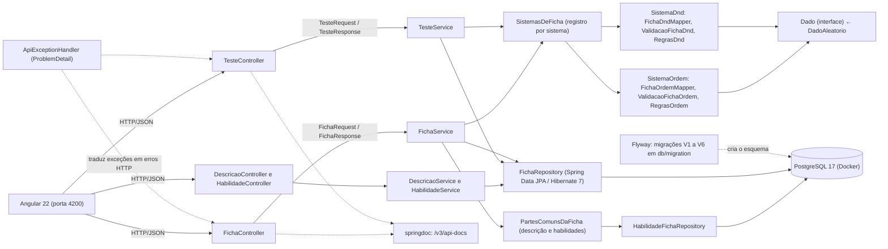
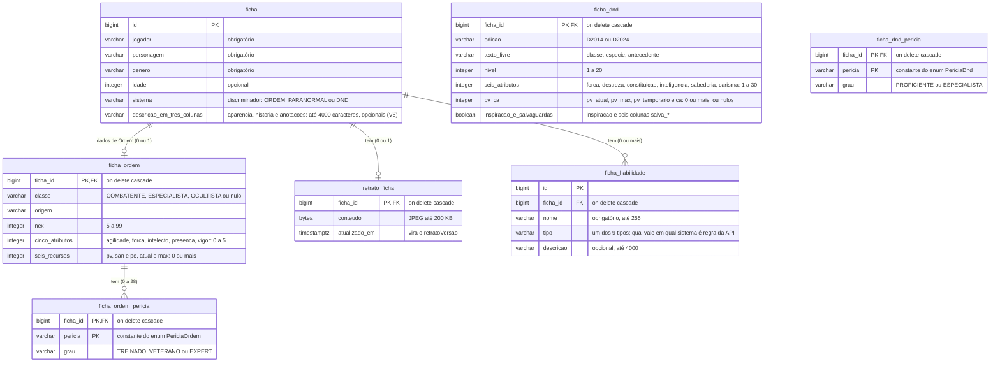
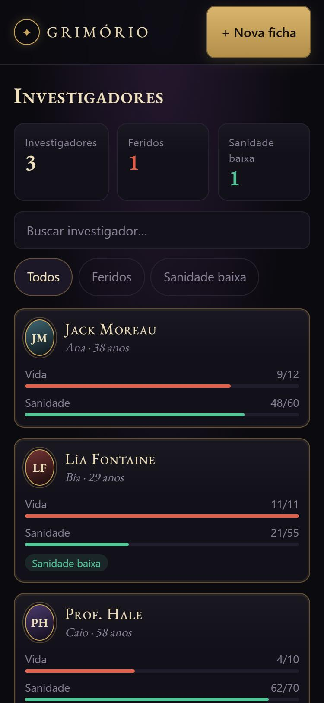
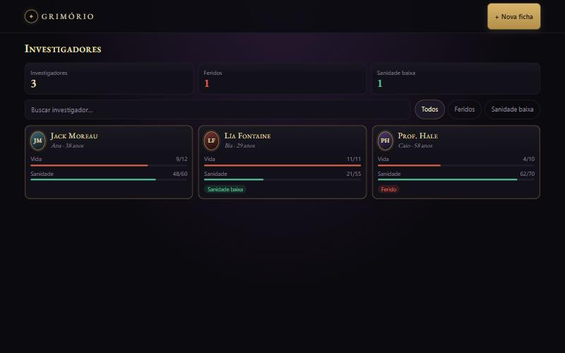
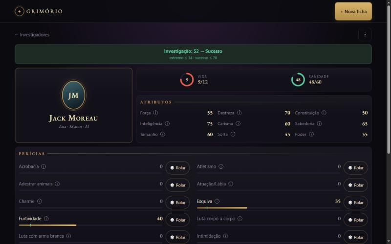
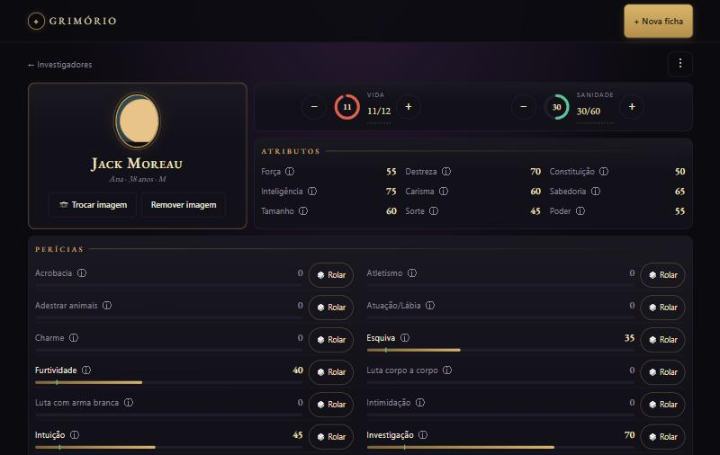

# Gerenciador de Fichas RPG

Aplicação de estudo full stack para cadastrar, consultar, editar e excluir fichas de personagens de RPG de mais de um sistema (hoje Ordem Paranormal, D&D 5e e D&D 2024), com interface Angular e API REST em Java e Spring Boot, persistida em PostgreSQL, com o esquema versionado por migrações Flyway.

> **App não oficial.** Ordem Paranormal é de seus autores e da Jambô Editora; o app usa só nomes e mecânicas, sem texto dos livros. Para D&D, o app é compatível com a quinta edição (5E) e usa material do SRD 5.1 e do SRD 5.2.1 sob a licença CC-BY-4.0 (atribuição abaixo).

### Atribuição do SRD (D&D)

O app usa do SRD só nomes de atributos e perícias e a mecânica de modificador, proficiência e vantagem, sem nenhum texto do SRD. As duas frases abaixo são as atribuições que a licença CC-BY-4.0 pede, uma para cada edição:

> This work includes material taken from the System Reference Document 5.1 ("SRD 5.1") by Wizards of the Coast LLC and available at https://dnd.wizards.com/resources/systems-reference-document. The SRD 5.1 is licensed under the Creative Commons Attribution 4.0 International License available at https://creativecommons.org/licenses/by/4.0/legalcode.

> This work includes material from the System Reference Document 5.2.1 ("SRD 5.2.1") by Wizards of the Coast LLC, available at https://www.dndbeyond.com/srd. The SRD 5.2.1 is licensed under the Creative Commons Attribution 4.0 International License, available at https://creativecommons.org/licenses/by/4.0/legalcode.

## Problema

Mestres e jogadores de RPG de mesa costumam manter as fichas de personagem em papel, que se perdem e são difíceis de atualizar. Este sistema guarda a ficha em um banco de dados e permite editá-la a qualquer momento, e cada ficha pertence a um sistema de RPG, com as regras dele. Começa por **Ordem Paranormal**: dados do jogador e do personagem, classe, origem, NEX (5% a 99%), 5 atributos de 0 a 5, 28 perícias com grau de treinamento (Treinado, Veterano, Expert) e os recursos PV, SAN e PE (atual e máximo). Em **D&D 5e (2014) e D&D 2024**: nível, 6 atributos com modificador, 6 salvaguardas, 18 perícias com proficiência ou especialização, PV, PV temporário, CA e inspiração.

## Status da modernização

O projeto original é de dezembro de 2021 (Java 11, Spring Boot 2.5.7, Springfox, Angular 13). Ele está sendo modernizado de forma incremental, por refatoração e não por reescrita, com cada passo coberto por testes.

| Incremento | Entrega | Situação |
| --- | --- | --- |
| 1.1 | Base segura e testável: credenciais fora do código, `docker compose` com o banco local, testes de caracterização das 5 rotas, CI | Concluído (PR #1) |
| 1.2 | Upgrade para Java 21 e Spring Boot 4.1.2 em duas etapas, springdoc no lugar do Springfox, pacote `dev.spironello.fichasrpg` | Concluído (PR #2) |
| 1.3 | Camada de serviço, DTOs, validação, erros padronizados (ProblemDetail), logs e correção dos comportamentos errados da API | Concluído (PR #3) |
| 1.4a | Migrações Flyway (`ddl-auto=validate`) e troca do MySQL por PostgreSQL 17, sem mudar a API | Concluído (PR #4) |
| 1.4b | Perícias em tabela própria (migração V2), sem mudar o JSON da API | Concluído (PR #5) |
| 1.5 | Teste de perícia (rolagem com sucesso, sucesso extremo e falha) com aleatoriedade injetável | Concluído (PR #6) |
| 1.6 | Contrato da API com nomes claros (`/fichas`, JSON em português), front-end Angular ajustado no mesmo incremento, job de CI do front-end e README final | Concluído (PR #7) |

**Fase 2 — mesa ao vivo** (design em [`docs/superpowers/specs/2026-11-04-j1-fase-2-design.md`](docs/superpowers/specs/2026-11-04-j1-fase-2-design.md)): transformar o projeto numa ferramenta usada de verdade pelo grupo durante as sessões, com login, campanhas e rolagens ao vivo.

| Incremento | Entrega | Situação |
| --- | --- | --- |
| 2.1 | Frontend refeito em Angular 22, visual "investigação sombria", pensado primeiro para o celular | Concluído (PR #8) |
| 2.1b | Redesign: painel de fichas e tela própria para cada ficha, visual "Moderno com alma gótica" ([spec](docs/superpowers/specs/2026-11-04-j1-redesign-design.md)) | Concluído (PR #9) |
| 2.1c | Retrato do personagem enviado pelo jogador (recorte no navegador, tabela `retrato_ficha`) e edição rápida de vida e sanidade na ficha | Concluído nesta branch |
| 2.1d | Vários sistemas de RPG, começando por Ordem Paranormal completa: uma tabela por sistema (migração V4), API polimórfica, rolagem de vários d20, edição rápida por `PATCH`, escolha do sistema na criação. **O d100 saiu** e as fichas antigas viraram Ordem ([spec](docs/superpowers/specs/2026-11-04-j1-sistemas-design.md), [ADR 0015](docs/decisoes/0015-uma-tabela-por-sistema.md), [ADR 0016](docs/decisoes/0016-saida-do-d100-e-conversao-para-ordem.md)) | Concluído nesta branch |
| 2.1e | D&D 5e e D&D 2024 no mesmo esqueleto: tabelas `ficha_dnd` e `ficha_dnd_pericia` (migração V5), proficiência, especialização, salvaguardas, vantagem e desvantagem, e as regras de cada sistema atrás da interface `SistemaDeFicha` ([spec](docs/superpowers/specs/2026-11-04-j1-sistemas-design.md), [plano](docs/superpowers/plans/2026-11-05-j1-2.1e-dnd.md), [ADR 0017](docs/decisoes/0017-regras-de-cada-sistema-atras-de-uma-interface.md)) | Concluído nesta branch |
| 2.1g | Abas na ficha (Ficha, Habilidades e Descrição), com a descrição e as habilidades em rotas próprias (migração V6) e um componente de lista editável que as próximas abas reaproveitam ([spec](docs/superpowers/specs/2026-11-09-j1-abas-da-ficha-design.md), [plano](docs/superpowers/plans/2026-11-09-j1-2.1g-abas-descricao-habilidades.md), [ADR 0018](docs/decisoes/0018-listas-da-ficha-em-recursos-proprios.md)) | Concluído nesta branch |
| 2.1h | Inventário (aba nova) | Planejado |
| 2.1i | Ataques (aba nova) | Planejado |
| 2.1j | Magias e rituais (aba nova) | Planejado |
| 2.1f | Dado animado, já com d20 (vários dados em Ordem, 2 com vantagem ou desvantagem) | Planejado |
| 2.2 | Login com e-mail e senha (JWT + refresh rotacionado), dono da ficha | Planejado |
| 2.3 | Campanhas, convite por link, papéis Mestre/Jogador | Planejado |
| 2.4 | Rolagens gravadas e ao vivo (WebSocket STOMP) | Planejado |
| 2.5 | Login com Google | Planejado |
| 2.6 | Deploy gratuito (Cloudflare Pages + Render + Neon) | Planejado |

## Tecnologias

| Camada | Stack do repositório |
| --- | --- |
| Back-end | Java 21, Spring Boot 4.1.2, Spring Web MVC, Spring Data JPA (Hibernate 7) |
| Banco de dados | PostgreSQL 17 (Docker), migrações com Flyway 12 |
| Front-end | Angular 22 (standalone, signals, zoneless), Angular Material 22, TypeScript 6 |
| Documentação de API | springdoc-openapi (OpenAPI 3 e Swagger UI) |
| Testes | Back-end: JUnit, MockMvc, Mockito, Testcontainers. Front-end: Vitest |
| Build e CI | Maven e Angular CLI; GitHub Actions (job `backend` com `./mvnw -B verify` e job `frontend` com build e testes em Node 24) |

## Funcionalidades da API

O controlador `FichaController` expõe o recurso `/fichas`. O campo `sistema` do corpo escolhe o tipo da ficha ([ADR 0015](docs/decisoes/0015-uma-tabela-por-sistema.md)); os valores aceitos são `ORDEM_PARANORMAL` e `DND`:

| Método | Rota | Finalidade | Respostas |
| --- | --- | --- | --- |
| GET | `/fichas` | Listar o **resumo** das fichas (o que o painel mostra) | 200 |
| GET | `/fichas/{id}` | Consultar a ficha completa | 200; 404 se não existe |
| POST | `/fichas` | Cadastrar uma ficha (o corpo leva o `sistema`) | 201 com `Location: /fichas/{id}`; 400 se inválida, ou se `sistema` falta ou é desconhecido |
| PUT | `/fichas/{id}` | Substituir uma ficha | 200; 400 se inválida; 404 se não existe; 409 "Sistema não muda" se o `sistema` do corpo for outro |
| PATCH | `/fichas/{id}/recursos` | Edição rápida: muda só os valores **atuais** enviados, por exemplo `{"PV": 10, "SAN": 30}` | 200 com a ficha completa; 400 se o código não existe no sistema da ficha ou o valor é negativo ou nulo; 404 se não existe |
| DELETE | `/fichas/{id}` | Excluir uma ficha | 204; 404 se não existe |
O `RetratoController` cuida da imagem do personagem (incremento 2.1c, [ADR 0014](docs/decisoes/0014-retrato-no-postgresql-em-tabela-separada.md)):

| Método | Rota | Finalidade | Respostas |
| --- | --- | --- | --- |
| PUT | `/fichas/{id}/retrato` | Enviar ou trocar o retrato: o corpo é o próprio JPEG (`Content-Type: image/jpeg`) | 204; 404 se a ficha não existe; 415 se não for `image/jpeg`; 413 acima de 200 KB; 422 se não for um JPEG legível ou passar de 1000 px por lado |
| GET | `/fichas/{id}/retrato` | Baixar o retrato | 200 `image/jpeg` com `Cache-Control: private, max-age=31536000, immutable` e `nosniff`; 404 se a ficha não existe ou não tem retrato |
| DELETE | `/fichas/{id}/retrato` | Remover o retrato | 204 (também sem retrato); 404 se a ficha não existe |

O servidor confere o tamanho pelo **cabeçalho** do JPEG antes de decodificar: um arquivo de poucos bytes que "diz" ter 50000×50000 é recusado com 422, sem a API alocar gigabytes de memória.

A descrição e as habilidades têm rotas próprias, no `DescricaoController` e no `HabilidadeController` (incremento 2.1g, [ADR 0018](docs/decisoes/0018-listas-da-ficha-em-recursos-proprios.md)). Elas não fazem parte do `PUT /fichas/{id}`:

| Método | Rota | Finalidade | Respostas |
| --- | --- | --- | --- |
| PUT | `/fichas/{id}/descricao` | Substituir a descrição (`aparencia`, `historia` e `anotacoes`) | 200 com a descrição; 400 por campo; 404 "Ficha não encontrada" |
| POST | `/fichas/{id}/habilidades` | Acrescentar uma habilidade (`nome`, `tipo` e `descricao`) | 201 com `Location: /fichas/{id}/habilidades/{habilidadeId}`; 400 por campo; 404 "Ficha não encontrada" |
| PUT | `/fichas/{id}/habilidades/{habilidadeId}` | Substituir uma habilidade | 200; 400 por campo; 404 "Ficha não encontrada" ou "Item não encontrado" |
| DELETE | `/fichas/{id}/habilidades/{habilidadeId}` | Remover uma habilidade | 204; 404 "Ficha não encontrada" ou "Item não encontrado" |

Uma habilidade que não existe, ou que é de outra ficha, responde 404 "Item não encontrado". Nos erros 400, a chave de `errors` é o campo (`nome`, `tipo`, `aparencia`...).

Qualquer falha inesperada responde 500 com uma mensagem genérica; o detalhe fica só no log do servidor.

### Formato da ficha

A resposta completa (`GET /fichas/{id}`, e o corpo de `POST`, `PUT` e `PATCH`) leva `sistema` e os dados do sistema. Em Ordem Paranormal, `atributos` e `recursos` são objetos chaveados pelo código, e `pericias` traz só as perícias treinadas, com o grau:

```json
{
  "id": 7, "sistema": "ORDEM_PARANORMAL",
  "jogador": "Ana", "personagem": "Jack Moreau", "genero": "M", "idade": 38, "retratoVersao": null,
  "classe": "ESPECIALISTA", "origem": "Investigador", "nex": 10,
  "atributos": { "AGI": 2, "FOR": 1, "INT": 3, "PRE": 2, "VIG": 1 },
  "recursos": { "PV": { "atual": 18, "maximo": 20 }, "SAN": { "atual": 16, "maximo": 16 }, "PE": { "atual": 3, "maximo": 5 } },
  "pericias": { "INVESTIGACAO": "TREINADO", "PERCEPCAO": "TREINADO" }
}
```

A listagem (`GET /fichas`) devolve só um **resumo** por ficha, igual para qualquer sistema: o painel não precisa conhecer os detalhes de cada um, e `recursos` vira uma lista (em Ordem, PV, SAN e PE nessa ordem). Por não tocar nas perícias, listar continua sendo uma consulta só:

```json
{ "id": 7, "sistema": "ORDEM_PARANORMAL", "jogador": "Ana", "personagem": "Jack Moreau", "idade": 38,
  "retratoVersao": null, "recursos": [ { "codigo": "PV", "atual": 18, "maximo": 20 }, { "codigo": "SAN", "atual": 16, "maximo": 16 }, { "codigo": "PE", "atual": 3, "maximo": 5 } ] }
```

**Descrição e habilidades (2.1g).** A ficha completa, de qualquer sistema, traz também `descricao` e `habilidades`:

```json
"descricao": { "aparencia": "Alto, cicatriz no queixo.", "historia": null, "anotacoes": null },
"habilidades": [ { "id": 3, "nome": "Ataque Furtivo", "tipo": "CLASSE", "descricao": "Dano extra uma vez por turno." } ]
```

O `GET /fichas/{id}` monta as duas partes, mas o `PUT /fichas/{id}` **não as toca**: o corpo do `PUT` não leva `descricao` nem `habilidades`, e, por causa do JSON estrito, enviá-las dá 400. Elas só mudam pelas rotas da seção anterior. A listagem (`GET /fichas`) não as traz.

- **Descrição:** `aparencia`, `historia` e `anotacoes` têm até 4000 caracteres cada. Texto vazio (ou só com espaços) vira `null`, e as quebras de linha são preservadas.
- **Habilidade:** `nome` é obrigatório (até 255 caracteres), `tipo` é obrigatório e `descricao` é opcional (até 4000). A lista vem na ordem em que as habilidades foram criadas.
- **Tipos por sistema:**

| Sistema | Tipos (`tipo`) |
| --- | --- |
| Ordem Paranormal | `CLASSE` (Classe), `TRILHA` (Trilha), `ORIGEM` (Origem), `PARANORMAL` (Poder paranormal) e `OUTRA` (Outra) |
| D&D (2014 e 2024) | `CLASSE` (Classe), `SUBCLASSE` (Subclasse), `ESPECIE` (Raça na 2014, Espécie na 2024), `ANTECEDENTE` (Antecedente), `TALENTO` (Talento) e `OUTRA` (Outra) |

Um tipo que existe só no outro sistema responde 400 com `errors.tipo` ("não existe em D&D" ou "não existe em Ordem Paranormal").

`retratoVersao` só existe na **resposta**: é o instante do último envio do retrato em milissegundos (ou `null` sem retrato), e a interface o usa na URL da imagem (`/retrato?v=…`) para o cache do navegador nunca mostrar uma foto velha. Enviado no corpo do `POST` ou `PUT`, ele é recusado como chave desconhecida.

**Entrada** (`POST` e `PUT`, sem o `id`, que vem da URL):
- `sistema` é obrigatório e escolhe o formato do resto do corpo (o Jackson usa `@JsonTypeInfo`). Em Ordem: `jogador`, `personagem` e `genero` são obrigatórios (até 255 caracteres), `nex` é obrigatório (5 a 99), `atributos` traz os 5 códigos (`AGI`, `FOR`, `INT`, `PRE`, `VIG`) de 0 a 5, e `classe` (`COMBATENTE`, `ESPECIALISTA` ou `OCULTISTA`), `origem`, `idade`, `recursos` e `pericias` são opcionais.
- Perícia ausente é destreinada. `VETERANO` exige NEX 35 ou mais e `EXPERT`, NEX 70 ou mais.
- O JSON é **estrito**: uma chave desconhecida (por exemplo `"STR"`) devolve 400 citando a chave, em vez de ser ignorada. Em `pericias`, um código que não existe (por exemplo `"VOAR"`) ou um grau que não existe (`"MESTRE"`) também devolve 400. Um sistema desconhecido ou ausente devolve 400.
- O `id` no corpo é aceito e **ignorado**, porque o Angular o envia sempre: no PUT vale o id da URL; no POST o id é gerado.
- O PUT é substituição completa ([ADR 0008](docs/decisoes/0008-put-como-substituicao-completa.md)): campos omitidos viram `null` e perícias e recursos omitidos são removidos. O sistema da ficha não muda: um `sistema` diferente devolve 409.
- O `PATCH` é o oposto, de propósito: só os recursos enviados mudam, e só o valor **atual** (os máximos ficam como estavam). Os códigos aceitos dependem do sistema (em Ordem, `PV`, `SAN` e `PE`; em D&D, `PV` e `PV_TEMP`).

**Erros** seguem o ProblemDetail (RFC 9457, `Content-Type: application/problem+json`). Exemplo de validação (`POST` de Ordem sem `jogador` e com o atributo `AGI` igual a 6):

```json
{
  "title": "Dados inválidos",
  "status": 400,
  "detail": "Há campos inválidos na requisição. Veja a propriedade errors.",
  "instance": "/fichas",
  "errors": { "jogador": "é obrigatório", "atributos[AGI]": "deve estar entre 0 e 5" }
}
```

A chave de `errors` vem em **duas formas**, conforme quem achou o erro, e a interface normaliza `campo[X]` para `campo.X` para mostrar a mensagem no campo certo:

| Quem valida | Forma da chave | Exemplos |
| --- | --- | --- |
| Bean Validation (campo a campo) | `campo` ou `campo[X]` | `jogador`, `nex`, `atributos[AGI]` ("deve estar entre 0 e 5" ou "é obrigatório" para valor nulo) |
| Regras que cruzam campos (`ValidacaoFichaOrdem`) | `campo.X` | `atributos.VIG` ("é obrigatório", atributo ausente), `pericias.INVESTIGACAO` ("Veterano exige NEX 35% ou mais", "Expert exige NEX 70% ou mais") |
| `PATCH` de recursos e `POST` de testes | a chave do próprio campo ou código | `DES` ("não existe em Ordem Paranormal"), `PV` (valor negativo), `alvo`, `modo`, `codigo` |

As regras cruzadas só rodam depois do Bean Validation: com NEX inválido, só o erro do NEX aparece, porque o limite de grau depende dele. Chave desconhecida, tipo errado, código de perícia ou grau inexistente e `sistema` desconhecido ou ausente respondem 400 só com `detail` (sem `errors`). O conflito de sistema responde 409.

Decisões em [ADR 0007](docs/decisoes/0007-erros-padronizados-e-json-estrito.md), [ADR 0012](docs/decisoes/0012-contrato-com-nomes-claros.md) (o formato de nomes) [ADR 0015](docs/decisoes/0015-uma-tabela-por-sistema.md) (o formato por sistema) e [ADR 0018](docs/decisoes/0018-listas-da-ficha-em-recursos-proprios.md) (descrição e listas em rotas próprias). A API permite chamadas da interface local em `http://localhost:4200`.

Com a API rodando, a documentação interativa (Swagger UI) fica em `http://localhost:8080/swagger-ui.html` e a especificação OpenAPI em `http://localhost:8080/v3/api-docs`.
### Ficha de D&D

Com `sistema: DND` a ficha vale para as duas edições, que usam as mesmas fórmulas: o campo `edicao` diz qual é (`D2014` para a 5e de 2014, `D2024` para a de 2024). `atributos` traz os 6 códigos (`FOR`, `DES`, `CON`, `INT`, `SAB`, `CAR`) de 1 a 30 e `nivel` vai de 1 a 20. `recursos` traz `PV` (atual e máximo) e `PV_TEMP` (só o atual, **sem máximo**: o `maximo` vem sempre `null`). `salvaguardas` é a lista dos atributos em que a ficha tem proficiência, e `pericias` traz só as perícias com `PROFICIENTE` ou `ESPECIALISTA` (perícia ausente é sem proficiência). `classe`, `especie` e `antecedente` são texto livre e opcionais, e `ca` e `inspiracao` são opcionais (a inspiração nula vira `false`).

```json
{
  "id": 9, "sistema": "DND", "edicao": "D2024",
  "jogador": "Bia", "personagem": "Thalia", "genero": "F", "idade": 27, "retratoVersao": null,
  "classe": "Ladina", "especie": "Elfa", "antecedente": "Criminosa", "nivel": 5,
  "atributos": { "FOR": 8, "DES": 16, "CON": 12, "INT": 13, "SAB": 10, "CAR": 14 },
  "recursos": { "PV": { "atual": 28, "maximo": 33 }, "PV_TEMP": { "atual": 0, "maximo": null } },
  "ca": 14, "inspiracao": false,
  "salvaguardas": ["DES", "INT"],
  "pericias": { "FURTIVIDADE": "ESPECIALISTA", "PERCEPCAO": "PROFICIENTE" }
}
```

As 18 perícias de D&D (iguais nas duas edições). O código é a constante do enum `PericiaDnd`, a chave de `pericias` e o `codigo` do teste:

| Código em `pericias` | Nome | Atributo |
| --- | --- | --- |
| `ATLETISMO` | Atletismo | FOR |
| `ACROBACIA` | Acrobacia | DES |
| `FURTIVIDADE` | Furtividade | DES |
| `PRESTIDIGITACAO` | Prestidigitação | DES |
| `ARCANISMO` | Arcanismo | INT |
| `HISTORIA` | História | INT |
| `INVESTIGACAO` | Investigação | INT |
| `NATUREZA` | Natureza | INT |
| `RELIGIAO` | Religião | INT |
| `INTUICAO` | Intuição | SAB |
| `LIDAR_COM_ANIMAIS` | Lidar com Animais | SAB |
| `MEDICINA` | Medicina | SAB |
| `PERCEPCAO` | Percepção | SAB |
| `SOBREVIVENCIA` | Sobrevivência | SAB |
| `ATUACAO` | Atuação | CAR |
| `ENGANACAO` | Enganação | CAR |
| `INTIMIDACAO` | Intimidação | CAR |
| `PERSUASAO` | Persuasão | CAR |

**Erros de D&D** (o mesmo ProblemDetail, com as chaves `campo.X` das regras cruzadas):
- `atributos.CON` ("é obrigatório"): faltou um dos 6 atributos; nível fora de 1–20 e atributo fora de 1–30 vêm do Bean Validation.
- `recursos.PV_TEMP.maximo` ("PV temporário não tem máximo"): o `PV_TEMP` não aceita `maximo`.
- `codigo` ("não existe em D&D"): no `PATCH` a chave é o próprio código errado (por exemplo `SAN`), e no teste é `codigo`.
- **409 "Sistema não muda" nos dois sentidos:** um `PUT` com `sistema: DND` numa ficha de Ordem, ou com `sistema: ORDEM_PARANORMAL` numa ficha de D&D. O 409 vem antes da validação.

**Edição rápida:** `PATCH /fichas/{id}/recursos` com `{"PV": 20, "PV_TEMP": 5}` muda só os valores atuais (os máximos ficam como estavam). Código fora de `PV` e `PV_TEMP` e valor negativo ou nulo dão 400.

**Rolagem de D&D** (`POST /fichas/{id}/testes`, `RegrasDnd`, código puro, sem Spring). O `alvo` aceita `PERICIA`, `ATRIBUTO` e `SALVAGUARDA`, e o `modo` aceita `NORMAL`, `VANTAGEM` e `DESVANTAGEM`:

| Conta | Fórmula |
| --- | --- |
| Modificador | ⌊(valor − 10) / 2⌋, com `Math.floorDiv` (valor 9 dá −1, e não 0) |
| Proficiência | 2 + ⌊(nível − 1) / 4⌋ (nível 1 a 4 dá +2, nível 17 a 20 dá +6) |
| Perícia | modificador do atributo, mais a proficiência (`PROFICIENTE`) ou 2× a proficiência (`ESPECIALISTA`) |
| Salvaguarda | modificador, mais a proficiência se o atributo está em `salvaguardas` |
| Teste de atributo | só o modificador |
| Dados | `NORMAL`: 1d20. `VANTAGEM`: 2d20, fica o **maior**. `DESVANTAGEM`: 2d20, fica o **menor** |

A resposta é a mesma de Ordem (`dados`, `mantido`, `bonus`, `total`). O "20 natural" e o "1 natural" **não vêm da API**: a interface os mostra olhando o dado mantido. `SALVAGUARDA` e `modo` agora valem em D&D e **continuam respondendo 400 em Ordem** (`alvo` "SALVAGUARDA não existe em Ordem Paranormal", `modo` "só NORMAL existe em Ordem Paranormal").

### Do contrato antigo para o novo

Até o incremento 1.5 a rota era `/sheetPlayer` e o JSON tinha 41 chaves. Não há rota antiga mantida nem versionamento: o Angular mudou junto.

| Antes (até o 1.5) | Agora (1.6) |
| --- | --- |
| `/sheetPlayer`, `/sheetPlayer/{id}` | `/fichas`, `/fichas/{id}` |
| `/sheetPlayer/{id}/testes-de-pericia` | `/fichas/{id}/testes-de-pericia` (depois, no 2.1d, `/fichas/{id}/testes`) |
| `nameJ` | `jogador` |
| `nameC` | `personagem` |
| `gender` | `genero` |
| `age` | `idade` |
| `lifeA` / `lifeM` | `vidaAtual` / `vidaMaxima` |
| `sanA` / `sanM` | `sanidadeAtual` / `sanidadeMaxima` |
| `str` / `dex` / `cons` | `forca` / `destreza` / `constituicao` |
| `int` / `car` / `sab` | `inteligencia` / `carisma` / `sabedoria` |
| `tam` / `sor` / `pod` | `tamanho` / `sorte` / `poder` |
| `atribute1`..`atribute23` (chaves planas, `null` quando vazias) | `pericias[<código do enum>]` (objeto, só as preenchidas); o d100 saiu no 2.1d (veja abaixo) |


Depois, no 2.1d, a migração V4 ([ADR 0016](docs/decisoes/0016-saida-do-d100-e-conversao-para-ordem.md)) tirou o d100 e deu nomes claros ao que faltava no banco. De novo sem rota antiga mantida:

| Antes (1.6) | Agora (2.1d) |
| --- | --- |
| tabela `sheet_player` | `ficha` (comum) + `ficha_ordem` + `ficha_ordem_pericia` |
| `namej`, `namec`, `gender`, `age` | `jogador`, `personagem`, `genero`, `idade` |
| `lifea`/`lifem`, `sana`/`sanm` | `pv_atual`/`pv_max`, `san_atual`/`san_max` em `ficha_ordem` |
| 9 atributos d100 e 23 perícias (`ficha_pericia`) | somem; a ficha antiga vira Ordem com NEX 5 e atributos 1 |
| `/fichas/{id}/testes-de-pericia` (d100) | `/fichas/{id}/testes` (d20 de Ordem) |
| JSON plano, com os campos do d100 na raiz | JSON com `sistema`, `atributos`, `recursos` e `pericias` como objetos |
| edição rápida de vida e sanidade por `PUT` | `PATCH /fichas/{id}/recursos` |

### Teste de Ordem

O `TesteController` expõe uma rota à parte, e o CRUD acima não mudou. A rota é a mesma para qualquer sistema (a rolagem de D&D está em "Ficha de D&D"); esta seção descreve a de Ordem:

| Método | Rota | Finalidade | Respostas |
| --- | --- | --- | --- |
| POST | `/fichas/{id}/testes` | Rolar um teste de perícia ou de atributo da ficha | 200; 400 se `alvo`, `codigo` ou `modo` não valem naquele sistema; 404 se a ficha não existe |

É POST porque o resultado é aleatório (não idempotente) e responde 200 porque nenhum recurso é criado: o teste **não é gravado**. O corpo leva `alvo` (`PERICIA` ou `ATRIBUTO`), o `codigo` (de `PericiaOrdem` ou `AtributoOrdem`, tabela na seção Perícias) e, opcionalmente, o `modo`. Exemplo, com Intelecto 3 e Investigação treinada:

```http
POST /fichas/7/testes
{"alvo": "PERICIA", "codigo": "INVESTIGACAO"}

200 OK
{"alvo": "PERICIA", "codigo": "INVESTIGACAO", "nome": "Investigação",
 "dados": [14, 7, 19], "mantido": 19, "bonus": 5, "total": 24}
```

Regras (`RegrasOrdem`, código puro, sem Spring):

| Situação | Dados | Dado mantido |
| --- | --- | --- |
| atributo da perícia (ou o atributo pedido) = N, com N de 1 a 5 | N d20 | o **maior** |
| atributo = 0 | 2 d20 | o **menor** |

O `total` é o dado mantido mais o bônus do grau: destreinado +0, Treinado +5, Veterano +10 e Expert +15 (Veterano exige NEX 35 e Expert, NEX 70). Teste de atributo não tem bônus. A resposta traz **todos** os dados (`dados`), para a interface mostrar cada um e destacar o `mantido`. Não há comparação com dificuldade (DT): quem compara é o mestre, como na mesa.

O contrato tem valores que só o D&D usa (`alvo` `SALVAGUARDA`, `modo` `VANTAGEM` e `DESVANTAGEM`, veja "Ficha de D&D"), e **em Ordem esses valores respondem 400**. Pedir um atributo como perícia (ou o contrário) e um código que não existe também dão 400, com a chave `codigo`. A sorte entra pela interface `Dado`, como no [ADR 0011](docs/decisoes/0011-teste-de-pericia-e-aleatoriedade-injetavel.md) (a regra d100 daquele ADR saiu; a injeção do `Dado` continua).

> Nota sobre rotas removidas: até o incremento 1.1, a dependência `spring-data-rest-hal-explorer`, adicionada junto com o Springfox, trazia o Spring Data REST de forma transitiva, que expunha uma segunda API CRUD não intencional e sem documentação em `/sheetPlayers`, além de `/profile` e `/explorer`. No incremento 1.2 a dependência foi removida e essas rotas passaram a responder 404. Veja o [ADR 0005](docs/decisoes/0005-springdoc-e-remocao-do-spring-data-rest.md). No 2.1d saiu também `/fichas/{id}/testes-de-pericia`, a rota do d100.


## Arquitetura

Estado atual:



O controller cuida só de HTTP: recebe e devolve DTOs (`record`), nunca a entidade. O corpo de entrada é a `sealed interface FichaRequest`, e o Jackson escolhe o record certo (`FichaOrdemRequest` ou `FichaDndRequest`) pelo campo `sistema`. O `FichaService` guarda as transações (`@Transactional`) e os logs, e lança `FichaNaoEncontradaException` quando a ficha não existe e `SistemaImutavelException` quando o `PUT` troca o sistema (409). Ele não conhece nenhum sistema: pede ao registro `SistemasDeFicha` a implementação da interface `SistemaDeFicha` que atende a ficha (`SistemaOrdem` ou `SistemaDnd`) e delega `criar`, `copiar`, `resposta`, `resumo`, `atualizarRecursos` e `testar` ([ADR 0017](docs/decisoes/0017-regras-de-cada-sistema-atras-de-uma-interface.md)). O 409 de sistema continua no serviço, antes da validação. O Bean Validation confere o que se vê campo a campo; a `ValidacaoFichaOrdem` e a `ValidacaoFichaDnd` conferem o que cruza campos (atributo ausente, grau que exige mais NEX, PV temporário com máximo) e lançam `DadosInvalidosException`, que vira o mesmo 400 "Dados inválidos". O `FichaOrdemMapper` e o `FichaDndMapper` convertem DTO e entidade à mão, campo a campo. A entidade `Ficha` é abstrata (dados comuns) e `FichaOrdem` e `FichaDnd` a estendem, com herança JPA JOINED ([ADR 0015](docs/decisoes/0015-uma-tabela-por-sistema.md)). As perícias treinadas ficam em `ficha_ordem_pericia` (um `Map<PericiaOrdem, GrauOrdem>` na entidade) e as de D&D com proficiência em `ficha_dnd_pericia` (um `Map<PericiaDnd, GrauDnd>`). Os métodos de leitura do repository usam `@EntityGraph` para trazer ficha e perícias numa consulta só, e a listagem usa o resumo, que nem toca nas perícias. O `ApiExceptionHandler` transforma as exceções em respostas ProblemDetail. O springdoc lê os controllers e gera a especificação OpenAPI.

A descrição e as habilidades ficam fora desse fluxo ([ADR 0018](docs/decisoes/0018-listas-da-ficha-em-recursos-proprios.md)). O `DescricaoController` e o `DescricaoService` gravam os três textos nas colunas novas da `ficha`. O `HabilidadeController` e o `HabilidadeService` cuidam do `POST`, do `PUT` e do `DELETE` de cada habilidade e conferem antes se o tipo existe no sistema da ficha (`TipoHabilidade.permitidoEm`). A `Ficha` **não tem coleção** de habilidades: elas são a entidade `HabilidadeFicha`, com `@ManyToOne`, lida pelo `HabilidadeFichaRepository`. Para o detalhe, o `SistemaDeFicha` pede ao `PartesComunsDaFicha` a descrição e as habilidades; o resumo da listagem não chama esse componente, e por isso listar continua sendo uma consulta só. Um item de outra ficha lança `ItemDaFichaNaoEncontradoException`, genérica para as próximas listas, que vira 404 "Item não encontrado".

O teste tem camadas próprias, para o CRUD ficar intacto: o `TesteService` busca a ficha (404 com a mesma `FichaNaoEncontradaException`), delega a rolagem ao `SistemaDeFicha` da ficha, que valida o pedido, pede os d20 ao `Dado` e aplica a regra pura do sistema: a `RegrasOrdem` (quantos dados, qual se mantém, bônus do grau) ou a `RegrasDnd` (modificador, proficiência, vantagem e desvantagem). A interface `Dado` isola a sorte: `DadoAleatorio` (`RandomGenerator`) em produção, uma sequência fixa nos testes.

Modelo de dados (esquema criado pelas migrações V1 a V6):



O retrato fica numa tabela própria para a listagem nunca ler bytes de imagem: a ficha só traz o `retratoVersao`, por uma subconsulta (`@Formula`) no mesmo SELECT, então listar continua sendo uma consulta só.

A V4 renomeou `sheet_player` para `ficha` sem mudar os ids, por isso o retrato e as URLs continuam valendo. `ficha_ordem` tem `check` para NEX (5 a 99), atributos (0 a 5) e recursos (≥ 0), e `ficha_ordem_pericia` limita o grau a três valores. Perícia destreinada não tem linha; no JSON ela não aparece em `pericias`.

A V5 (migração só de criação, sem mexer em dados) acrescentou `ficha_dnd` e `ficha_dnd_pericia`: uma tabela serve as duas edições, e a coluna `edicao` diz qual é. `ficha_dnd` tem `check` para nível (1 a 20), atributos (1 a 30), recursos e CA (≥ 0) e edição (`D2014` ou `D2024`); `ficha_dnd_pericia` limita o grau a `PROFICIENTE` e `ESPECIALISTA`. As salvaguardas são seis colunas booleanas (`salva_forca` etc.), e o PV temporário é só o valor atual, sem máximo. Perícia sem proficiência não tem linha. A V1 a V4 não foram editadas.

A V6 acrescentou a descrição e as habilidades, para os dois sistemas. `aparencia`, `historia` e `anotacoes` são colunas novas de `ficha` (até 4000 caracteres, nulas quando vazias). `ficha_habilidade` guarda uma linha por habilidade, com `check` nos 9 tipos, `on delete cascade` (excluir a ficha apaga as habilidades) e um índice em `ficha_id`. A tabela não sabe o sistema da ficha, então quem confere o tipo de cada sistema é a API.

### Perícias

As 28 perícias de Ordem Paranormal. O código é a constante do enum `PericiaOrdem`, a chave do objeto `pericias` e o `codigo` do teste; o atributo é o dado que a perícia rola:
| Código em `pericias` | Nome | Atributo |
| --- | --- | --- |
| `ACROBACIA` | Acrobacia | AGI |
| `ADESTRAMENTO` | Adestramento | PRE |
| `ARTES` | Artes | PRE |
| `ATLETISMO` | Atletismo | FOR |
| `ATUALIDADES` | Atualidades | INT |
| `CIENCIAS` | Ciências | INT |
| `CRIME` | Crime | AGI |
| `DIPLOMACIA` | Diplomacia | PRE |
| `ENGANACAO` | Enganação | PRE |
| `FORTITUDE` | Fortitude | VIG |
| `FURTIVIDADE` | Furtividade | AGI |
| `INICIATIVA` | Iniciativa | AGI |
| `INTIMIDACAO` | Intimidação | PRE |
| `INTUICAO` | Intuição | PRE |
| `INVESTIGACAO` | Investigação | INT |
| `LUTA` | Luta | FOR |
| `MEDICINA` | Medicina | INT |
| `OCULTISMO` | Ocultismo | INT |
| `PERCEPCAO` | Percepção | PRE |
| `PILOTAGEM` | Pilotagem | AGI |
| `PONTARIA` | Pontaria | AGI |
| `PROFISSAO` | Profissão | INT |
| `REFLEXOS` | Reflexos | AGI |
| `RELIGIAO` | Religião | PRE |
| `SOBREVIVENCIA` | Sobrevivência | INT |
| `TATICA` | Tática | INT |
| `TECNOLOGIA` | Tecnologia | INT |
| `VONTADE` | Vontade | PRE |

Estrutura de pastas:
- `Gerenciador de fichas RPG/`: aplicação Spring Boot.
- `Gerenciador de fichas RPG/src/main/java/dev/spironello/fichasrpg/controller/`: endpoints REST (`FichaController`, `TesteController`, `RetratoController`, `DescricaoController`, `HabilidadeController`).
- `Gerenciador de fichas RPG/src/main/java/dev/spironello/fichasrpg/dto/`: records de entrada e saída da API (a `FichaRequest` e a `FichaResponse` são interfaces seladas; `FichaOrdemRequest` e `FichaOrdemResponse` são os de Ordem, e `FichaDndRequest` e `FichaDndResponse`, os de D&D).
- `Gerenciador de fichas RPG/src/main/java/dev/spironello/fichasrpg/service/`: regras, transações, logs, `FichaService`, a interface `SistemaDeFicha` com o registro `SistemasDeFicha` e as implementações `SistemaOrdem` e `SistemaDnd`, os mappers `FichaOrdemMapper` e `FichaDndMapper`, as validações `ValidacaoFichaOrdem` e `ValidacaoFichaDnd`, o teste (`TesteService`, `RegrasOrdem`, `RegrasDnd` e o `Dado`) o retrato (`RetratoService` e `ValidadorRetrato`) e a descrição e as habilidades (`DescricaoService`, `HabilidadeService` e o `PartesComunsDaFicha`).
- `Gerenciador de fichas RPG/src/main/java/dev/spironello/fichasrpg/config/`: o `Clock` da aplicação (`RelogioConfig`), injetável como o `Dado` para os testes escolherem o instante.
- `Gerenciador de fichas RPG/src/main/java/dev/spironello/fichasrpg/exception/`: exceções e tratamento de erros.
- `Gerenciador de fichas RPG/src/main/java/dev/spironello/fichasrpg/model/`: entidades JPA (`Ficha`, `FichaOrdem`, `FichaDnd`, `RetratoFicha`, `HabilidadeFicha`) e os enums (`Sistema`, `TipoHabilidade`, os de Ordem: `AtributoOrdem`, `PericiaOrdem`, `GrauOrdem`, `ClasseOrdem`, `RecursoOrdem`, e os de D&D: `EdicaoDnd`, `AtributoDnd`, `PericiaDnd`, `GrauDnd`, `RecursoDnd`).
- `Gerenciador de fichas RPG/src/main/java/dev/spironello/fichasrpg/repository/`: persistência.
- `Gerenciador de fichas RPG/src/test/java/dev/spironello/fichasrpg/`: testes.
- `docs/decisoes/`: registros de decisões (ADRs).
- `frontend/`: aplicação Angular. Cada sistema fica em `frontend/src/app/fichas/sistemas/<sistema>/` (`ordem/` e `dnd/`, cada um com o catálogo, a ficha e o formulário; `comum/` guarda o que os formulários repartem); a escolha do sistema fica em `fichas/criacao/`. As abas da ficha ficam em `fichas/abas/` (`abas-da-ficha`, `habilidades-aba` e `descricao-aba`) e o `ListaEditavel` genérico, em `fichas/componentes/lista-editavel/`.

## Como rodar

### Pré-requisitos

- JDK 21 (o `pom.xml` compila para Java 21).
- Docker com Docker Compose (Docker Desktop no Windows). Ele é usado para o banco local **e** pelos testes.
- Node.js 24 (ou 22.22+) com npm, só para rodar a interface.

### Banco de dados e API

As credenciais do banco **não ficam no código**: a aplicação as lê das variáveis `DB_URL`, `DB_USERNAME` e `DB_PASSWORD`. Para desenvolvimento, elas ficam em um arquivo `.env` local, que não é versionado.

1. Na raiz do repositório, crie o seu `.env` a partir do modelo e troque as senhas de exemplo:

   ```sh
   cp .env.example .env
   ```

   No PowerShell: `Copy-Item .env.example .env`.

2. Suba o PostgreSQL 17 em container (lê o `.env`; usa a porta 5432, então ela precisa estar livre):

   ```sh
   docker compose up -d
   ```

3. Rode o back-end. O `.env` da raiz é carregado automaticamente; se você definir as variáveis `DB_*` no ambiente, elas têm prioridade:

   ```sh
   cd "Gerenciador de fichas RPG"
   ./mvnw spring-boot:run
   ```

   No PowerShell, use `.\mvnw.cmd spring-boot:run` (no cmd: `mvnw.cmd spring-boot:run`). A API fica em `http://localhost:8080/fichas`.

   Observações:
   - O PostgreSQL leva alguns segundos para aceitar conexões depois do `docker compose up -d`; se o back-end falhar na primeira tentativa, rode de novo.
   - O `.env` é procurado em `../.env`, relativo à pasta de onde o back-end é iniciado. Rode sempre de dentro de `Gerenciador de fichas RPG` (ou configure a IDE com esse diretório de trabalho). Se as variáveis não forem encontradas, o erro aparece como `URL must start with 'jdbc'`.
   - Dados que já estavam no MySQL local de versões anteriores **não são migrados automaticamente** (projeto de estudo, sem produção). Para limpar o ambiente antigo: `docker compose down --remove-orphans` e, se quiser descartar os dados, `docker volume rm gerenciador-de-fichas-rpg_mysql_data` (o nome exato aparece em `docker volume ls`).
   - O esquema é criado pelo Flyway na primeira subida da API (`src/main/resources/db/migration`); o Hibernate só confere (`ddl-auto=validate`).
   - **Migração aplicada não se edita**: o Flyway guarda o checksum de cada arquivo em `flyway_schema_history` e recusa subir se um arquivo já aplicado mudar. Para corrigir, crie uma nova versão (V4, V5...). Se o seu banco **local** de desenvolvimento ficar com checksum divergente, `docker compose down -v` recria o volume, mas **apaga os dados locais**.

Para parar o banco: `docker compose down` (acrescente `-v` para apagar também os dados). Para um ambiente isolado, use um nome de projeto: `docker compose -p meu-teste up -d` (o `docker-compose.yml` não fixa o nome do container, então o projeto isola de verdade).

### Interface

A interface é um projeto Angular 22 em `frontend/`, no visual "Moderno com alma gótica". A organização é de app moderno (busca, filtros, blocos) e a aparência é de grimório: fundo grafite com névoa púrpura, dourado, títulos em EB Garamond (fonte de licença aberta servida pelo próprio app) e retrato em medalhão. É pensada primeiro para o celular, e é a mesma tela no computador, só com mais colunas:

- **Painel (`/fichas`):** contadores (investigadores, feridos e sanidade baixa), busca por personagem ou jogador sem diferenciar acentos, filtros "Feridos" e "Sanidade baixa" (PV ou SAN atual ≤ metade do máximo) e um cartão por ficha, com medalhão, o **selo do sistema** e uma barra para cada recurso (PV, SAN e PE). O painel lê o resumo da API, igual para qualquer sistema.
- **Nova ficha (`/fichas/nova`):** primeiro a **escolha do sistema**, com 3 links: Ordem Paranormal (`/fichas/nova/ordem-paranormal`), D&D 5e (`/fichas/nova/dnd-2014`) e D&D 2024 (`/fichas/nova/dnd-2024`). As duas edições de D&D usam a mesma tela, que recebe a edição pela rota. O sistema não muda depois.
- **Formulário de Ordem (criar e editar):** as mesmas regras da API, com o erro do servidor mostrado no campo certo (a interface normaliza `atributos[AGI]` para `atributos.AGI`). Os graus de cada perícia ficam **limitados pelo NEX** (Veterano a partir de 35, Expert a partir de 70). Uma ficha nova começa em NEX 5 com os atributos em 1.
- **Abas da ficha (2.1g):** a ficha de qualquer sistema tem as abas **Ficha**, **Habilidades** e **Descrição**. A aba aberta fica na URL (`/fichas/:id?aba=habilidades`), então atualizar a página ou mandar o link abre a mesma aba; aba ausente ou desconhecida abre a Ficha. Trocar de aba usa `replaceUrl`, que substitui a entrada do histórico em vez de empilhar outra, e o botão voltar não passa por todas as abas visitadas. O topo (retrato, anéis e resultado da rolagem) fica fixo acima das abas. No computador, o layout da ficha mudou com as abas.
- **Aba Habilidades:** usa o `ListaEditavel`, um componente genérico (adicionar, editar na própria linha e remover com confirmação) que o 2.1h ao 2.1j reaproveitam. O seletor de tipo mostra só os tipos do sistema da ficha.
- **Aba Descrição:** três campos (aparência, história e anotações) com contador N/4000 e um botão "Salvar descrição" que só habilita quando há mudança. Os campos ficam bloqueados enquanto salva, e o aviso de salvo é anunciado para leitores de tela.
- **Ficha de Ordem (`/fichas/:id`), em blocos:** retrato com nome, classe e NEX, anéis de PV, SAN e PE, a Defesa (10 + Agilidade), os 5 atributos e as 28 perícias, com **33 botões "Rolar"** (5 atributos + 28 perícias) e 33 dicas curtas, escritas com palavras próprias. O resultado mostra **cada dado** rolado, destaca o mantido e soma o bônus do grau (selo T, V ou E). Editar e Excluir ficam no menu ⋮, e excluir pede confirmação.
- **Formulário de D&D (criar e editar):** os mesmos cuidados do de Ordem, com o erro do servidor no campo certo. O campo do texto livre se chama **"Raça" em 2014 e "Espécie" em 2024** (é o mesmo campo `especie` da API), e as 6 salvaguardas com proficiência e as 18 perícias (nenhuma, proficiente ou especialista) ficam em blocos próprios.
- **Ficha de D&D (`/fichas/:id`):** mostra os **6 atributos com o modificador**, as **6 salvaguardas** e as **18 perícias**, cada um com o bônus calculado e um botão "Rolar" (os atributos rolam só o modificador). Um seletor **Normal · Vantagem · Desvantagem** vale para a próxima rolagem e **volta a Normal depois de rolar**. O resultado mostra os dados, destaca o mantido e o bônus (com "−" de verdade quando negativo), e avisa **"20 natural"** ou "1 natural" olhando o dado mantido. Os anéis são **Vida** (PV atual e máximo) e **Temporário** (PV temporário, sem máximo), com o mesmo − e + e a mesma edição rápida de Ordem; CA e inspiração aparecem no cabeçalho.
- **`/fichas/:id/editar`** é uma rota só: a tela carrega a ficha e abre o formulário do sistema dela (Ordem ou D&D).- **Retrato do personagem:** "Trocar imagem" abre um recorte na moldura oval 4:5 (arrastar ou setas para posicionar, controle de zoom). O navegador reduz a foto para 400×500 em JPEG antes de enviar, então uma foto de celular de vários MB vira dezenas de KB. "Remover imagem" pede confirmação e volta às iniciais.
- **Edição rápida de PV, SAN e PE (em D&D, PV e PV temporário):** botões − e + em cada anel e o número clicável para digitar o valor. A tela muda na hora e salva sozinha 0,8 s depois do último toque, por um `PATCH` que leva **só os códigos que mudaram** (vários toques viram uma requisição só, e uma edição rápida nunca sobrescreve o resto da ficha). Se falhar, o valor volta ao último salvo; sair da ficha com um ajuste pendente salva na hora.
- **API fora do ar ou "acordando":** a tela mostra "Servidor indisponível" com o botão "Tentar de novo", em vez de ficar em branco.
- A ficha e os formulários carregam sob demanda, para a primeira tela abrir rápido no celular.

| Painel no celular | Ficha no celular |
| --- | --- |
|  |  |

| Painel no computador | Ficha no computador |
| --- | --- |
|  |  |

| Retrato e edição rápida no celular | Retrato e edição rápida no computador |
| --- | --- |
|  |  |

As capturas usam fichas de demonstração e são do incremento 2.1c, quando a ficha ainda era a do d100 (9 atributos e 23 perícias); elas ainda não foram refeitas com a ficha de Ordem.

Com a API e o banco no ar (seção anterior):

```sh
cd frontend
npm ci
npm start
```

Acesse `http://localhost:4200`. A interface chama a API em `http://localhost:8080` (`apiUrl` em `frontend/src/environments/`).

Testes e build da interface (é o que o CI roda):

```sh
cd frontend
npx ng test --watch=false
npx ng build
```

## Testes

```sh
cd "Gerenciador de fichas RPG"
./mvnw -B clean verify
```

**Os testes de integração precisam do Docker em execução** (os unitários do serviço não). Eles sobem o próprio PostgreSQL 17 descartável com o Testcontainers, então não usam o `.env` nem o banco do `docker compose`. Usar o banco real (e não um banco em memória) é a decisão do [ADR 0002](docs/decisoes/0002-testes-de-caracterizacao-com-testcontainers.md). O mesmo comando roda no GitHub Actions (`.github/workflows/ci.yml`, job `backend`), em push na `main` e em pull requests. O job `frontend` roda `npm ci`, `npx ng build` e `npx ng test --watch=false` em Node 24.

**Front-end:** 309 testes unitários em 33 arquivos (Vitest, `cd frontend && npx ng test --watch=false`), sem servidor nem banco. Número da última execução, na branch do 2.1g, já com a correção final (eram 260 em 29 arquivos no 2.1e e 186 em 22 no 2.1d):
- rotas e shell (topo único, um só `<router-outlet>`, a tela aberta não é recriada ao mudar a largura, as rotas de nova ficha e edição);
- regras do painel (ferido e sanidade baixa na metade exata, ficha sem o recurso ou com máximo 0, busca sem acento, contadores);
- o painel (cartões com selo do sistema e barras de PV, SAN e PE, vazio, erro com "Tentar de novo", recarga depois de criar, editar ou excluir, filtros, busca e "Limpar filtros");
- medalhão (iniciais e cor estável por ficha) e status em barra e em anel (limitados a 0–100%);
- `catalogo-ordem.spec`: as 5 atributos e as 28 perícias (atributo-base de cada uma, 33 dicas), o bônus por grau e a Defesa;
- o cliente da API e o modelo (`ficha-api.spec`, `ficha.model.spec`: URLs, corpos, `PATCH` de recursos, `POST` de testes, tradução de erros, inclusive a API fora do ar e a chave `campo[X]` virando `campo.X`);
- `escolha-sistema.spec`: os três cartões (Ordem, D&D 5e e D&D 2024) são links para o formulário de cada sistema, e nenhum fica desabilitado;
- `formulario-ordem.spec`: valores iniciais (NEX 5, atributos 1), obrigatórios, limites de NEX e atributos, graus limitados pelo NEX, o erro do servidor no campo certo (e o foco nele), envio duplo bloqueado, edição;
- `ficha-detalhe.spec`: os 33 botões "Rolar", o resultado com cada dado e o mantido destacado, toque duplo bloqueado, menu ⋮ com exclusão confirmada, 404;
- `recursos-ficha.spec` (edição rápida): limites do + e do −, vários toques viram um `PATCH` só (relógio simulado) com apenas os códigos mudados, erro volta o valor, toque durante o salvamento, salvar ao sair, digitar com Enter e cancelar com Esc;
- o retrato: a conta do recorte 4:5, o diálogo (salvar, cancelar, imagem que não abre), o cache de URLs locais e trocar e remover na ficha.
- Abas, descrição e habilidades (2.1g): `lista-editavel.spec` (lista vazia, adicionar, editar um item por vez, remover só depois da confirmação), `habilidades-aba.spec` (os tipos de cada sistema, criar, editar e excluir pela API, erro do servidor no campo, clique duplo, limite de 4000), `descricao-aba.spec` (contador N/4000, botão desabilitado sem mudança, campos bloqueados enquanto salva, aviso de salvo, quebras de linha) e `abas-da-ficha.spec` (a aba pedida na URL e a aba desconhecida), além dos casos novos de `ficha-detalhe.spec` (troca de aba) e `ficha-api.spec` (as rotas novas).
- D&D (2.1e): `regras-dnd.spec` (modificador com 9 dando −1, proficiência por nível, bônus de perícia, especialização e salvaguarda, nas fronteiras), `catalogo-dnd.spec` (6 atributos, 18 perícias, rótulo "Raça" e "Espécie"), `ficha-dnd.spec` (bônus na tela, "Rolar", seletor de modo que volta a Normal, "−" no bônus negativo, "20 natural", anéis Vida e Temporário), `ficha-ordem.spec` (a ficha de Ordem, agora um componente por sistema), `formulario-dnd.spec` (valores iniciais, limites, erro do servidor no campo, edição), `edicao-ficha.spec` (a rota de edição abre o formulário do sistema da ficha) e `formulario-comum.spec` (o que os dois formulários repartem).

**Back-end:** são 245 testes (número da última execução do `./mvnw -B clean verify` na branch do 2.1g; eram 210 no 2.1e e 137 no 2.1d):

| Grupo | O que cobre |
| --- | --- |
| `FichaControllerTest` | As rotas `GET`, `POST`, `PUT` e `DELETE` de `/fichas`: o resumo da listagem (PV, SAN e PE nessa ordem), a ficha completa, criar (201 + `Location`), atualizar (inclusive campos omitidos viram `null`), excluir (204), ids inexistentes (404 ProblemDetail), e a ida e volta das perícias pelo banco |
| `FichaValidacaoTest` | 400 com `errors` por campo, limite de 255, chave desconhecida, tipo errado, JSON malformado, `id` no corpo ignorado, código de perícia ou grau inexistente, atributos fora de 0–5 (`atributos[AGI]`) ou ausentes (`atributos.VIG`), NEX fora de 5–99, Veterano e Expert abaixo do NEX mínimo (`pericias.X`), sistema `DND` ou ausente (400), e valor rejeitado fora do log |
| `RecursosControllerTest` | `PATCH /fichas/{id}/recursos`: muda só o que foi enviado, PV, SAN e PE juntos, código desconhecido, valor negativo ou nulo (400), 404 |
| `TesteControllerTest` | `POST /fichas/{id}/testes` de ponta a ponta com `Dado` fixo: perícia com e sem grau, atributo 0 (2d20, o menor), atributo sem bônus, e 400 para `SALVAGUARDA`, `modo` `VANTAGEM`, código que não existe em Ordem e atributo pedido como perícia; 404 |
| `FichaServiceTest`, `TesteServiceTest` | Unitários com Mockito, sem Spring e sem Docker: sistema que não pode mudar (409), substituição completa, regras cruzadas, ficha inexistente, perícia que usa o atributo-base, e o log sem a lista de dados |
| `SistemasDeFichaTest` | Unitário: o registro devolve o componente de cada sistema, e sistema duplicado ou sem implementação lança `IllegalStateException` |
| `RegrasDndTest`, `PericiaDndTest` | Unitários: modificador (9 dá −1), proficiência por nível, perícia, especialização, salvaguarda, 1d20 e 2d20 com o maior e o menor; as 18 perícias e o atributo de cada uma |
| `FichaDndRepositoryTest` | A ficha de D&D vai e volta do banco (atributos, salvaguardas, perícias com proficiência) e a cascata ao excluir |
| `FichaDndControllerTest`, `FichaDndValidacaoTest` | O CRUD de D&D e o 409 nos dois sentidos; 400 para atributo ausente ou fora de 1–30, nível fora de 1–20, `recursos.PV_TEMP.maximo` e perícia ou grau inexistente |
| `RecursosDndControllerTest`, `TesteDndControllerTest` | `PATCH` com `PV` e `PV_TEMP` (e o 400 de `SAN`); `POST /fichas/{id}/testes` de D&D com `Dado` fixo: perícia, atributo, salvaguarda, vantagem, desvantagem e "não existe em D&D" |
| `FichaDndMapperTest` | Unitário: a ida e a volta entre DTO e entidade de D&D, e o resumo com PV e PV temporário |
| `FichaOrdemMapperTest` | Unitário: perícias, atributos e recursos vão para os campos certos e voltam; o resumo traz PV, SAN e PE sem perícias |
| `RegrasOrdemTest` | Unitário: quantidade de dados (atributo 0 rola 2 e mantém o menor), bônus de cada grau e o dado de 20 faces |
| `PericiaOrdemTest` | Unitário: as 28 perícias, a distribuição por atributo (AGI 7, FOR 2, INT 9, PRE 9, VIG 1) e nomes sem repetição |
| `MigracaoSistemasTest` | Migra um schema separado até a V3, insere fichas d100 (uma com perícias e retrato, outra sem vida nem sanidade, outra sem perícias) e confere, após a V4, ids e dados comuns, `sistema`, NEX 5, atributos 1, PV e SAN copiados, nenhuma perícia, retrato intacto e as colunas e a tabela d100 ausentes |
| `ContratoJsonTest` | O contrato do front: as 13 chaves da ficha de Ordem (com mapas por código) e as 7 do resumo |
| `ListagemSemNMaisUmTest` | Listar fichas de Ordem e de D&D, todas com perícias e (desde o 2.1g) habilidades, executa 1 consulta SQL (estatísticas do Hibernate), e não 1 + N, mesmo com a herança JOINED |
| `EsquemaBancoTest` | As tabelas `ficha`, `ficha_ordem`, `ficha_ordem_pericia` e `retrato_ficha` (e, desde o 2.1e, `ficha_dnd` e `ficha_dnd_pericia`) (nomes, tipos e nulabilidade) e a prova de que o Flyway aplicou da V1 à V6 (a V6 acrescentou `ficha_habilidade` e as colunas da descrição) |
| `HabilidadeFichaRepositoryTest`, `TipoHabilidadeTest` | A habilidade vai e volta do banco, em ordem de criação, e some junto com a ficha (cascata); qual tipo vale em qual sistema (`CLASSE` e `OUTRA` nos dois, os demais em um só) |
| `DescricaoControllerTest`, `HabilidadeControllerTest` | `PUT /fichas/{id}/descricao` (texto vazio vira `null`, quebras de linha preservadas, limite de 4000, 404) e as rotas das habilidades (201 + `Location`, `PUT`, `DELETE` 204, 400 por campo, tipo de outro sistema em `errors.tipo`, habilidade de outra ficha em 404 "Item não encontrado") |
| `MigracaoPericiasTest`, `MigracaoRetratoTest` | Migrações antigas (V2 e V3) continuam provadas, cada uma com dados no formato anterior |
| `RetratoFichaRepositoryTest`, `ValidadorRetratoTest`, `RetratoControllerTest` | O retrato do 2.1c: bytes e instante, cascata, JPEG válido e inválido, a "bomba de decodificação", as 3 rotas e os cabeçalhos |
| `ApiExceptionHandlerTest`, `DocumentacaoApiTest`, `FichasRpgApplicationTests` | O 500 genérico sem vazar texto interno, Swagger UI e OpenAPI respondem, e o contexto sobe |

Saíram com o d100: `SheetPlayerControllerTest`, `SheetPlayerValidacaoTest`, `SheetPlayerServiceTest`, `SheetPlayerMapperPericiasTest`, `PericiaTest`, `RegraTestePericiaTest`, `TestePericiaServiceTest` e `TestePericiaControllerTest`. Cada expectativa que ainda fazia sentido migrou para o teste de Ordem equivalente, escrito antes do código.

Os testes do controller nasceram no 1.1 como testes de caracterização, que registravam o comportamento de então, com bugs. No 1.3 os bugs foram corrigidos e esses testes foram reescritos de propósito para especificar o comportamento correto, antes do código. No 1.6 foram renomeados para as rotas e chaves novas, e no 2.1d reescritos para a ficha de Ordem. Comportamento atual da API:

- `GET`, `PUT`, `PATCH` e `DELETE` de id inexistente respondem 404 com ProblemDetail.
- `POST` e `PUT` sem os campos obrigatórios (ou com texto acima de 255 caracteres) respondem 400 com `errors` por campo.
- `POST` responde 201 com o header `Location`; `DELETE` responde 204.
- Chave desconhecida (`"STR"`), código de perícia ou grau inexistente, `sistema` desconhecido ou ausente, tipo errado (`"idade": "abc"`) e JSON malformado respondem 400.
- `PUT` substitui a ficha inteira, de propósito: campos omitidos viram `null` e perícias omitidas são removidas. Com outro `sistema`, responde 409.
- O `id` enviado no corpo é ignorado.
- O `PUT /fichas/{id}` não toca na descrição nem nas habilidades, e enviá-las no corpo dá 400 (JSON estrito).

## Decisões e trade-offs

Cada decisão tem um registro curto (contexto, decisão, alternativas e consequências) em `docs/decisoes/`:

- [0001 Credenciais em variáveis de ambiente](docs/decisoes/0001-credenciais-em-variaveis-de-ambiente.md): a senha saiu do código e vem do ambiente ou de um `.env` local.
- [0002 Testes de caracterização com Testcontainers](docs/decisoes/0002-testes-de-caracterizacao-com-testcontainers.md): testes contra um MySQL real antes de qualquer refatoração.
- [0003 Manter o MySQL até o Flyway](docs/decisoes/0003-manter-mysql-ate-o-flyway.md): a troca de banco só acontece junto com as migrações (feita no 1.4a, ADR 0009).
- [0009 Flyway e PostgreSQL](docs/decisoes/0009-flyway-e-postgresql.md): esquema versionado em SQL, `ddl-auto=validate` e troca de banco.
- [0010 Perícias em tabela própria](docs/decisoes/0010-pericias-em-tabela-propria.md): `ficha_pericia` no lugar de 23 colunas, enum `Pericia`, migração V2 e `@EntityGraph`; JSON inalterado.
- [0011 Teste de perícia e aleatoriedade injetável](docs/decisoes/0011-teste-de-pericia-e-aleatoriedade-injetavel.md): regra pura, interface `Dado`, perícia sem valor como 0 e o que ficou de fora. **A regra d100 foi substituída no 2.1d (ADR 0016); a injeção do `Dado` continua valendo.**
- [0004 Upgrade em duas etapas](docs/decisoes/0004-upgrade-em-duas-etapas.md): Boot 2.5 → 3.5 → 4.1, com testes de contrato e de esquema escritos antes.
- [0005 springdoc e remoção do Spring Data REST](docs/decisoes/0005-springdoc-e-remocao-do-spring-data-rest.md): documentação nova e fim de uma API paralela acidental.
- [0006 Compatibilidade de nomes no Boot 4](docs/decisoes/0006-compatibilidade-de-nomes-no-boot-4.md): como preservei o JSON e o esquema do banco, e por que troquei a primeira solução.
- [0007 Erros padronizados e JSON estrito](docs/decisoes/0007-erros-padronizados-e-json-estrito.md): ProblemDetail, códigos HTTP e rejeição de chaves desconhecidas.
- [0008 PUT como substituição completa](docs/decisoes/0008-put-como-substituicao-completa.md): sem PATCH e sem regras numéricas inventadas.
- [0012 Contrato com nomes claros](docs/decisoes/0012-contrato-com-nomes-claros.md): rota `/fichas`, JSON em português com `pericias` como objeto, sem versionar a API; a entidade e o banco só mudam depois.
- [0013 Frontend novo em Angular 22](docs/decisoes/0013-frontend-novo-em-angular-22.md): refazer as telas na versão atual em vez de atualizar o Angular 13 versão a versão.
- [0014 Retrato no PostgreSQL em tabela separada](docs/decisoes/0014-retrato-no-postgresql-em-tabela-separada.md): a imagem do personagem numa tabela própria (a listagem nunca lê os bytes), validada no servidor pelo cabeçalho do JPEG antes de decodificar.
- [0015 Uma tabela por sistema (herança JPA JOINED)](docs/decisoes/0015-uma-tabela-por-sistema.md): `ficha` com o comum e `ficha_ordem` (e `ficha_dnd`) por sistema, JSON polimórfico pelo campo `sistema`, e por que não catálogo genérico nem JSONB.
- [0016 Saída do d100 e conversão para Ordem Paranormal](docs/decisoes/0016-saida-do-d100-e-conversao-para-ordem.md): a V4 renomeia `sheet_player` sem mudar os ids, converte cada ficha em Ordem (NEX 5, atributos 1) e apaga o que era só do d100; o risco de vida ou sanidade negativas.
- [0017 Regras de cada sistema atrás de `SistemaDeFicha`](docs/decisoes/0017-regras-de-cada-sistema-atras-de-uma-interface.md): `criar`, `copiar`, `resposta`, `resumo`, `atualizarRecursos` e `testar` por sistema, um registro que falha na subida se houver dois, o 409 antes da validação, e o cast `Ficha` → `FichaDnd` como ponto fraco.
- [0018 Listas da ficha em recursos próprios](docs/decisoes/0018-listas-da-ficha-em-recursos-proprios.md): descrição e habilidades em rotas próprias, fora do `PUT` da ficha, sem coleção JPA na `Ficha` (a listagem segue em 1 consulta) e uma exceção de 404 que as próximas listas reaproveitam.

## Perguntas técnicas (roteiro de entrevista)

**Por que refatorar em vez de reescrever?**
O projeto já funcionava e tinha um front-end acoplado ao formato do JSON. Reescrever perderia esse comportamento sem prova de que o novo é equivalente. Refatorando em passos pequenos, cada um com testes verdes, sempre sei o que mudou e posso parar em qualquer ponto.

**O que você fez com a senha do banco que estava exposta?**
Tirei do código e passei a lê-la de variáveis de ambiente ou de um `.env` ignorado pelo Git, com um `.env.example` de modelo. Como a senha antiga continua no histórico do Git, a trato como comprometida: o certo é trocá-la onde foi usada. Reescrever o histórico é uma decisão separada.

**Por que Testcontainers e não H2?**
Porque quero testar no banco que uso de verdade. O H2 tem diferenças de SQL e de tipos, e o próprio problema da coluna `int` (palavra reservada no SQL) é o tipo de coisa que um banco diferente esconderia. O custo é exigir Docker e ser um pouco mais lento.

**Como você garantiu que o upgrade não quebrou nada?**
Antes de mexer nas versões, escrevi testes de caracterização das 5 rotas e dois testes extras: um com as 41 chaves do JSON que o Angular consumia na época e outro com o esquema da tabela. Depois atualizei e só aceitei as etapas com `clean verify` verde. Os dois testes extras pegaram justamente as duas mudanças silenciosas mais perigosas.

**Qual foi o problema mais difícil do upgrade?**
Os nomes mudando sozinhos. No Jackson 3, `getSTR()` passou a sair como `"STR"`, o que quebraria o Angular; resolvi com `@JsonProperty` explícito. No Hibernate 7, a tabela viraria `SheetPlayer` e os dados existentes sumiriam. Minha primeira solução foi uma estratégia de nomes própria de 63 linhas, que funcionava mas tratava o sintoma. A causa-raiz eram as aspas globais, usadas só por causa da coluna `int`; removi-as e deixei aspas apenas nessa coluna. O mesmo teste de esquema validou as duas soluções.

**O que era a API acidental do Spring Data REST?**
Uma dependência adicionada junto com o Springfox trazia o Spring Data REST de forma transitiva, que expunha uma segunda API CRUD sem validação e sem documentação em `/sheetPlayers`, além de `/profile` e `/explorer`. Removi a dependência e confirmei com a aplicação rodando que essas rotas respondem 404.

**Por que o DELETE de id inexistente passou a responder 200, e como ficou?**
Por causa do Spring Data 3: o `deleteById` passou a ignorar ids que não existem, em vez de lançar exceção (antes disso resultava em 500). No 1.2 não escondi a mudança: ajustei o teste e documentei. No 1.3 a camada de serviço verifica a existência e lança `SheetPlayerNotFoundException`, que vira 404.

**Por que o upgrade foi em duas etapas?**
Porque Boot 2.5 → 4.1 junta muitas mudanças (Spring 6, Jakarta, Hibernate, Jackson 3). Passando antes pelo 3.5.16, cada quebra tem uma causa mais fácil de identificar, e cada etapa fica com `clean verify` verde. Custa mais commits, mas reduz o risco.

**PUT ou PATCH?**
PUT, como substituição completa. O Angular já envia a ficha inteira, então um PATCH seria código sem cliente que o use. Aceito o custo: quem mandar uma ficha parcial apaga os outros campos. Se surgir esse cliente, o PATCH entra como um incremento próprio ([ADR 0008](docs/decisoes/0008-put-como-substituicao-completa.md)).

**Por que ProblemDetail?**
Porque é o padrão (RFC 9457) e o Spring já o suporta: não preciso inventar um formato de erro. O cliente recebe sempre `title`, `status` e `detail`, e na validação uma propriedade `errors` por campo. Mensagens em português e sem stack trace.

**Por que rejeitar campos desconhecidos no JSON?**
Porque o Jackson 3 já me mostrou que um nome de campo pode mudar sem aviso, e um `"STR"` ignorado em silêncio vira dado perdido. Com o modo estrito o erro aparece na hora, com o nome da chave. O custo é que é uma configuração global; a exceção é o `id`, que aceito e ignoro porque o Angular o envia.

**Por que trocar MySQL por PostgreSQL agora?**
Porque o roteiro do portfólio já previa o PostgreSQL e esta é a hora mais barata: o projeto não tem usuários nem dados em produção, e a rede de testes com Testcontainers me diz na hora se algo quebrou. Fiz a troca junto com o Flyway, mas em um incremento só dele, sem mudar a API. Os 34 testes que não tratam do esquema passaram sem mudar uma asserção; só o teste de esquema precisou dos tipos do PostgreSQL. O custo é que os dados do MySQL local não migram.

**Por que Flyway com `ddl-auto=validate`?**
Com `ddl-auto=update` o esquema depende de como o Hibernate decidir gerá-lo, não há histórico e uma mudança de versão pode alterar o banco sem aviso. Com Flyway cada mudança é um arquivo SQL versionado (`V1__...`), aplicado uma única vez e registrado em `flyway_schema_history`. O `validate` faz o Hibernate só conferir: se a entidade divergir da migração, a aplicação não sobe. O custo é escrever o SQL à mão e manter entidade e migração em sincronia.

**Por que tabela própria e não 23 colunas ou JSONB?**
Porque as 23 colunas `atribute1..23` não diziam nada, não dava para iterar sobre as perícias e cada perícia nova pedia um `ALTER TABLE`. O JSONB seria flexível, mas eu perderia tipo e integridade no banco e a consulta por perícia ficaria pior. Com a tabela `ficha_pericia` e um enum, o banco garante a chave e o valor inteiro, e perícia nova é uma constante. O custo é um join a mais e a lista de nomes valer só na aplicação (sem `check constraint`), o que está no [ADR 0010](docs/decisoes/0010-pericias-em-tabela-propria.md).

**Como garantiu que a migração não perde dados?**
Escrevi o teste antes da V2: ele migra um schema separado só até a V1, insere fichas no formato antigo (com `atribute1` e `atribute23` preenchidos, outras nulas e uma ficha sem nenhuma perícia) e migra até a última versão. Depois confere que as linhas de `ficha_pericia` são exatamente as esperadas, que as colunas antigas sumiram e que o resto da ficha está igual. A V2 copia antes de apagar as colunas e roda numa transação só, porque o PostgreSQL tem DDL transacional: se falhar no meio, nada fica pela metade. Também a rodei de verdade num banco novo pelo `docker compose`.

**Como evitou N+1?**
Ler as fichas e depois o mapa de perícias de cada uma geraria 1 consulta para a lista e mais 1 por ficha. Coloquei `@EntityGraph(attributePaths = "pericias")` no `findAll` e no `findById`, que faz o Hibernate trazer tudo num SELECT com join. Provei com as estatísticas do Hibernate num teste: com 3 fichas a listagem executa 1 consulta; sem o grafo, o mesmo teste contou 4. O custo é lembrar de repetir o grafo em qualquer método de leitura novo.

**Como você testa algo aleatório?**
Não testo a sorte, testo a regra. Separei a regra (`avaliar(valor, rolagem)`, uma função pura) da fonte de sorte (a interface `Dado`). A regra é testada com rolagens escolhidas por mim, nas fronteiras; o serviço e o endpoint recebem um `Dado` fixo. Não usei mock de `Random`: a interface pequena diz o que o teste espera. O custo é uma interface a mais, e a `DadoAleatorio` real só é exercitada de verdade em execução.

**Por que perícia sem valor conta como 0?**
Porque uma perícia sem valor na ficha é uma perícia que o personagem não treinou, e isso é uma situação normal do jogo, não um erro do cliente. Contar como 0 evita um erro novo e a regra continua uma só: com valor 0, qualquer rolagem de 1 a 100 falha. O custo é que uma perícia esquecida na ficha falha em silêncio; está no [ADR 0011](docs/decisoes/0011-teste-de-pericia-e-aleatoriedade-injetavel.md).

**Por que não versionar a API (`/v2`)?**
Versionar serve para quem tem clientes que eu não controlo e que não podem mudar na mesma hora. Aqui o único cliente é o Angular, que está no mesmo repositório e mudou no mesmo incremento, com o CI compilando os dois lados. Manter uma `/v1` seria código morto e duas APIs para testar. O custo é a quebra de contrato: se existisse um cliente de fora, ele pararia de funcionar; nesse caso eu versionaria ([ADR 0012](docs/decisoes/0012-contrato-com-nomes-claros.md)).

**Por que nomes em português no JSON?**
Porque o domínio é de RPG em português (perícia, sanidade, ficha) e a tela já mostra esses termos; `vidaAtual` e `forca` se explicam sozinhos, o que `lifeA` e `str` não faziam. Traduzir para o inglês criaria termos artificiais para o jogo. Aceito que fora do Brasil o padrão seria inglês; é uma escolha para este projeto de estudo, fácil de reverter porque o mapper concentra a tradução.

**Como trocou o contrato sem quebrar a interface?**
Escrevi primeiro os testes no contrato novo e os vi falhar (34 falhas), depois mudei DTOs, mapper e rotas até o `clean verify` ficar verde, e só então ajustei o Angular no mesmo incremento. A entidade e as migrações não mudaram; o mapper traduz. Na época, como o Angular 13 não rodava no Node da minha máquina, compilei e servi o front num container `node:16`, e o CI ganhou um job que roda `ng build`. No 2.1 o frontend foi refeito em Angular 22, com testes automatizados.

**Por que refazer o frontend em vez de atualizar o Angular 13?**
O backend eu refatorei passo a passo porque tinha regra e contrato a preservar. O frontend antigo eram 3 formulários e um painel, e o design ia mudar inteiro de qualquer jeito. Atualizar 9 versões (13 → 22) para depois jogar as telas fora seria esforço sem retorno. Refiz as telas no Angular atual (standalone, signals, Vitest) contra a mesma API, com testes primeiro, e conferi o fluxo no navegador nas larguras de celular e de computador. O custo é que o frontend não tem a história de "upgrade seguro" que o backend tem ([ADR 0013](docs/decisoes/0013-frontend-novo-em-angular-22.md)).

**Por que a busca e os filtros do painel rodam no navegador, e não na API?**
Porque a lista inteira já chega pelo `GET /fichas` e ela é pequena: são as fichas de uma mesa. Filtrar no navegador responde na hora, sem rota nova nem requisição a cada letra digitada. As regras ("ferido" = vida atual ≤ metade da máxima) são funções puras, testadas à parte, inclusive nos casos sem valor. O custo aparece quando houver muitas fichas por campanha: aí a busca e a paginação vão para o servidor.

**Como você garantiu que o redesign não quebrou nada?**
Antes de apagar os componentes antigos, fiz um mapa de testes: cada teste que saía migrou para o componente novo que herdou o comportamento, ou foi reescrito quando o comportamento saiu de propósito (as duas colunas). Nenhum comportamento ficou sem teste. Mesmo assim, a conferência manual no celular achou um bug que os testes não pegam: a ficha passava da largura da tela, porque a coluna do grid crescia até o conteúdo mais largo. Corrigi com `minmax(0, 1fr)` e medi no navegador. A revisão independente ainda achou o texto da perícia "esmaecida" abaixo do contraste AA; troquei a opacidade pela cor de texto suave.

**Por que guardar a imagem no banco, e não num serviço de arquivos?**
Para o portfólio, com poucas fichas, uma tabela `retrato_ficha` separada resolve sem serviço novo, credenciais ou cartão: o backup do banco já leva as imagens e excluir a ficha apaga o retrato junto. A separação é o ponto importante: a listagem nunca lê bytes, só o `retratoVersao`, por uma subconsulta no mesmo SELECT (o teste que conta as consultas não mudou). O navegador já reduz a foto para cerca de 50 KB. Se o volume crescer, o armazenamento de objetos (R2/S3) volta à mesa no deploy ([ADR 0014](docs/decisoes/0014-retrato-no-postgresql-em-tabela-separada.md)).

**Como você protege o upload de imagem?**
O servidor não confia no navegador: só aceita `image/jpeg` (415), lê no máximo 200 KB do corpo (413) e confere os bytes iniciais do JPEG. A revisão independente achou o ponto mais sutil: eu decodificava a imagem antes de conferir o limite de 1000 px, e um JPEG de poucos bytes com o cabeçalho dizendo 50000×50000 derrubava a API por falta de memória ("bomba de decodificação"). Agora o tamanho vem do cabeçalho, antes de decodificar, com um teste que reproduz o ataque. O `GET` responde com `nosniff` e SVG nunca é aceito, porque pode carregar script.

**Por que uma tabela por sistema e não JSONB?**
Cada sistema tem atributos, perícias e recursos diferentes, mas o banco precisa garantir as regras de cada um: atributo de 0 a 5, NEX de 5 a 99, grau com três valores. Com uma tabela por sistema (`ficha_ordem`) cada regra vira um `check` no banco, e o Hibernate confere o mapeamento ao subir. O JSONB seria mais fácil de mudar, mas a validação ficaria só no código. O catálogo genérico (atributo/valor) também perde a checagem. O custo é uma migração, uma entidade, um DTO e um mapper por sistema novo, e duas cadeias de `instanceof` no serviço, que o 2.1e trocou pela interface `SistemaDeFicha` ([ADR 0015](docs/decisoes/0015-uma-tabela-por-sistema.md), [ADR 0017](docs/decisoes/0017-regras-de-cada-sistema-atras-de-uma-interface.md)).

**Como a ficha antiga virou Ordem sem perder o retrato?**
A V4 não cria uma tabela nova e copia: ela **renomeia** `sheet_player` para `ficha`, então os ids não mudam e o `retrato_ficha`, que aponta para o id, nem percebe. Depois insere uma linha em `ficha_ordem` por ficha (NEX 5, atributos 1, PV e SAN copiados) e só então apaga as colunas do d100. Tudo numa transação, porque o PostgreSQL tem DDL transacional. Escrevi o teste antes (`MigracaoSistemasTest`: migra até a V3 com fichas d100 e retrato, aplica a V4 e confere tudo) e fiz um backup do banco antes de aplicar no meu. O risco que registrei: vida ou sanidade negativas violariam o `check` novo e a V4 falharia, sem perda de dados ([ADR 0016](docs/decisoes/0016-saida-do-d100-e-conversao-para-ordem.md)).

**Como o JSON escolhe o tipo certo?**
O corpo de entrada é uma `sealed interface FichaRequest` com `@JsonTypeInfo` pelo campo `sistema` e `@JsonSubTypes`. O Jackson lê o valor e cria o record certo (`FichaOrdemRequest` ou `FichaDndRequest`). Sistema desconhecido ou ausente vira 400; `PUT` com outro sistema vira 409, porque o sistema é escolhido na criação e não muda. A interface selada faz o compilador avisar quando um sistema novo não for tratado.

**Como testar uma rolagem aleatória?**
Testo a regra, não a sorte. A sorte entra pela interface `Dado`, injetada, e os testes usam uma sequência fixa. A `RegrasOrdem` é uma classe pura: com atributo N rola N d20 e mantém o maior, e com atributo 0 rola 2 e mantém o **menor**. As fronteiras (0, 1, 5 e cada grau) são testadas sem Spring, e o endpoint recebe o `Dado` fixo. O `TesteService` devolve todos os dados rolados, então o teste confere também a lista, não só o total.

**Como a edição rápida evita sobrescrever a ficha?**
Ela não usa o `PUT`, que é substituição completa. O `PATCH /fichas/{id}/recursos` recebe só os **valores atuais** dos códigos que mudaram (`{"PV": 10}`), e o servidor mexe só neles. No navegador, a tela muda na hora e o `PATCH` sai 800 ms depois do último toque, então vários toques viram uma requisição só e, se falhar, o valor volta ao último salvo.
**Como você acrescentou um segundo sistema sem `instanceof` espalhado?**
Tirei tudo o que muda de um sistema para outro para trás da interface `SistemaDeFicha` (`criar`, `copiar`, `resposta`, `resumo`, `atualizarRecursos` e `testar`). `SistemaOrdem` e `SistemaDnd` implementam a interface, e o `FichaService` e o `TesteService` só pedem ao registro `SistemasDeFicha` a implementação certa e delegam. A lógica de Ordem foi movida, não reescrita, e os testes de Ordem passaram sem mudar uma asserção. Um sistema novo vira um `@Component`, um record de pedido e uma linha em `@JsonSubTypes`. O custo é um cast `Ficha` para `FichaDnd` dentro de cada implementação: seguro, porque o registro escolhe pelo `sistema` e o 409 vem antes, mas ainda é um cast ([ADR 0017](docs/decisoes/0017-regras-de-cada-sistema-atras-de-uma-interface.md)).

**Por que `Math.floorDiv` no modificador?**
O modificador de D&D é (valor − 10) / 2 arredondado para baixo. Na divisão inteira do Java, (9 − 10) / 2 dá 0, porque ela arredonda para o zero, mas na regra do jogo o valor 9 tem modificador −1. O `Math.floorDiv` arredonda para baixo e dá −1. Escrevi o teste da fronteira (9, 10, 11 e 1) antes do código, e o front usa a mesma fórmula com o mesmo teste.

**Onde a regra é calculada, no front ou no back?**
A rolagem é no servidor: é ele que sorteia os dados e devolve `dados`, `mantido`, `bonus` e `total`. O front só mostra, na ficha, os bônus de cada perícia e salvaguarda (para o botão "Rolar" já dizer "+5"), e para isso repete as fórmulas, com os mesmos testes de borda dos dois lados. O custo é a duplicação; o ganho é a tela não esperar a rede para mostrar um bônus. O "20 natural" é só informação da interface, olhando o dado mantido.

**O que o teste no navegador pegou que os testes automáticos não pegaram?**
O layout das salvaguardas. O jsdom, que roda os testes do front, não faz layout: ele confere o HTML, mas não sabe como o bloco aparece na tela. Só abrindo o app no navegador de verdade deu para ver o problema, e então corrigi. Por isso o teste automático não substitui olhar a tela.

**Por que as listas da ficha não entram no PUT?**
Porque o `PUT` é substituição completa ([ADR 0008](docs/decisoes/0008-put-como-substituicao-completa.md)): se as habilidades (e depois o inventário, os ataques e as magias) fossem no corpo, cada edição pequena reenviaria a ficha inteira, o formulário ficaria enorme e uma aba poderia apagar o que outra acabou de salvar. Dei à descrição e a cada lista uma rota própria (`PUT /fichas/{id}/descricao` e `POST`, `PUT` e `DELETE` em `/habilidades`), e cada aba salva sozinha. O custo é ter mais rotas e controllers, e o "PUT substitui tudo" passar a valer só para os campos centrais. Se alguém mandar `habilidades` no `PUT`, o JSON estrito responde 400 ([ADR 0018](docs/decisoes/0018-listas-da-ficha-em-recursos-proprios.md)).

**Como você garantiu que a listagem continua em 1 consulta?**
A `Ficha` não tem coleção de habilidades: elas são outra entidade, com `@ManyToOne`, lida pelo repositório só quando se pede a ficha completa. O resumo da listagem nunca chama o `PartesComunsDaFicha`, então não há nada para carregar. O `ListagemSemNMaisUmTest`, que conta as consultas com as estatísticas do Hibernate, agora cria habilidades em todas as fichas e continua vendo 1 consulta. O custo é que o detalhe faz uma consulta a mais, para as habilidades.

**Como a aba fica na URL sem poluir o histórico?**
A aba aberta vai no parâmetro `?aba=`, que a rota entrega ao componente como um `input`, e assim recarregar a página ou mandar o link abre a mesma aba. Ao trocar de aba, navego com `replaceUrl`, que troca a entrada atual do histórico em vez de empilhar outra, e o botão voltar sai da ficha, sem passar por cada aba visitada. Uma aba desconhecida (ou de outro sistema) abre a Ficha.

**Por que um componente genérico de lista?**
Habilidades, inventário, ataques, magias e rituais pedem o mesmo gesto: adicionar, editar na linha e remover com confirmação. O `ListaEditavel` faz isso uma vez, e cada aba só diz o que mostrar em cada linha e chama a API. O custo é que o genérico precisa continuar simples: se uma lista pedir algo muito diferente, ela deixa de usá-lo.

## Próximos passos

A fase 2 (mesa ao vivo) segue o roteiro da seção "Status da modernização":

- **2.1h Inventário**, **2.1i Ataques** e **2.1j Magias e rituais**: uma aba nova para cada um, com a lista em rotas próprias, reaproveitando o `ListaEditavel` e a exceção de item não encontrado ([ADR 0018](docs/decisoes/0018-listas-da-ficha-em-recursos-proprios.md)).
- **2.1f Dado animado**, já com d20 (vários dados em Ordem, 2 com vantagem ou desvantagem, e o dado mantido em destaque).
- **2.2 Login** com e-mail e senha: hoje qualquer um que alcance a API lê e edita qualquer ficha.
- **2.3 Campanhas** com convite e papéis Mestre/Jogador.
- **2.4 Rolagens ao vivo** para toda a mesa (WebSocket).
- **2.5 Login com Google** e **2.6 deploy** gratuito, com link público.

## O que este projeto demonstra

- Integração entre front-end TypeScript e API Java.
- Operações CRUD com Spring MVC e Spring Data JPA.
- Testes de caracterização contra banco real (Testcontainers) como rede de segurança e, depois, como especificação do comportamento correto.
- Camadas (controller, serviço, repository), DTOs com `record`, Bean Validation e erros padronizados (ProblemDetail).
- Upgrade seguro de framework (Spring Boot 2.5 → 4.1, Java 11 → 21) com testes de contrato e de esquema.
- Integração contínua com GitHub Actions e banco local reproduzível com Docker.
- Documentação de endpoints com OpenAPI e Swagger UI (springdoc).
- Regra de domínio testável: lógica pura separada da aleatoriedade, que entra por uma interface injetada.
- Documentação de decisões (ADRs) com alternativas e consequências.
- Evolução de contrato de API (renomear rotas e campos) com backend, frontend, testes e CI mudando juntos, sem deixar a aplicação quebrada no meio do caminho.
- Frontend Angular atual (standalone, signals, carregamento sob demanda), pensado primeiro para o celular, com testes unitários (Vitest) e erros da API tratados na tela.
- Modelagem de dados para mais de um domínio: herança JPA JOINED (uma tabela por sistema de RPG) com `check` no banco, JSON polimórfico por `@JsonTypeInfo` e interface selada.
- Migração que preserva dados: renomear em vez de copiar para manter ids e retratos, testada com dados no formato antigo.
- Descrição e listas da ficha em rotas próprias (`PUT` da descrição e `POST`, `PUT` e `DELETE` das habilidades), sem coleção JPA na entidade para a listagem continuar em 1 consulta, e abas na interface com a aba aberta guardada na URL.
- Um segundo sistema de RPG sem duplicar regra: interface `SistemaDeFicha` com registro e uma implementação por sistema, regras puras testadas nas fronteiras (modificador de D&D, vantagem e desvantagem) e atribuição de licença (SRD, CC-BY-4.0).

## Contexto do portfólio

Projeto de estudo que registra minha prática com Java, Spring Boot e Angular. É separado do meu TCC de mesa digital em Unity: [VTT_TCC](https://github.com/Deive25/VTT_TCC).
