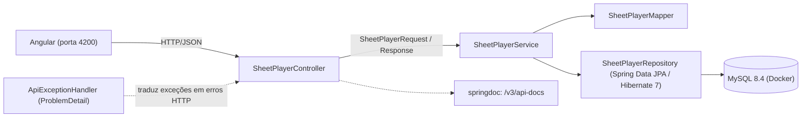

# Gerenciador de Fichas RPG

Aplicação de estudo full stack para cadastrar, consultar, editar e excluir fichas de personagens de RPG, com interface Angular e API REST em Java e Spring Boot, persistida em MySQL.

## Problema

Mestres e jogadores de RPG de mesa costumam manter as fichas de personagem em papel, que se perdem e são difíceis de atualizar. Este sistema guarda a ficha (dados do jogador e do personagem, vida e sanidade atual e máxima, 9 atributos e 23 perícias) em um banco de dados e permite editá-la a qualquer momento.

## Status da modernização

O projeto original é de dezembro de 2021 (Java 11, Spring Boot 2.5.7, Springfox, Angular 13). Ele está sendo modernizado de forma incremental, por refatoração e não por reescrita, com cada passo coberto por testes.

| Incremento | Entrega | Situação |
| --- | --- | --- |
| 1.1 | Base segura e testável: credenciais fora do código, `docker compose` com MySQL, testes de caracterização das 5 rotas, CI | Concluído (PR #1 aberto) |
| 1.2 | Upgrade para Java 21 e Spring Boot 4.1.2 em duas etapas, springdoc no lugar do Springfox, pacote `dev.spironello.fichasrpg` | Concluído nesta branch |
| 1.3 | Camada de serviço, DTOs, validação, erros padronizados (ProblemDetail), logs e correção dos comportamentos errados da API | Concluído nesta branch |
| 1.4 | Perícias em tabela própria, migrações Flyway e PostgreSQL | Planejado |
| 1.5 | Teste de perícia (rolagem com sucesso, sucesso extremo e falha) com aleatoriedade injetável | Planejado |
| 1.6 | Ajustes mínimos no front-end e README final | Planejado |

## Tecnologias

| Camada | Stack do repositório |
| --- | --- |
| Back-end | Java 21, Spring Boot 4.1.2, Spring Web MVC, Spring Data JPA (Hibernate 7) |
| Banco de dados | MySQL 8.4 (Docker) |
| Front-end | Angular 13, TypeScript 4.4, Angular Material, Bootstrap |
| Documentação de API | springdoc-openapi (OpenAPI 3 e Swagger UI) |
| Testes | JUnit, MockMvc, Mockito, Testcontainers |
| Build e CI | Maven e Angular CLI; GitHub Actions (`./mvnw -B verify`) |

## Funcionalidades da API

O controlador `SheetPlayerController` expõe o recurso `/sheetPlayer`:

| Método | Rota | Finalidade | Respostas |
| --- | --- | --- | --- |
| GET | `/sheetPlayer` | Listar fichas | 200 |
| GET | `/sheetPlayer/{id}` | Consultar uma ficha | 200; 404 se não existe |
| POST | `/sheetPlayer` | Cadastrar uma ficha | 201 com `Location: /sheetPlayer/{id}`; 400 se inválida |
| PUT | `/sheetPlayer/{id}` | Substituir uma ficha | 200; 400 se inválida; 404 se não existe |
| DELETE | `/sheetPlayer/{id}` | Excluir uma ficha | 204; 404 se não existe |

Qualquer falha inesperada responde 500 com uma mensagem genérica; o detalhe fica só no log do servidor.

**Entrada.** O JSON tem as 41 chaves de sempre (`nameJ`, `nameC`, `gender`, `age`, `lifeA`..., `str`..`pod`, `atribute1`..`atribute23`).
- `nameJ`, `nameC` e `gender` são obrigatórios e têm no máximo 255 caracteres. Os números não têm limite ([ADR 0008](docs/decisoes/0008-put-como-substituicao-completa.md)).
- O JSON é **estrito**: uma chave desconhecida (por exemplo `"STR"` em vez de `"str"`) devolve 400 citando a chave, em vez de ser ignorada.
- O `id` no corpo é aceito e **ignorado**, porque o Angular o envia sempre: no PUT vale o id da URL; no POST o id é gerado.
- O PUT é substituição completa: campos omitidos viram `null`.

**Erros** seguem o ProblemDetail (RFC 9457, `Content-Type: application/problem+json`). Exemplo de validação (`POST` sem `nameJ`):

```json
{
  "title": "Dados inválidos",
  "status": 400,
  "detail": "Há campos inválidos na ficha. Veja a propriedade errors.",
  "instance": "/sheetPlayer",
  "errors": { "nameJ": "é obrigatório" }
}
```

Decisões em [ADR 0007](docs/decisoes/0007-erros-padronizados-e-json-estrito.md). A API permite chamadas da interface local em `http://localhost:4200`.

Com a API rodando, a documentação interativa (Swagger UI) fica em `http://localhost:8080/swagger-ui.html` e a especificação OpenAPI em `http://localhost:8080/v3/api-docs`.

> Nota sobre rotas removidas: até o incremento 1.1, a dependência `spring-data-rest-hal-explorer`, adicionada junto com o Springfox, trazia o Spring Data REST de forma transitiva, que expunha uma segunda API CRUD não intencional e sem documentação em `/sheetPlayers`, além de `/profile` e `/explorer`. No incremento 1.2 a dependência foi removida e essas rotas passaram a responder 404. Veja o [ADR 0005](docs/decisoes/0005-springdoc-e-remocao-do-spring-data-rest.md).

## Arquitetura

Estado atual:



O controller cuida só de HTTP: recebe e devolve DTOs (`record`), nunca a entidade. O `SheetPlayerService` guarda as regras, as transações (`@Transactional`) e os logs, e lança `SheetPlayerNotFoundException` quando a ficha não existe. O `SheetPlayerMapper` converte DTO e entidade campo a campo, à mão. O `ApiExceptionHandler` transforma as exceções em respostas ProblemDetail. O springdoc lê o controller e gera a especificação OpenAPI.

Estrutura de pastas:

- `Gerenciador de fichas RPG/`: aplicação Spring Boot.
- `Gerenciador de fichas RPG/src/main/java/dev/spironello/fichasrpg/controller/`: endpoints REST.
- `Gerenciador de fichas RPG/src/main/java/dev/spironello/fichasrpg/dto/`: records de entrada e saída da API.
- `Gerenciador de fichas RPG/src/main/java/dev/spironello/fichasrpg/service/`: regras, transações, logs e mapper.
- `Gerenciador de fichas RPG/src/main/java/dev/spironello/fichasrpg/exception/`: exceções e tratamento de erros.
- `Gerenciador de fichas RPG/src/main/java/dev/spironello/fichasrpg/model/`: entidade JPA.
- `Gerenciador de fichas RPG/src/main/java/dev/spironello/fichasrpg/repository/`: persistência.
- `Gerenciador de fichas RPG/src/test/java/dev/spironello/fichasrpg/`: testes.
- `docs/decisoes/`: registros de decisões (ADRs).
- `frontend/`: aplicação Angular.

## Como rodar

### Pré-requisitos

- JDK 21 (o `pom.xml` compila para Java 21).
- Docker com Docker Compose (Docker Desktop no Windows). Ele é usado para o banco local **e** pelos testes.
- Node.js compatível com Angular 13, apenas se for rodar a interface.

### Banco de dados e API

As credenciais do banco **não ficam no código**: a aplicação as lê das variáveis `DB_URL`, `DB_USERNAME` e `DB_PASSWORD`. Para desenvolvimento, elas ficam em um arquivo `.env` local, que não é versionado.

1. Na raiz do repositório, crie o seu `.env` a partir do modelo e troque as senhas de exemplo:

   ```sh
   cp .env.example .env
   ```

   No PowerShell: `Copy-Item .env.example .env`.

2. Suba o MySQL 8.4 em container (lê o `.env`; usa a porta 3306, então ela precisa estar livre):

   ```sh
   docker compose up -d
   ```

3. Rode o back-end. O `.env` da raiz é carregado automaticamente; se você definir as variáveis `DB_*` no ambiente, elas têm prioridade:

   ```sh
   cd "Gerenciador de fichas RPG"
   ./mvnw spring-boot:run
   ```

   No PowerShell, use `.\mvnw.cmd spring-boot:run` (no cmd: `mvnw.cmd spring-boot:run`). A API fica em `http://localhost:8080/sheetPlayer`.

   Observações:
   - O MySQL leva alguns segundos para aceitar conexões depois do `docker compose up -d`; se o back-end falhar na primeira tentativa, rode de novo.
   - O `.env` é procurado em `../.env`, relativo à pasta de onde o back-end é iniciado. Rode sempre de dentro de `Gerenciador de fichas RPG` (ou configure a IDE com esse diretório de trabalho). Se as variáveis não forem encontradas, o erro aparece como `URL must start with 'jdbc'`.
   - `DB_USERNAME` não pode ser `root`: a imagem do MySQL usa `DB_ROOT_PASSWORD` para o root e cria o usuário da aplicação separadamente.

Para parar o banco: `docker compose down` (acrescente `-v` para apagar também os dados).

### Interface

A interface não foi validada neste incremento. Em outro terminal:

```sh
cd frontend
npm install
npm start
```

Use uma versão do Node.js compatível com Angular 13. Acesse a interface em `http://localhost:4200` e confira a URL da API nas chamadas do front-end.

## Testes

```sh
cd "Gerenciador de fichas RPG"
./mvnw -B verify
```

**Os testes de integração precisam do Docker em execução** (os unitários do serviço não). Eles sobem o próprio MySQL 8.4 descartável com o Testcontainers, então não usam o `.env` nem o banco do `docker compose`. Usar o MySQL real (e não um banco em memória) é a decisão do [ADR 0002](docs/decisoes/0002-testes-de-caracterizacao-com-testcontainers.md). O mesmo comando roda no GitHub Actions (`.github/workflows/ci.yml`), em push na `main` e em pull requests.

São 35 testes, em oito grupos:

| Grupo | Testes | O que cobre |
| --- | --- | --- |
| `SheetPlayerControllerTest` | 11 | As 5 rotas: listar, buscar, criar (201 + `Location`), atualizar e excluir (204), com ids existentes e inexistentes (404 ProblemDetail) |
| `SheetPlayerValidacaoTest` | 12 | 400 com `errors` por campo, limite de 255, chave desconhecida, tipo errado, JSON malformado, tratamento do `id` no corpo, id da rota não numérico (400 em português) e valor rejeitado fora do log |
| `SheetPlayerServiceTest` | 6 | Unitários do serviço com Mockito, sem Spring e sem Docker |
| `ApiExceptionHandlerTest` | 1 | Unitário: o 500 genérico não vaza o texto interno da exceção |
| `FichasRpgApplicationTests` | 1 | O contexto da aplicação sobe |
| `ContratoJsonTest` | 1 | As 41 chaves do JSON que o Angular consome |
| `EsquemaBancoTest` | 1 | Tabela `sheet_player`: nomes, tipos e nulabilidade das colunas |
| `DocumentacaoApiTest` | 2 | Swagger UI e OpenAPI respondem |

Os testes de `SheetPlayerControllerTest` nasceram no 1.1 como testes de caracterização, que registravam o comportamento de então, com bugs. No 1.3 os bugs foram corrigidos e esses testes foram reescritos de propósito para especificar o comportamento correto, antes do código. Comportamento atual da API:

- `GET`, `PUT` e `DELETE` de id inexistente respondem 404 com ProblemDetail.
- `POST` e `PUT` sem os campos obrigatórios (ou com texto acima de 255 caracteres) respondem 400 com `errors` por campo.
- `POST` responde 201 com o header `Location`; `DELETE` responde 204.
- Chave desconhecida (`"STR"`), tipo errado (`"age": "abc"`) e JSON malformado respondem 400.
- `PUT` substitui a ficha inteira, de propósito: campos omitidos viram `null`.
- O `id` enviado no corpo é ignorado.

## Decisões e trade-offs

Cada decisão tem um registro curto (contexto, decisão, alternativas e consequências) em `docs/decisoes/`:

- [0001 Credenciais em variáveis de ambiente](docs/decisoes/0001-credenciais-em-variaveis-de-ambiente.md): a senha saiu do código e vem do ambiente ou de um `.env` local.
- [0002 Testes de caracterização com Testcontainers](docs/decisoes/0002-testes-de-caracterizacao-com-testcontainers.md): testes contra um MySQL real antes de qualquer refatoração.
- [0003 Manter o MySQL até o Flyway](docs/decisoes/0003-manter-mysql-ate-o-flyway.md): a troca de banco só acontece junto com as migrações, no 1.4.
- [0004 Upgrade em duas etapas](docs/decisoes/0004-upgrade-em-duas-etapas.md): Boot 2.5 → 3.5 → 4.1, com testes de contrato e de esquema escritos antes.
- [0005 springdoc e remoção do Spring Data REST](docs/decisoes/0005-springdoc-e-remocao-do-spring-data-rest.md): documentação nova e fim de uma API paralela acidental.
- [0006 Compatibilidade de nomes no Boot 4](docs/decisoes/0006-compatibilidade-de-nomes-no-boot-4.md): como preservei o JSON e o esquema do banco, e por que troquei a primeira solução.
- [0007 Erros padronizados e JSON estrito](docs/decisoes/0007-erros-padronizados-e-json-estrito.md): ProblemDetail, códigos HTTP e rejeição de chaves desconhecidas.
- [0008 PUT como substituição completa](docs/decisoes/0008-put-como-substituicao-completa.md): sem PATCH e sem regras numéricas inventadas.

## Perguntas técnicas (roteiro de entrevista)

**Por que refatorar em vez de reescrever?**
O projeto já funcionava e tinha um front-end acoplado ao formato do JSON. Reescrever perderia esse comportamento sem prova de que o novo é equivalente. Refatorando em passos pequenos, cada um com testes verdes, sempre sei o que mudou e posso parar em qualquer ponto.

**O que você fez com a senha do banco que estava exposta?**
Tirei do código e passei a lê-la de variáveis de ambiente ou de um `.env` ignorado pelo Git, com um `.env.example` de modelo. Como a senha antiga continua no histórico do Git, a trato como comprometida: o certo é trocá-la onde foi usada. Reescrever o histórico é uma decisão separada.

**Por que Testcontainers e não H2?**
Porque quero testar no banco que uso de verdade. O H2 tem diferenças de SQL e de tipos, e o próprio problema da coluna `int` (palavra reservada no MySQL) é o tipo de coisa que um banco diferente esconderia. O custo é exigir Docker e ser um pouco mais lento.

**Como você garantiu que o upgrade não quebrou nada?**
Antes de mexer nas versões, escrevi testes de caracterização das 5 rotas e dois testes extras: um com as 41 chaves do JSON que o Angular consome e outro com o esquema da tabela. Depois atualizei e só aceitei as etapas com `clean verify` verde. Os dois testes extras pegaram justamente as duas mudanças silenciosas mais perigosas.

**Qual foi o problema mais difícil do upgrade?**
Os nomes mudando sozinhos. No Jackson 3, `getSTR()` passou a sair como `"STR"`, o que quebraria o Angular; resolvi com `@JsonProperty` explícito. No Hibernate 7, a tabela viraria `SheetPlayer` e os dados existentes sumiriam. Minha primeira solução foi uma estratégia de nomes própria de 63 linhas, que funcionava mas tratava o sintoma. A causa-raiz eram as aspas globais, usadas só por causa da coluna `int`; removi-as e deixei aspas apenas nessa coluna. O mesmo teste de esquema validou as duas soluções.

**O que era a API acidental do Spring Data REST?**
Uma dependência adicionada junto com o Springfox trazia o Spring Data REST de forma transitiva, que expunha uma segunda API CRUD sem validação e sem documentação em `/sheetPlayers`, além de `/profile` e `/explorer`. Removi a dependência e confirmei com a aplicação rodando que essas rotas respondem 404.

**Por que o DELETE de id inexistente passou a responder 200, e como ficou?**
Por causa do Spring Data 3: o `deleteById` passou a ignorar ids que não existem, em vez de lançar exceção (antes disso resultava em 500). No 1.2 não escondi a mudança: ajustei o teste e documentei. No 1.3 a camada de serviço verifica a existência e lança `SheetPlayerNotFoundException`, que vira 404.

**Por que o upgrade foi em duas etapas?**
Porque Boot 2.5 → 4.1 junta muitas mudanças (Spring 6, Jakarta, Hibernate, Jackson 3). Passando antes pelo 3.5.16, cada quebra tem uma causa mais fácil de identificar, e cada etapa fica com `clean verify` verde. Custa mais commits, mas reduz o risco.

**PUT ou PATCH?**
PUT, como substituição completa. O Angular já envia a ficha inteira, então um PATCH seria código sem cliente que o use. Aceito o custo: quem mandar uma ficha parcial apaga os outros campos. Se surgir esse cliente, o PATCH entra como um incremento próprio ([ADR 0008](docs/decisoes/0008-put-como-substituicao-completa.md)).

**Por que ProblemDetail?**
Porque é o padrão (RFC 9457) e o Spring já o suporta: não preciso inventar um formato de erro. O cliente recebe sempre `title`, `status` e `detail`, e na validação uma propriedade `errors` por campo. Mensagens em português e sem stack trace.

**Por que rejeitar campos desconhecidos no JSON?**
Porque o Jackson 3 já me mostrou que um nome de campo pode mudar sem aviso, e um `"STR"` ignorado em silêncio vira dado perdido. Com o modo estrito o erro aparece na hora, com o nome da chave. O custo é que é uma configuração global; a exceção é o `id`, que aceito e ignoro porque o Angular o envia.

## Próximos passos

- **1.3** (concluído nesta branch): serviço, DTOs, validação, ProblemDetail e logs. Falta revisar e abrir o PR.
- **1.4**: perícias em tabela própria, migrações Flyway e troca do MySQL por PostgreSQL.
- **1.5**: teste de perícia (rolagem com sucesso, sucesso extremo e falha) com aleatoriedade injetável.
- **1.6**: ajustes mínimos no front-end e README final.

## O que este projeto demonstra

- Integração entre front-end TypeScript e API Java.
- Operações CRUD com Spring MVC e Spring Data JPA.
- Testes de caracterização contra banco real (Testcontainers) como rede de segurança e, depois, como especificação do comportamento correto.
- Camadas (controller, serviço, repository), DTOs com `record`, Bean Validation e erros padronizados (ProblemDetail).
- Upgrade seguro de framework (Spring Boot 2.5 → 4.1, Java 11 → 21) com testes de contrato e de esquema.
- Integração contínua com GitHub Actions e banco local reproduzível com Docker.
- Documentação de endpoints com OpenAPI e Swagger UI (springdoc).
- Documentação de decisões (ADRs) com alternativas e consequências.

## Contexto do portfólio

Projeto de estudo que registra minha prática com Java, Spring Boot e Angular. É separado do meu TCC de mesa digital em Unity: [VTT_TCC](https://github.com/Deive25/VTT_TCC).
